# 🌐 BSM 451 – Ağ Programlama Ders Konu Anlatımı ve Vize Rehberi

> **Sakarya Üniversitesi – Bilgisayar Mühendisliği Bölümü**  
> **Ders Sorumlusu:** Dr. Öğr. Üyesi Musa BALTA  
> **Kapsam:** Hafta 1–5 Ders Sunumları (Slayt Görselleri ve Sayfa/Slayt Referanslarıyla) & Katman 2–3 `libpcap` C Uygulama Kodları (`.c`)

> [!IMPORTANT]
> ### 🚨 RESMİ VİZE SINAV DUYURUSU VE FORMATI (Dr. Öğr. Üyesi Musa BALTA)
> * **Sınav Yapısı:** **Karma Sınav $\rightarrow$ 60 Puan Test + 40 Puan Klasik**
> * **1) TEST KISMI (60 Puan):** Sistemde yüklü tüm sunumlardan sorumlusunuz; **`Hafta-2 Pcap.pdf` sunumu test sorularına DÂHİL DEĞİLDİR!** *(Pcap teorik slaytlarına çalışarak vakit kaybetmeyiniz)*.
> * **2) KLASİK KISIM (40 Puan):** Bir **Ağ Topolojisi Şeması** verilecek ve bu topoloji üzerinden **2–3 maddelik soru türetilecektir**. Sizden tüm kodu sıfırdan yazmanız değil, verilen C kodlarındaki **kritik boşlukları doldurmanız (Fill-in-the-blanks)** beklenecektir!
>   * *Sorumlu Olunan Kodlar:* **Katman 2–3 C Kodları** (`1-arpgonder.c`, `2-icmpgonder.c`, `ping_client.c`, `ping_server.c`) ve Hafta 5'teki **TCP İstemci-Sunucu C Kodu** (`socket`, `bind`, `listen`, `accept`, `connect`, `send`, `recv`).
> * 👉 Bu duyuruya özel olarak hazırlanan **[40 Puanlık Klasik Sınav Topoloji & Kod Boşluk Doldurma Simülasyonları](#-40-puanlık-klasik-sınav-özel-bölümü-topoloji-tabanlı-c-kod-boşluk-doldurma-simülasyonları)** bölümünü mutlaka çözünüz!

---

## 📑 İçindekiler
0. [🏆 VİZE SINAV STRATEJİ REHBERİ: 40P KLASİK SORU SİMÜLASYONU & 60P TEST GARANTİ KONULARI](#-vize-sınav-strateji-rehberi-40p-klasik-soru-simülasyonu--60p-test-garanti-konuları)
   * [🎯 BÖLÜM 1: 40 Puanlık Klasik Soru İçin Topoloji ve Kod Boşluk Doldurma Simülasyonları](#-bölüm-1-40-puanlık-klasik-soru-i̇çin-topoloji-ve-kod-boşluk-doldurma-simülasyonları)
   * [🎯 BÖLÜM 2: 60 Puanlık Test Sınavı İçin Garanti Çıkacak Konular](#-bölüm-2-60-puanlık-test-sınavı-i̇çin-garanti-çıkacak-konular)
1. [1. Ders: Hafta 1 – OSI Referans Modeli ve Katmansal Yapı](#1-ders-hafta-1--osi-referans-modeli-ve-katmansal-yapı)
   * [1.4. Hafta 1 Değerlendirme Soruları (20 Soru & Çözümleri)](#14-hafta-1-değerlendirme-soruları-20-soru--çözümleri)
2. [2. Ders: Hafta 2 – Katman 2 Protokolleri (Ethernet & ARP) ve `1-arpgonder.c` ⭐](#2-ders-hafta-2--katman-2-protokolleri-ethernet--arp-ve-1-arpgonderc-)
   * [2.5. Hafta 2 Değerlendirme Soruları (20 Soru & Çözümleri)](#25-hafta-2-değerlendirme-soruları-20-soru--çözümleri)
3. [3. Ders (Bölüm 1): Hafta 3 – Katman 3: IPv4, Fragmantasyon, Opsiyonlar, Checksum ve IPv6](#3-ders-bölüm-1-hafta-3--katman-3-ipv4-fragmantasyon-opsiyonlar-checksum-ve-ipv6)
4. [4. Ders (Bölüm 2): Hafta 3 – Katman 3: ICMP Protokolü ve 3 C Kodu (`2-icmpgonder.c`, `ping_server.c`, `ping_client.c`) ⭐](#4-ders-bölüm-2-hafta-3--katman-3-icmp-protokolü-ve-3-c-kodu-)
   * [4.5. Hafta 3 Değerlendirme Soruları (20 Soru & Çözümleri)](#45-hafta-3-değerlendirme-soruları-20-soru--çözümleri)
5. [5. Ders (Bölüm 1): Hafta 4 – Katman 4: TCP Segment Yapısı, 3-Way Handshake, Durum Şeması, Akış ve Hata Kontrolü](#5-ders-bölüm-1-hafta-4--katman-4-tcp-segment-yapısı-3-way-handshake-durum-şeması-akış-ve-hata-kontrolü)
   * [5.6. Hafta 4 Değerlendirme Soruları (20 Soru & Çözümleri)](#56-hafta-4-değerlendirme-soruları-20-soru--çözümleri)
6. [6. Ders (Bölüm 2): Hafta 4 – Katman 4: TCP Tıkanıklık Kontrolü, 4 Zamanlayıcı, RTT/RTO Hesabı ve UDP](#6-ders-bölüm-2-hafta-4--katman-4-tcp-tıkanıklık-kontrolü-4-zamanlayıcı-rttrto-hesabı-ve-udp)
   * [6.13. Hafta 4 (Bölüm 2) Değerlendirme Soruları (20 Soru & Çözümleri)](#613-hafta-4-bölüm-2-değerlendirme-soruları-20-soru--çözümleri)
7. [7. Ders: Hafta 5 – Soket Programlama (C, Java ve Endianness) 🎯 *(Klasik Soru Konusu)*](#7-ders-hafta-5--soket-programlama-c-java-ve-endianness--vize-klasik--test)
   * [7.8. Hafta 5 Değerlendirme Soruları (20 Soru & Çözümleri)](#78-hafta-5-değerlendirme-soruları-20-soru--çözümleri)
8. [8. Ders: Hafta 6 – Katman 7 Protokolleri (FTP, SMTP, MIME, POP3/IMAP, SNMP, MIB, HTTP)](#8-ders-hafta-6--katman-7-protokolleri-ftp-smtp-mime-pop3imap-snmp-mib-http)
   * [8.7. Hafta 6 Değerlendirme Soruları (20 Soru & Çözümleri)](#87-hafta-6-değerlendirme-soruları-20-soru--çözümleri)

---

---

# 🏆 VİZE SINAV STRATEJİ REHBERİ: 40P KLASİK SORU SİMÜLASYONU & 60P TEST GARANTİ KONULARI

> ### 📢 Ders Sorumlusu Dr. Öğr. Üyesi Musa BALTA'nın Sınav Duyurusu:
> 1. **Vize Sınavı Formatı:** Karma olacaktır (**60 Puan Test** + **40 Puan Klasik** = 100 Puan).
> 2. **60 Puanlık Test Soruları:** Sistemde yüklü tüm konulardan sorumlusunuz (**`Hafta-2 Pcap.pdf` PCAP sunusu HARİÇ!**).
> 3. **40 Puanlık Klasik Soru:** Sistemde yüklü **Katman 2-3 Kodları** (`1-arpgonder.c`, `2-icmpgonder.c`, `ping_server.c`, `ping_client.c`) ve **TCP İstemci-Sunucu C Kodundan** (`Hafta-5 Soket Programlama`) sorumlusunuz.
> 4. **Klasik Sorunun Yapısı:** *"Klasik soru için bir topoloji yapısı verilecek oradan 2-3 maddelik soru türetilecektir. Sizden tüm kodu değil ama bazı boşlukları doldurmanız beklenecektir."*

---

## 🎯 BÖLÜM 1: 40 PUANLIK KLASİK SORU İÇİN TOPOLOJİ VE KOD BOŞLUK DOLDURMA SİMÜLASYONLARI

Hocanın duyurusuna göre sınavda kağıda bir **ağ topolojisi** çizilecek (Host A, Switch, Router Gateway, Host B, Sunucu vb.) ve bu topolojiye göre 4 temel C kodumuzdan boşluk doldurma istenecektir. Aşağıda sınavda çıkabilecek **3 kritik topoloji senaryosu** ve boşluk doldurma çözümleri yer almaktadır:

```
                  +-------------------------------------------------------+
                  |                 ÖRNEK SINAV TOPOLOJİSİ                |
                  +-------------------------------------------------------+
                  
   [ Host A (İstemci) ]                                   [ Host B (Aynı Ağ) ]
   IP : 192.168.1.10                                      IP : 192.168.1.50
   MAC: 00:11:22:33:44:55                                 MAC: 00:AA:22:33:44:55
          |                                                         |
          +-------------------+                     +---------------+
                              |                     |
                        [ Switch 1 (Yerel Ağ: 192.168.1.0/24) ]
                                         |
                                         | eth0: IP : 192.168.1.1
                                         |       MAC: 00:RR:11:22:33:44
                                  [ YÖNLENDİRİCİ (ROUTER) ]
                                         | eth1: IP : 10.0.0.1
                                         |       MAC: 00:RR:55:66:77:88
                                         |
                        [ Switch 2 (Uzak Ağ: 10.0.0.0/24) ]
                                         |
                                         |
                              [ TCP/ICMP Web Sunucusu ]
                              IP : 10.0.0.100
                              MAC: 00:EE:99:88:77:66
                              Port: 8080 (TCP)
```

---

### 📌 Simülasyon 1: Katman 2 – [`1-arpgonder.c`](./0-Katman2-3%20Kodlar/1-arpgonder.c) Topoloji Boşluk Doldurma

**Senaryo A (Aynı Ağdaki Cihaz):** Host A (`192.168.1.10`), aynı ağdaki Host B'ye (`192.168.1.50`) paket göndermek için MAC adresini öğrenmek istemektedir.  
**Senaryo B (Farklı Ağdaki Cihaz):** Host A (`192.168.1.10`), uzak ağdaki Sunucuya (`10.0.0.100`) veri göndermek için ARP isteği yapacaktır.

**Sınav Sorusu: Aşağıda `1-arpgonder.c` kodundaki boşlukları yukarıdaki topolojiye göre doldurunuz:**

```c
u_char packet[42];

/* 1. ETHERNET BAŞLIĞI (14 Byte) */
// Soru: ARP Request yerel ağda yayınlanacağı için Hedef MAC ne olmalıdır?
packet[0] = 0xff; packet[1] = 0xff; packet[2] = 0xff;
packet[3] = 0xff; packet[4] = 0xff; packet[5] = 0xff; // [BOŞLUK 1: Broadcast MAC]

// Soru: Gönderen Host A'nın Kaynak MAC adresi:
packet[6] = 0x00; packet[7] = 0x11; packet[8] = 0x22;
packet[9] = 0x33; packet[10]= 0x44; packet[11]= 0x55; // [BOŞLUK 2: Host A MAC]

// Soru: Ethernet Tipi (ARP için EtherType sabiti):
packet[12]= 0x08; packet[13]= 0x06;                  // [BOŞLUK 3: 0x0806 (ARP)]

/* 2. ARP PAKETİ (28 Byte) */
packet[14]= 0x00; packet[15]= 0x01;                  // Hardware Type: 1 (Ethernet)
packet[16]= 0x08; packet[17]= 0x00;                  // Protocol Type: IPv4 (0x0800)
packet[18]= 0x06;                                    // Hardware Size: 6
packet[19]= 0x04;                                    // Protocol Size: 4

// Soru: ARP İstek (Request) İşlem Kodu (Opcode):
packet[20]= 0x00; packet[21]= 0x01;                  // [BOŞLUK 4: Opcode 1 = Request]

// Gönderen (Sender) MAC: Host A MAC
packet[22]= 0x00; packet[23]= 0x11; packet[24]= 0x22;
packet[25]= 0x33; packet[26]= 0x44; packet[27]= 0x55;

// Gönderen (Sender) IP: Host A IP (192.168.1.10 -> 0xC0, 0xA8, 0x01, 0x0A)
packet[28]= 0xc0; packet[29]= 0xa8; packet[30]= 0x01; packet[31]= 0x0a;

// Soru: Hedef MAC (Target MAC) henüz bilinmediği için ne atanmalıdır?
packet[32]= 0x00; packet[33]= 0x00; packet[34]= 0x00;
packet[35]= 0x00; packet[36]= 0x00; packet[37]= 0x00; // [BOŞLUK 5: 0x00 sıfırlanır!]

// Soru: Hedef IP (Target IP) - DİKKAT!
// Senaryo A (Host B için): 192.168.1.50 -> 0xC0, 0xA8, 0x01, 0x32
// Senaryo B (Sunucu 10.0.0.100 için): Farklı ağda olduğu için paket Router'a gidecektir!
// Bu yüzden Target IP = Router eth0 IP (192.168.1.1) olmalıdır! -> 0xC0, 0xA8, 0x01, 0x01
packet[38]= 0xc0; packet[39]= 0xa8; packet[40]= 0x01; packet[41]= 0x01; // [BOŞLUK 6]
```

---

### 📌 Simülasyon 2: Katman 3 – [`2-icmpgonder.c`](./0-Katman2-3%20Kodlar/2-icmpgonder.c) ve [`ping_server.c`](./0-Katman2-3%20Kodlar/Ping%20Uygulaması/ping_server.c)

**Sınav Sorusu 1 (`2-icmpgonder.c` Boşluk Doldurma):** Host A'dan Sunucuya (`10.0.0.100`) gönderilecek ICMP Echo Request paketinde:
* `packet[12..13] = 0x08, 0x00;` $\rightarrow$ **EtherType = IPv4**
* `packet[14] = 0x45;` $\rightarrow$ **Version 4, IHL 5 (20 Byte)**
* `packet[22] = 0x40;` $\rightarrow$ **TTL = 64**
* `packet[23] = 0x01;` $\rightarrow$ **Protocol = 1 (ICMP)**
* `packet[26..29]` $\rightarrow$ **Kaynak IP (Host A): `192.168.1.10`**
* `packet[30..33]` $\rightarrow$ **Hedef IP (Sunucu): `10.0.0.100`**
* `packet[34] = 0x08;` $\rightarrow$ **ICMP Type = 8 (Echo Request)**
* `packet[35] = 0x00;` $\rightarrow$ **ICMP Code = 0**

**Sınav Sorusu 2 (`ping_server.c` Satır 107–120 Takas / Swap ve Reply Mantığı):**  
Sunucu gelen Echo Request paketine cevap verirken adresleri ters çevirip paketi geri yollar. Sınavda bu döngünün sınırları veya mantığı sorulur:

```c
// ping_server.c Satır 107-118:
// Soru: for döngüsü neden 4 adımdır? MAC 6 bayt, IP 4 bayt olduğu için ilk 4 bayt birlikte takas edilir:
for (int i = 0; i < 4; i++) {
    swap(&my_packet[i + 0], &my_packet[i + 6]);   // Hedef MAC [0..3] <-> Kaynak MAC [6..9]
    swap(&my_packet[i + 26], &my_packet[i + 30]); // Kaynak IP [26..29] <-> Hedef IP [30..33]
}
// Kalan 2 bayt MAC ayrıca takas edilir:
swap(&my_packet[4], &my_packet[10]);
swap(&my_packet[5], &my_packet[11]);

// Soru: Paketi Echo Reply yapmak için Type alanına ne yazılmalıdır?
my_packet[34] = 0x00; // [BOŞLUK]: 0x08 (Request) -> 0x00 (Echo Reply) yapılır!
pcap_sendpacket(handle, my_packet, 50);
```

---

### 📌 Simülasyon 3: Katman 4 – Hafta 5 TCP İstemci - Sunucu C Kodu Boşluk Doldurma

Hoca duyurusunda açıkça belirttiği gibi **TCP istemci-sunucu C kodundan** klasik soru gelecektir.

#### A) TCP Sunucu (Server) Kod Boşluk Doldurma (Slayt 23–26):
```c
int servSock, clntSock;
struct sockaddr_in echoServAddr; // Sunucu adres yapısı
struct sockaddr_in echoClntAddr; // İstemci adres yapısı
unsigned int clntLen;

// 1. ADIM: Soket Oluşturma (Slayt 23)
servSock = socket(PF_INET, SOCK_STREAM, IPPROTO_TCP); // [BOŞLUK: PF_INET, SOCK_STREAM, IPPROTO_TCP]

// 2. ADIM: Sunucu Adres Yapısını Doldurma (Slayt 24)
memset(&echoServAddr, 0, sizeof(echoServAddr));
echoServAddr.sin_family = AF_INET;                // [BOŞLUK: AF_INET]
echoServAddr.sin_addr.s_addr = htonl(INADDR_ANY); // [BOŞLUK: htonl(INADDR_ANY) - Tüm arayüzleri dinle]
echoServAddr.sin_port = htons(8080);              // [BOŞLUK: htons(Port) - Host to Network Short]

// 3. ADIM: Soketi IP ve Porta Bağlama (Bind - Slayt 24)
bind(servSock, (struct sockaddr *)&echoServAddr, sizeof(echoServAddr)); // [BOŞLUK: bind]

// 4. ADIM: Dinleme Kuyruğunu Başlatma (Listen - Slayt 25)
listen(servSock, 5); // [BOŞLUK: listen, 5 = MAXPENDING kuyruk boyutu]

// 5. ADIM: Gelen Bağlantıyı Kabul Etme (Accept - Slayt 26)
clntLen = sizeof(echoClntAddr);
clntSock = accept(servSock, (struct sockaddr *)&echoClntAddr, &clntLen); // [BOŞLUK: accept]

// 6. ADIM: Veri Alma ve Gönderme (Slayt 31)
recv(clntSock, buffer, RCVBUFSIZE, 0); // [BOŞLUK: recv]
send(clntSock, buffer, recvSize, 0);   // [BOŞLUK: send]
close(clntSock);
```

#### B) TCP İstemci (Client) Kod Boşluk Doldurma (Slayt 27–30):
```c
int clientSock;
struct sockaddr_in echoServAddr;

// 1. ADIM: Soket Oluşturma (Slayt 27)
clientSock = socket(PF_INET, SOCK_STREAM, IPPROTO_TCP); // [BOŞLUK: SOCK_STREAM]

// 2. ADIM: Hedef Sunucu Adresini Tanımlama (Slayt 28)
memset(&echoServAddr, 0, sizeof(echoServAddr));
echoServAddr.sin_family = AF_INET;
echoServAddr.sin_addr.s_addr = inet_addr("10.0.0.100"); // [BOŞLUK: inet_addr - String IP'yi 32-bit'e çevirir]
echoServAddr.sin_port = htons(8080);                   // [BOŞLUK: htons]

// 3. ADIM: Sunucuya Bağlantı Kurma (Connect - 3-Way Handshake Tetikler! Slayt 28)
connect(clientSock, (struct sockaddr *)&echoServAddr, sizeof(echoServAddr)); // [BOŞLUK: connect]

// 4. ADIM: Veri Gönderme ve Yanıt Alma (Slayt 30-31)
send(clientSock, "MERHABA", 7, 0);
recv(clientSock, buffer, RCVBUFSIZE - 1, 0);
close(clientSock);
```

#### C) Byte Ordering (Endianness) Dönüşüm Fonksiyonları (Slayt 52):
* `htons(val)`: *Host to Network Short* (16-bit Port için)
* `htonl(val)`: *Host to Network Long* (32-bit IPv4 için)
* `ntohs(val)`: *Network to Host Short*
* `ntohl(val)`: *Network to Host Long*
* *(Ağ her zaman **Big-Endian**'dır; x86 PC'ler ise **Little-Endian**'dır!)*

---

## 🎯 BÖLÜM 2: 60 PUANLIK TEST SINAVI İÇİN GARANTİ ÇIKACAK KONULAR

> [!IMPORTANT]
> **Hoca Duyurusu:** `Hafta-2 Pcap.pdf` (libpcap mimarisi, pps hesapları, Wireshark tarihi) **TEST SINAVINDAN TAMAMEN ÇIKARILMIŞTIR!**  
> Sorumlu olduğunuz sunumlar: **Hafta 1 (OSI), Hafta 2 (Katman 2), Hafta 3 (Katman 3), Hafta 4 (Katman 4), Hafta 5 (Soket Programlama).**

Aşağıdaki maddeler test sınavında garanti soru adayıdır:
1. **Hafta 1 (OSI & Standartlar):**
   * **De Jure vs De Facto Standartlar (Slayt 3):** CCITT, IEEE, ISO $\rightarrow$ De Jure; IBM, UNIX $\rightarrow$ De Facto.
   * **Ara Düğümlerin (Router) Katmanları (Slayt 5):** Router'lar yalnızca ilk 3 katmanı (L1, L2, L3) çalıştırır.
   * **Katman PDU Adları (Slayt 6):** L4 = Segment, L3 = Packet/Datagram, L2 = Frame, L1 = Bit.
   * **Standart Hiyerarşisi (Slayt 4):** ISOC $\rightarrow$ IAB $\rightarrow$ IETF ve IRTF.
   * **Cihazlar (Slayt 6):** Hub = L1, Switch = L2, Router = L3.
2. **Hafta 2 (Katman 2 Ethernet & ARP):**
   * **Ethernet II Başlığı (Slayt 6):** 14 Byte (Hedef MAC [6B] + Kaynak MAC [6B] + Tip [2B]). Preamble ve CRC donanımda eklenir.
   * **CSMA/CD (Slayt 4–5):** 1-persistent stratejisi, çarpışmada `Jam Signal` basılması, Backoff rastgele beklemesi.
   * **MAC Adres Türleri (Slayt 7):** Unicast, Multicast (`01-00-5E-...`), Broadcast (`FF-FF-FF-FF-FF-FF`).
   * **ARP Paket Formatı (Slayt 11–12):** 28 Byte ARP şablonu. 14B Ethernet + 28B ARP = 42 Byte.
   * **ARP 4 Senaryosu (Slayt 13):** Farklı ağdaki bir cihaza giderken ARP Target IP = Router'ın IP'sidir!
3. **Hafta 3 (Katman 3 IPv4 & ICMP):**
   * **IPv4 Başlık Boyutu (Slayt 4):** Sabit 20B, opsiyonlarla 60B. HLEN (4 bit, $5..15$).
   * **Protocol Alanı (Slayt 5):** 1 = ICMP, 2 = IGMP, 6 = TCP, 17 = UDP, 89 = OSPF.
   * **Fragmantasyon Formülleri (Slayt 7):** $D$ biti, $M$ biti ($M=1$ devamı var, $M=0$ son parça). $\text{Offset} = \text{İlk Bayt} \div 8$.
   * **Strict vs Loose Source Route (Slayt 13–15):** Strict'te liste dışı router yasaktır; Loose'ta araya başka router girebilir.
   * **Checksum Hesabı (Slayt 18):** 16-bitlik blokların 1'e tümleyeni (tersi). Alıcıda sağlaması `0x0000` çıkmalıdır.
   * **ICMP Hata Gövdesi (Slayt 24):** Orijinal IP başlığı + orijinal datagramın ilk 8 baytı.
   * **ICMP Type 3 (Slayt 24):** `Code 2` (protokol ulaşılamaz) ve `Code 3` (port ulaşılamaz) YALNIZCA hedef Host tarafından üretilir!
   * **ICMP Type 11 (Slayt 26):** Code 0 (Router TTL=0) vs Code 1 (Host parça süre aşımı).
4. **Hafta 4 (Katman 4 TCP & UDP):**
   * **Port Numaraları (Slayt 4):** 20/21 FTP, 23 TELNET, 25 SMTP, 53 DNS, 80 HTTP.
   * **Sözde Başlık / Pseudoheader (Slayt 9):** 12 Byte (IP'ler, Protokol 6, TCP uzunluk) Checksum hesabına katılır.
   * **Sıra Numarası Tüketimi (Slayt 8, 10):** `SYN` ve `FIN` bayrakları 1 sıra numarası tüketir. Saf `ACK` tüketmez!
   * **Yarım Kapanma / Half-Close (Slayt 14):** İstemci FIN atar, sunucu veri yollamaya devam edebilir.
   * **11 Durumlu Şema (Slayt 11–12):** `TIME-WAIT` (2MSL bekleme), `LISTEN` $\rightarrow$ `SYN-RCVD`.
   * **Akış Kontrolü (Slayt 14, 16):** $\text{rwnd} = \text{Tampon} - \text{Okunmamış Veri}$.
   * **Hata Kontrolü (Slayt 20–24):** Go-Back-N vs Selective Repeat. Hızlı Yeniden İletim (3 Yinelenen ACK kuralı).
5. **Hafta 5 (Soket Programlama):**
   * **Soket Türleri (Slayt 4):** Stream (TCP, `SOCK_STREAM`), Datagram (UDP, `SOCK_DGRAM`), Raw (`SOCK_RAW`).
   * **Soket Fonksiyonları:** `socket()`, `bind()`, `listen()`, `connect()`, `accept()`, `send()`, `recv()`.
   * **Byte Ordering (Slayt 52):** Ağ her zaman **Big-Endian**'dır. `htons`, `htonl`, `ntohs`, `ntohl`.

---

# 1. Ders: Hafta 1 – OSI Referans Modeli ve Katmansal Yapı
**Kaynak Sunum:** `Hafta-1-OSI Referans Modeli ve Katmasal Yap .pdf` *(Toplam 4 PDF Sayfası / 8 Slayt)*

## 1.1. Bilgisayar Ağlarının Sınıflandırma Ağacı (PDF Sayfa 2, Slayt 3)
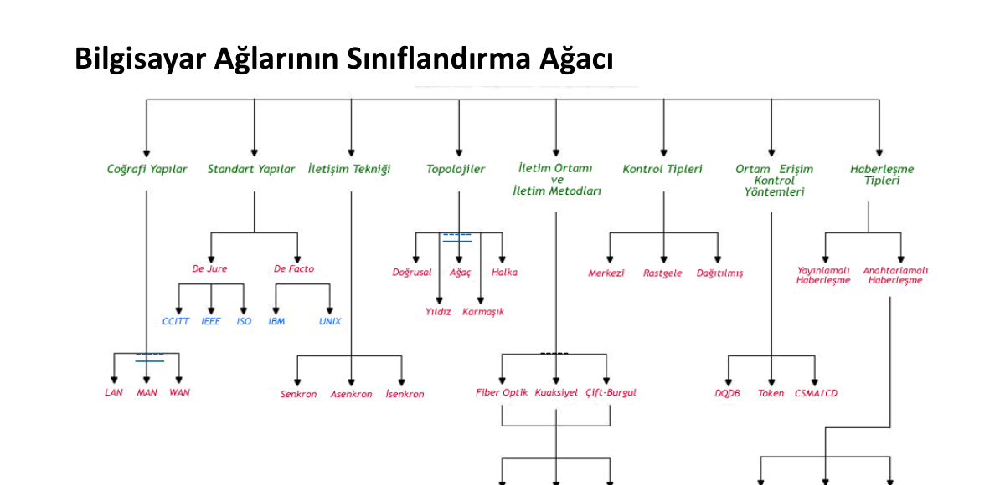

* **1) Coğrafi Yapılar:** `LAN` (Yerel Alan Ağı), `MAN` (Metropol Alan Ağı), `WAN` (Geniş Alan Ağı).
* **2) Standart Yapılar *(Sınavda De Jure / De Facto ayrımına dikkat!)*:**
  * **De Jure (Resmi / Yasal Standartlar):** `CCITT`, `IEEE`, `ISO`.
  * **De Facto (Fiili / Pratikte Kabul Gören Standartlar):** `IBM`, `UNIX`.
* **3) İletişim Tekniği:** `Senkron`, `Asenkron`, `İsenkron` (Sabit zaman aralıklı).
* **4) Topolojiler:** `Doğrusal` (Bus), `Yıldız` (Star), `Ağaç` (Tree), `Karmaşık` (Mesh), `Halka` (Ring).
* **5) İletim Ortamı ve İletim Metodları:**
  * *Ortamlar:* `Fiber Optik`, `Koaksiyel`, `Çift-Burgulu` (Twisted Pair).
  * *Metodlar:* `Geniş Band` (Broadband), `Taşıyıcı Band` (Carrierband), `Temel Band` (Baseband).
* **6) Kontrol Tipleri:** `Merkezi`, `Rastgele`, `Dağıtılmış`.
* **7) Ortam Erişim Kontrol Yöntemleri (MAC):** `DQDB`, `Token` (Jeton), `CSMA/CD`.
* **8) Haberleşme Tipleri:**
  * `Yayınlamalı Haberleşme` (Broadcast)
  * `Anahtarlamalı Haberleşme` (Switched) $\rightarrow$ **Devre Anahtarlamalı**, **Mesaj Anahtarlamalı**, **Paket Anahtarlamalı**.

---

## 1.2. Standart Organizasyonlar Hiyerarşisi (PDF Sayfa 2, Slayt 4)
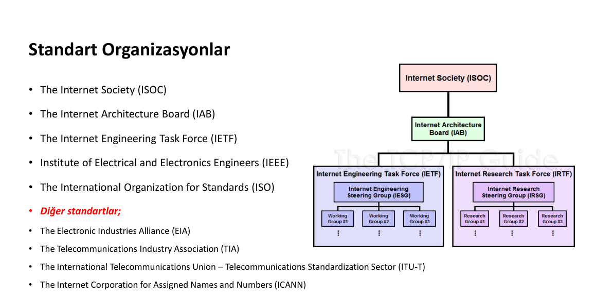

* **Şemadaki Hiyerarşi (Üstten Alta):**
  * **ISOC** (*Internet Society*) $\rightarrow$ **IAB** (*Internet Architecture Board*)
  * **IAB** iki ana kola ayrılır:
    1. **IETF** (*Internet Engineering Task Force*) $\rightarrow$ **IESG** (*Internet Engineering Steering Group*) $\rightarrow$ *Working Group #1, #2, #3...*
    2. **IRTF** (*Internet Research Task Force*) $\rightarrow$ **IRSG** (*Internet Research Steering Group*) $\rightarrow$ *Research Group #1, #2, #3...*
* **Diğer Kuruluşlar:** `IEEE`, `ISO`, `EIA`, `TIA`, `ITU-T`, `ICANN` (Alan adları ve sayılar), `IANA` (Port ve IP numara tahsisi).

---

## 1.3. OSI Referans Modeli, Kapsülleme ve Cihazlar (PDF Sayfa 3, Slayt 5–6 & PDF Sayfa 4, Slayt 7)
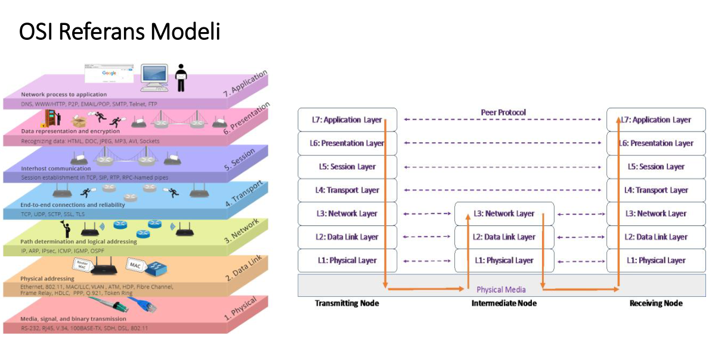
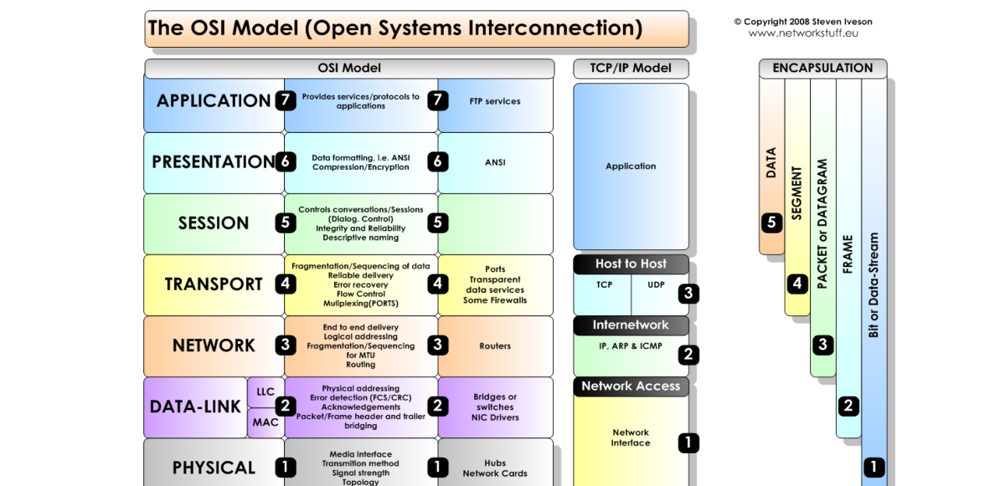

> [!IMPORTANT]
> **Sınav Detayı (Slayt 5 ve Slayt 6):**
> * **Intermediate Node (Ara Düğüm / Yönlendirici - Router):** Slayt 5'in sağındaki şemada görüldüğü üzere `Transmitting Node` ve `Receiving Node` 7 katmanın tamamını (`L1–L7`) çalıştırırken, aradaki yönlendiriciler (`Intermediate Node`) **yalnızca ilk 3 katmanı (`L1: Physical`, `L2: Data Link`, `L3: Network`)** çalıştırır!
> * **Kapsülleme (Encapsulation) Sırası (Slayt 6 Sağ Sütun):** Üst katmanlarda **`DATA`** (L7–L5) $\rightarrow$ Taşıma katmanında (L4) **`SEGMENT`** $\rightarrow$ Ağ katmanında (L3) **`PACKET or DATAGRAM`** $\rightarrow$ Veri Bağı katmanında (L2) **`FRAME`** $\rightarrow$ Fiziksel katmanda (L1) **`Bit or Data-Stream`**.

| Katman No | OSI Katmanı | Görevi ve Protokol Örnekleri (Slayt 5–7) | Cihaz / Bileşen (Slayt 6) | TCP/IP Modeli | Veri Birimi (PDU) |
| :---: | :--- | :--- | :--- | :--- | :--- |
| **7** | **Application** | Uygulama servisleri (`HTTP, DNS, DHCP, FTP, Telnet, SMTP`) | FTP services | Application | **DATA** |
| **6** | **Presentation**| Veri formatlama, sıkıştırma, şifreleme (`ANSI, HTML, JPEG, SSL/TLS`) | ANSI | Application | **DATA** |
| **5** | **Session** | Oturum kontrolü, diyalog yönetimi (`NetBIOS, RPC, SQL`) | — | Application | **DATA** |
| **4** | **Transport** | Uçtan uca bağlantı, güvenilirlik, akış/hata kontrolü, portlar (`TCP, UDP`) | Ports, Some Firewalls | **Host to Host** | **SEGMENT** |
| **3** | **Network** | Mantıksal adresleme (IP), yönlendirme, parçalama (`IP, ARP, ICMP, IGMP, OSPF`) | **Routers** | **Internetwork** | **PACKET / DATAGRAM** |
| **2** | **Data-Link (`LLC`+`MAC`)** | Fiziksel adresleme (MAC), hata tespiti (`FCS/CRC`), çerçeveleme (`Ethernet, PPP, ATM`) | **Bridges or Switches, NIC** | **Network Access** | **FRAME** |
| **1** | **Physical** | Kablo, sinyal gücü, ikili (binary) iletim (`RS-232, RJ45, 100BASE-TX`) | **Hubs, Network Cards** | **Network Access** | **Bit / Data-Stream** |

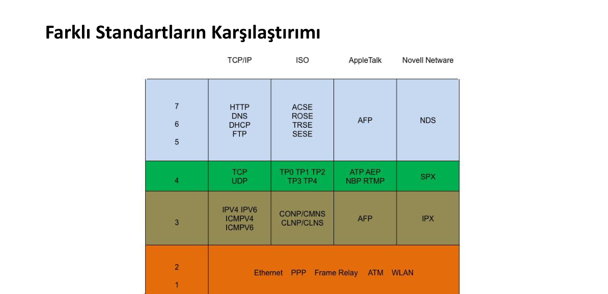

---
## 1.4. Hafta 1 Değerlendirme Soruları (20 Soru & Çözümleri)

### Soru 1: Standart Yapılar ve Türleri
**Soru:** Bilgisayar ağlarında standartlar "De Jure" (resmi/yasal) ve "De Facto" (fiili/fiilen kabul gören) olarak ikiye ayrılır. Aşağıdaki eşleştirmelerden hangisi tamamen **De Jure** standart kuruluşlarını içerir?  
- A) IBM, UNIX, CCITT  
- B) IEEE, ISO, CCITT  
- C) UNIX, IEEE, ISO  
- D) IBM, IEEE, CCITT  

<details>
<summary><b>💡 Çözümü ve Açıklamayı Gör</b></summary>

**Doğru Cevap: B**  
**Açıklama (PDF Sayfa 2, Slayt 3):** Slayt 3'teki sınıflandırma ağacına göre:
* **De Jure (Resmi/Hukuki):** `CCITT`, `IEEE`, `ISO` kurumlarıdır.
* **De Facto (Fiili/Piyasa Gerçeği):** `IBM` ve `UNIX` gibi endüstriyel kabul gören yapılardır.
</details>

---

### Soru 2: Ara Düğümlerin (Router) Katman Seviyesi
**Soru:** OSI referans modeline göre bir ağdaki kaynak ve hedef bilgisayarlar 7 katmanın tamamını çalıştırırken, aradaki yönlendiriciler (Router / Intermediate Node) en fazla hangi katmana kadar çalışır?  
- A) Sadece Katman 1 (Fiziksel)  
- B) Katman 1 ve Katman 2 (Veri Bağı)  
- C) Katman 1, Katman 2 ve Katman 3 (Ağ)  
- D) Katman 1'den Katman 4'e (Taşıma) kadar  

<details>
<summary><b>💡 Çözümü ve Açıklamayı Gör</b></summary>

**Doğru Cevap: C**  
**Açıklama (PDF Sayfa 3, Slayt 5):** Slayt 5'teki OSI şemasında açıkça görüldüğü üzere `Intermediate Node` (yönlendirici), paket yönlendirmesi yaptığı için yalnızca ilk 3 katmanı (**L1: Physical, L2: Data Link, L3: Network**) çalıştırır. Taşıma (L4) ve üst katmanlar uçtan uca (End-to-End) çalışır.
</details>

---

### Soru 3: Katman Veri Birimleri (PDU) Eşleştirmesi
**Soru:** OSI referans modelinde katmanlar arasında veri paketleme sürecinde kullanılan Protokol Veri Birimleri (PDU) adlandırmalarından hangisi **yanlıştır**?  
- A) Katman 4 (Taşıma) $\rightarrow$ Segment  
- B) Katman 3 (Ağ) $\rightarrow$ Packet veya Datagram  
- C) Katman 2 (Veri Bağı) $\rightarrow$ Frame (Çerçeve)  
- D) Katman 1 (Fiziksel) $\rightarrow$ Datagram  

<details>
<summary><b>💡 Çözümü ve Açıklamayı Gör</b></summary>

**Doğru Cevap: D**  
**Açıklama (PDF Sayfa 3, Slayt 6):** Katman 1'deki (Fiziksel) veri birimi **Bit** veya **Data-Stream**'dir. Datagram ise Katman 3 (Ağ) veri birimidir.
</details>

---

### Soru 4: Standart Kuruluşları Hiyerarşisi
**Soru:** İnternet standartlarını belirleyen organizasyon şemasına göre en üstte ISOC (Internet Society) yer alır. ISOC'a bağlı olan IAB (Internet Architecture Board) doğrudan hangi iki alt kurula ayrılır?  
- A) IEEE ve ISO  
- B) IETF ve IRTF  
- C) IESG ve IRSG  
- D) ICANN ve IANA  

<details>
<summary><b>💡 Çözümü ve Açıklamayı Gör</b></summary>

**Doğru Cevap: B**  
**Açıklama (PDF Sayfa 2, Slayt 4):** Slayt 4'teki hiyerarşik şemaya göre: `ISOC` $\rightarrow$ `IAB`. IAB ise iki ana kola ayrılır: **IETF** (*Internet Engineering Task Force*) ve **IRTF** (*Internet Research Task Force*). IESG ve IRSG ise bunların yönlendirme gruplarıdır.
</details>

---

### Soru 5: İletim Metotları: Baseband ve Broadband
**Soru:** Sayısal (dijital) sinyallerin herhangi bir modülasyona tabi tutulmadan doğrudan kablo frekans bandının tamamını kullanarak iletildiği yöntem aşağıdakilerden hangisidir?  
- A) Geniş Band (Broadband)  
- B) Taşıyıcı Band (Carrierband)  
- C) Temel Band (Baseband)  
- D) Asenkron Band  

<details>
<summary><b>💡 Çözümü ve Açıklamayı Gör</b></summary>

**Doğru Cevap: C**  
**Açıklama (PDF Sayfa 2, Slayt 3):** Temel Band (Baseband), iletim ortamının tüm bant genişliğini tek bir dijital sinyale ayırır (örneğin standart Ethernet). Geniş Band (Broadband) ise frekans bölmeli çoğullama ile birden fazla analog taşıyıcı dalga kullanır.
</details>

---

### Soru 6: Ortam Erişim Yöntemleri (MAC)
**Soru:** Klasik kablolu Ethernet ağlarında (IEEE 802.3) kullanılan ortam erişim kontrol yöntemi aşağıdakilerden hangisidir?  
- A) Token (Jeton)  
- B) DQDB  
- C) CSMA/CD  
- D) TDMA  

<details>
<summary><b>💡 Çözümü ve Açıklamayı Gör</b></summary>

**Doğru Cevap: C**  
**Açıklama (PDF Sayfa 2, Slayt 3 & Hafta 2 Slayt 4):** Ethernet, paylaşımlı ortamda çakışmaları sezmek için **CSMA/CD** (*Carrier Sense Multiple Access with Collision Detection*) protokolünü kullanır.
</details>

---

### Soru 7: Sunum (Presentation) Katmanı Görevleri
**Soru:** Aşağıdakilerden hangisi OSI 6. Katman olan Sunum (Presentation) katmanının temel görevlerinden biri **değildir**?  
- A) Karakter kodlama ve veri formatı dönüştürme (ASCII/ANSI çevirisi)  
- B) Veri sıkıştırma (Compression)  
- C) Veri şifreleme ve güvenlik (Encryption/Decryption)  
- D) Süreçler arası diyalog kontrolü ve oturum yönetimi  

<details>
<summary><b>💡 Çözümü ve Açıklamayı Gör</b></summary>

**Doğru Cevap: D**  
**Açıklama (PDF Sayfa 3, Slayt 5 & 6):** Süreçler arası diyalog kontrolü ve oturum yönetimi **Katman 5 (Oturum / Session)** katmanının görevidir. Sunum katmanı verinin nasıl temsil edildiğiyle (çeviri, sıkıştırma, şifreleme) ilgilenir.
</details>

---

### Soru 8: Oturum (Session) Katmanı ve Diyalog Yönetimi
**Soru:** İki uygulama arasındaki haberleşmede tek yönlü (simplex), sırayla iki yönlü (half-duplex) veya eşzamanlı iki yönlü (full-duplex) iletişim kurallarını belirleyen ve senkronizasyon kontrol noktaları koyan OSI katmanı hangisidir?  
- A) Katman 4 (Taşıma)  
- B) Katman 5 (Oturum)  
- C) Katman 6 (Sunum)  
- D) Katman 7 (Uygulama)  

<details>
<summary><b>💡 Çözümü ve Açıklamayı Gör</b></summary>

**Doğru Cevap: B**  
**Açıklama (PDF Sayfa 3, Slayt 5):** İletişim diyaloglarının yönetimi, senkronizasyon noktalarının eklenmesi ve oturumun açılıp kapatılması **Oturum (Session)** katmanının sorumluluğundadır.
</details>

---

### Soru 9: TCP/IP Modeli ile OSI Katman Karşılaştırması
**Soru:** TCP/IP modelinde yer alan "Host to Host" (veya Taşıma) katmanı, OSI modelinde hangi katmana birebir karşılık gelir?  
- A) Katman 2 (Veri Bağı)  
- B) Katman 3 (Ağ)  
- C) Katman 4 (Taşıma)  
- D) Katman 5 (Oturum)  

<details>
<summary><b>💡 Çözümü ve Açıklamayı Gör</b></summary>

**Doğru Cevap: C**  
**Açıklama (PDF Sayfa 3, Slayt 6):** TCP/IP modelinde Host-to-Host katmanı doğrudan OSI Katman 4 (Transport / Taşıma) katmanına karşılık gelir ve `TCP` ile `UDP` protokollerini barındırır.
</details>

---

### Soru 10: Ağ Cihazları ve Çalışma Katmanları
**Soru:** Hub, Anahtar (Switch) ve Yönlendirici (Router) cihazlarının OSI referans modelinde çalıştığı en üst katmanlar sırasıyla aşağıdakilerden hangisinde doğru verilmiştir?  
- A) L1 (Fiziksel), L2 (Veri Bağı), L3 (Ağ)  
- B) L2 (Veri Bağı), L2 (Veri Bağı), L3 (Ağ)  
- C) L1 (Fiziksel), L3 (Ağ), L4 (Taşıma)  
- D) L1 (Fiziksel), L2 (Veri Bağı), L4 (Taşıma)  

<details>
<summary><b>💡 Çözümü ve Açıklamayı Gör</b></summary>

**Doğru Cevap: A**  
**Açıklama (PDF Sayfa 3, Slayt 6):**
* **Hub / Repeater:** Yalnızca elektrik sinyalini çoğaltır $\rightarrow$ **L1 (Fiziksel)**
* **Switch / Bridge:** MAC adreslerini okur ve süzer $\rightarrow$ **L2 (Veri Bağı)**
* **Router:** IP adreslerini okur ve yönlendirir $\rightarrow$ **L3 (Ağ)**
</details>

---

### Soru 11: Anahtarlama Türleri
**Soru:** İletişim başlamadan önce kaynak ile hedef arasında fiziksel ve kesintisiz bir yol kuran, iletim süresince bant genişliğini bu yola rezerve eden anahtarlama türü hangisidir?  
- A) Paket Anahtarlamalı (Packet Switched)  
- B) Mesaj Anahtarlamalı (Message Switched)  
- C) Devre Anahtarlamalı (Circuit Switched)  
- D) Hücre Anahtarlamalı (Cell Switched)  

<details>
<summary><b>💡 Çözümü ve Açıklamayı Gör</b></summary>

**Doğru Cevap: C**  
**Açıklama (PDF Sayfa 2, Slayt 3):** Geleneksel telefon şebekelerinde kullanılan **Devre Anahtarlamalı (Circuit Switched)** iletimde bağlantı öncesinde hat rezerve edilir. İnternet ise **Paket Anahtarlamalı** yapıdadır.
</details>

---

### Soru 12: İletişim Teknikleri: İsenkron İletişim
**Soru:** Slayt 3'te listelenen "İletişim Teknikleri" sınıflandırmasında yer alan **İsenkron (Isochronous)** haberleşmenin en belirgin özelliği nedir?  
- A) Verilerin rastgele zamanlarda gönderilmesi  
- B) Veri baytlarının kesin ve sabit zaman aralıklarıyla, sıfıra yakın gecikme dalgalanmasıyla iletilmesi  
- C) Her karakterin başına start, sonuna stop biti konması  
- D) Veri aktarımı sırasında alıcıdan onay beklenmesi  

<details>
<summary><b>💡 Çözümü ve Açıklamayı Gör</b></summary>

**Doğru Cevap: B**  
**Açıklama (PDF Sayfa 2, Slayt 3):** İsenkron iletişim, gecikmeye duyarlı gerçek zamanlı ses ve video akışlarında verilerin sabit zaman aralıklarıyla ve eşzamanlı olarak iletilmesini ifade eder.
</details>

---

### Soru 13: IP ve Port Numaraları Tahsis Kuruluşu
**Soru:** İnternette kullanılan port numaralarının (örneğin port 80 HTTP, port 53 DNS) ve IP adresi bloklarının küresel tahsisinden sorumlu organizasyon hangisidir?  
- A) IEEE  
- B) ISO  
- C) IANA  
- D) ITU-T  

<details>
<summary><b>💡 Çözümü ve Açıklamayı Gör</b></summary>

**Doğru Cevap: C**  
**Açıklama (PDF Sayfa 2, Slayt 4):** **IANA** (*Internet Assigned Numbers Authority*), IP adresleri ve port numaralarının tescil ve dağıtımını denetleyen yetkili kurumdur.
</details>

---

### Soru 14: Kapsülleme (Encapsulation) Sırası
**Soru:** Gönderici bir bilgisayarda uygulama katmanında üretilen bir verinin kabloya çıkana kadar katmanlardan geçiş sırası (Kapsülleme) aşağıdakilerden hangisidir?  
- A) Uygulama $\rightarrow$ Veri Bağı $\rightarrow$ Ağ $\rightarrow$ Taşıma $\rightarrow$ Fiziksel  
- B) Uygulama $\rightarrow$ Taşıma $\rightarrow$ Ağ $\rightarrow$ Veri Bağı $\rightarrow$ Fiziksel  
- C) Fiziksel $\rightarrow$ Veri Bağı $\rightarrow$ Ağ $\rightarrow$ Taşıma $\rightarrow$ Uygulama  
- D) Ağ $\rightarrow$ Taşıma $\rightarrow$ Uygulama $\rightarrow$ Veri Bağı $\rightarrow$ Fiziksel  

<details>
<summary><b>💡 Çözümü ve Açıklamayı Gör</b></summary>

**Doğru Cevap: B**  
**Açıklama (PDF Sayfa 3, Slayt 6):** Gönderici tarafta veri üstten alta doğru akar: **Uygulama (L7-L5) $\rightarrow$ Taşıma (L4) $\rightarrow$ Ağ (L3) $\rightarrow$ Veri Bağı (L2) $\rightarrow$ Fiziksel (L1)**. Alıcıda ise tam tersi sırada (Ters Kapsülleme / Decapsulation) yukarı çıkar.
</details>

---

### Soru 15: Veri Bağı Katmanı Alt Katmanları
**Soru:** IEEE 802 standartlarına göre OSI 2. Katman olan Veri Bağı (Data Link) katmanı hangi iki alt katmana ayrılmıştır?  
- A) IP ve ICMP  
- B) TCP ve UDP  
- C) LLC (Logical Link Control) ve MAC (Media Access Control)  
- D) CSMA ve CD  

<details>
<summary><b>💡 Çözümü ve Açıklamayı Gör</b></summary>

**Doğru Cevap: C**  
**Açıklama (PDF Sayfa 3, Slayt 6 & Sayfa 4 Slayt 7):** Veri bağı katmanı:
1. **LLC (802.2):** Üst katman protokollerini ayırt etme ve akış denetimi sağlar.
2. **MAC (802.3/802.11):** Donanım adresleme ve ortama erişim kontrolünü sağlar.
</details>

---

### Soru 16: Ağ Topolojileri ve Tek Nokta Arızası
**Soru:** Merkezi bir düğümün (örneğin bir Switch) arızalanması durumunda tüm ağın iletişiminin kesildiği ancak kablo kopmalarının sadece ilgili bilgisayarı etkilediği topoloji hangisidir?  
- A) Doğrusal (Bus)  
- B) Yıldız (Star)  
- C) Halka (Ring)  
- D) Karmaşık (Mesh)  

<details>
<summary><b>💡 Çözümü ve Açıklamayı Gör</b></summary>

**Doğru Cevap: B**  
**Açıklama (PDF Sayfa 2, Slayt 3):** Yıldız (Star) topolojisinde tüm istasyonlar merkezi cihaza bağlıdır. Merkezi cihaz bozulursa tüm ağ çöker; bir uç kablosu koparsa sadece o istasyon devre dışı kalır.
</details>

---

### Soru 17: Fiziksel İletim Ortamları Karşılaştırması
**Soru:** Elektromanyetik parazitlerden (EMI) hiç etkilenmeyen, en yüksek bant genişliğini sunan ve ışık sinyaliyle iletim yapan fiziksel kablo türü hangisidir?  
- A) Çift-Burgulu Kablo (UTP/STP)  
- B) Koaksiyel Kablo (Coaxial)  
- C) Fiber Optik Kablo  
- D) RS-232 Seri Kablo  

<details>
<summary><b>💡 Çözümü ve Açıklamayı Gör</b></summary>

**Doğru Cevap: C**  
**Açıklama (PDF Sayfa 2, Slayt 3):** Fiber optik kablolar elektrik yerine ışık darbeleri ilettiği için elektriksel gürültüden (EMI) etkilenmez ve çok yüksek mesafelerde kayıpsız çalışır.
</details>

---

### Soru 18: Coğrafi Ağ Kapsamları
**Soru:** Bir üniversite kampüsü veya şehir ölçeğindeki binalar arası ağı ifade eden coğrafi sınıflandırma kısaltması nedir?  
- A) LAN (Local Area Network)  
- B) MAN (Metropolitan Area Network)  
- C) WAN (Wide Area Network)  
- D) PAN (Personal Area Network)  

<details>
<summary><b>💡 Çözümü ve Açıklamayı Gör</b></summary>

**Doğru Cevap: B**  
**Açıklama (PDF Sayfa 2, Slayt 3):** Bir oda veya bina içi **LAN**, şehir veya büyük kampüs ölçeği **MAN**, ülkeler ve kıtalar arası ağlar ise **WAN** olarak tanımlanır.
</details>

---

### Soru 19: Kontrol Tipleri: Merkezi, Dağıtılmış ve Rastgele
**Soru:** Slayt 3'teki sınıflandırmaya göre bir ağda iletim haklarının merkezi bir yönetici düğüm olmadan, her düğümün rastgele rekabet ederek hatta veri gönderdiği kontrol tipi hangisidir?  
- A) Merkezi (Centralized) Kontrol  
- B) Rastgele (Random / Contention-based) Kontrol  
- C) Dağıtılmış (Distributed) Kontrol  
- D) Hiyerarşik Kontrol  

<details>
<summary><b>💡 Çözümü ve Açıklamayı Gör</b></summary>

**Doğru Cevap: B**  
**Açıklama (PDF Sayfa 2, Slayt 3):** Ethernet'te CSMA/CD mantığı rastgele (random) erişim kontrolü sınıfındadır; düğümler hattı dinleyip rastgele yarışarak gönderir.
</details>

---

### Soru 20: Paket Anahtarlamanın Devre Anahtarlamaya Üstünlüğü
**Soru:** İnternetin temelini oluşturan Paket Anahtarlamalı (Packet Switched) ağların Devre Anahtarlamalı ağlara göre en büyük avantajı nedir?  
- A) İletişim boyunca hattın sadece iki kullanıcıya tahsis edilmesi  
- B) Ağ hatlarının ve bant genişliğinin dinamik paylaşılarak çok daha verimli kullanılması  
- C) Gecikmenin her zaman sıfır olması  
- D) Hiçbir paketin kaybolmaması  

<details>
<summary><b>💡 Çözümü ve Açıklamayı Gör</b></summary>

**Doğru Cevap: B**  
**Açıklama (PDF Sayfa 2, Slayt 3):** Paket anahtarlamada hatlar rezerve edilmez; paketler paylaşımlı hatlar üzerinden dinamik olarak iletilir, böylece hat boş kalmaz ve bant genişliği maksimum verimle kullanılır.
</details>

---

> [!NOTE]
> **📢 Vize Kapsamı Hatırlatması:** `Hafta-2 Pcap.pdf` (libpcap, Wireshark mimarisi, pps depolama hesapları) **hocanın duyurusu ile vize sınav kapsamından (test ve klasik) tamamen çıkarılmıştır.** Bu nedenle bu rehberde yer verilmemiştir. Sınav için doğrudan Katman 2 (Ethernet & ARP) ve kodları çalışınız.

---

# 2. Ders: Hafta 2 – Katman 2 Protokolleri (Ethernet & ARP) ve `1-arpgonder.c` ⭐ [VİZE KLASİK & TEST]
**Kaynak Sunum ve Kod:** `Hafta-2 Katman 2 Protokolleri.pdf` *(8 PDF Sayfası / 15 Slayt)* & [`1-arpgonder.c`](./0-Katman2-3%20Kodlar/1-arpgonder.c) *(Satır 1–108)*

## 2.1. Ethernet Protokolü (IEEE 802.3) ve CSMA/CD Backoff Algoritması (PDF Sayfa 2–3, Slayt 3–5)
* **Slayt 3 (Ethernet):** En yaygın LAN veri bağı protokolü **IEEE 802.3 Ethernet**'tir (1960'lardaki radyo tabanlı **Alohanet**'in uzantısıdır). Tercih sebepleri: Kurulum kolaylığı, güvenilirlik, ölçeklenebilirlik, çoklu kullanım uyumu.
* **Slayt 4 (CSMA/CD):**
  * **Carrier Sense (Taşıyıcı Sezme):** Kabloda aktarım olup olmadığını kontrol eder.
  * **Multiple Access (Çoklu Erişim):** İletim hattındaki tüm düğümlerin aynı hakka sahip olduğunu belirtir.
  * **Collision Detection (Çarpışmayı Sezme):** İki düğümün aynı anda veri göndermesiyle oluşan çarpışmayı algılar.
* **Slayt 5 (Ethernet'te Veri Gönderme / Backoff Akış Şeması):**
  1. `Start` $\rightarrow$ `Set k to zero` (Deneme sayacı $k = 0$ yapılır).
  2. `Sense carrier` (Hattı dinle — *1-persistent strategy*: hat meşgulse boşalana kadar sürekli dinle).
  3. Hat boşsa (`Busy? No`) $\rightarrow$ `Wait IFG time` (*Interframe Gap* süresi kadar bekle) $\rightarrow$ `Send the frame` (Çerçeveyi gönder).
  4. `Collision?` (Çarpışma oldu mu?): Hayır ise `Success`. Evet ise `Send jam signal` (diğer düğümleri uyarmak için bozucu sinyal gönder) $\rightarrow$ `Increment k` ($k = k + 1$).
  5. Deneme sayısı kontrolü (Slayttaki şemada `k < 10`): Limit aşılmadıysa `Wait backoff time` kadar rastgele bekle ve başa dön; limit aşıldıysa `Abort` (iptal et).

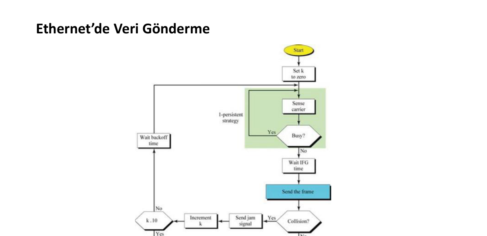

---

## 2.2. Ethernet II Başlık Yapısı (14 Byte) ve İletişim Şekilleri (PDF Sayfa 3–4, Slayt 6–7)
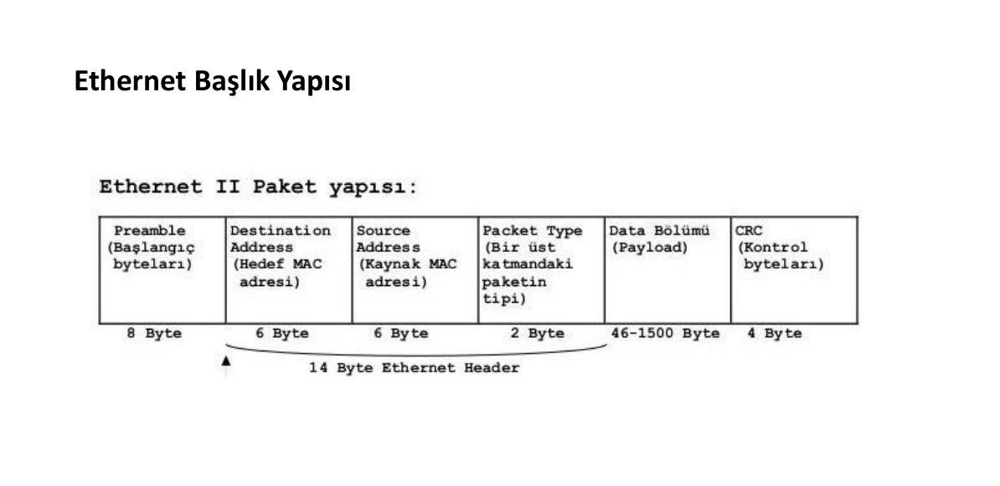

* **Slayt 6 (Ethernet II Başlığı = `14 Byte`):**
  * `Destination Address (Hedef MAC)`: **6 Byte** (`packet[0..5]`)
  * `Source Address (Kaynak MAC)`: **6 Byte** (`packet[6..11]`)
  * `Packet Type (Üst katman protokol tipi)`: **2 Byte** (`packet[12..13]` $\rightarrow$ ARP için `0x0806`, IPv4 için `0x0800`)
  * **Toplam Ethernet Başlığı:** $6 + 6 + 2 = \mathbf{14\text{ Byte}}$! *(Baştaki 8 Byte `Preamble` ve sondaki 4 Byte `CRC` ağ kartı donanımı tarafından kabloda eklenir; yazılımdaki 14 byte başlığa dahil değildir).*
  * `Data Bölümü (Payload)`: **46 – 1500 Byte** arasındadır.
* **Slayt 7 (Ethernet İletişim Şekilleri):**
  1. **Unicast:** Tek bir MAC adresine (`00-07-E9-42-AC-28`).
  2. **Multicast:** Bir gruba; hedef MAC **`01-00-5E`** ile başlar (`01-00-5E-00-00-01`).
  3. **Broadcast:** Ağdaki tüm cihazlara; hedef MAC **`FF-FF-FF-FF-FF-FF`**.

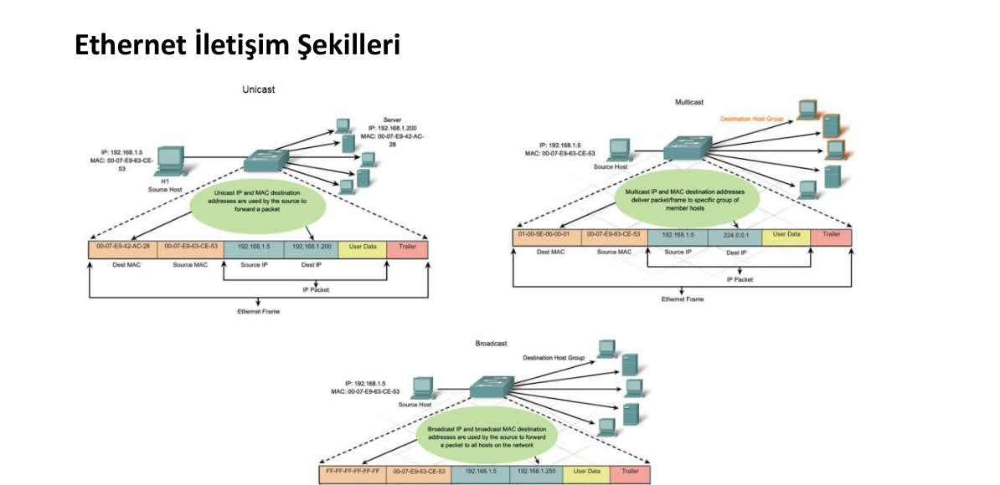

---

## 2.3. ARP (Address Resolution Protocol) Yapısı ve Senaryoları (PDF Sayfa 4–7, Slayt 8–14)
* **Slayt 8–10 (ARP Görevi):** Paketin teslimi için **Mantıksal (IP)** ve **Fiziksel (MAC)** olmak üzere iki düzey adresleme gerekir. ARP, IP protokolünden mantıksal (IP) adresi alır, fiziksel (MAC) adresle eşler ve veri bağı katmanına iletir.
* **Slayt 9 (ARP İşleyişi):** **ARP Request** tüm yerel ağa yayınlanır (**Broadcast**: Ethernet hedef MAC `FF:FF:FF:FF:FF:FF`), **ARP Reply** ise sadece soran düğüme gönderilir (**Unicast**).

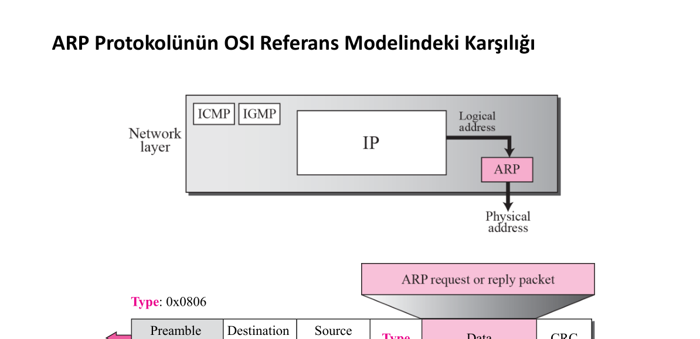
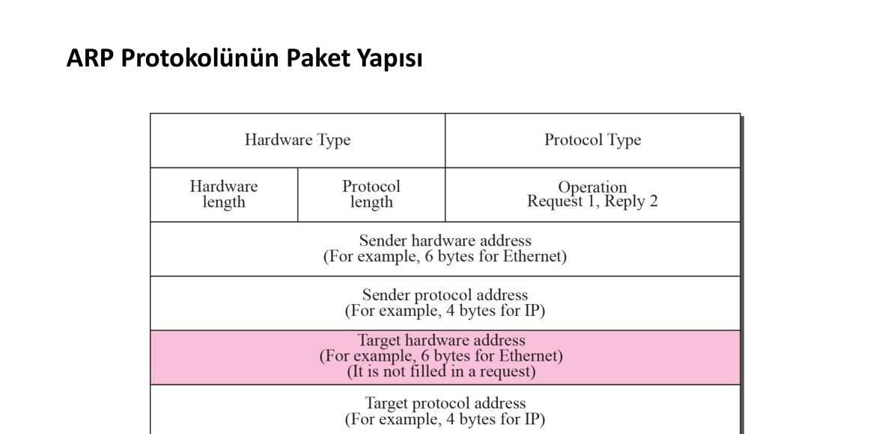

> [!IMPORTANT]
> **Kapsülleme Mantığı: "14 Byte Ethernet + 28 Byte ARP = 42 Byte" Nereden Gelir?**
> * **Slayt 11 ve Slayt 12:** Şablonun genel adı **ARP Paketi**dir ve boyutu **28 Byte**'tır (`2B Hardware Type + 2B Protocol Type + 1B HW Len + 1B Proto Len + 2B Operation + 6B Sender MAC + 4B Sender IP + 6B Target MAC + 4B Target IP = 28 Byte`).
> * Bu 28 byte'lık ARP şablonunun `Operation` (`packet[20..21]`) alanına `1` (`0x0001`) yazılırsa adı **ARP Request Paketi**, `2` (`0x0002`) yazılırsa adı **ARP Reply Paketi** olur.
> * Slayt 11'de pembe oklarla gösterildiği gibi, bu **28 byte'lık ARP (Request veya Reply) paketi** doğrudan Ethernet çerçevesinin **`Data`** kısmına (`packet[14..41]`) yerleştirilir! *(ARP paketinde IP başlığı yoktur).*
> * Başına **14 Byte Ethernet Başlığı** (`packet[0..13]`) eklendiğinde kabloya gönderilen toplam çerçeve **`14 + 28 = 42 Byte`** (`u_char packet[42]`) olur.

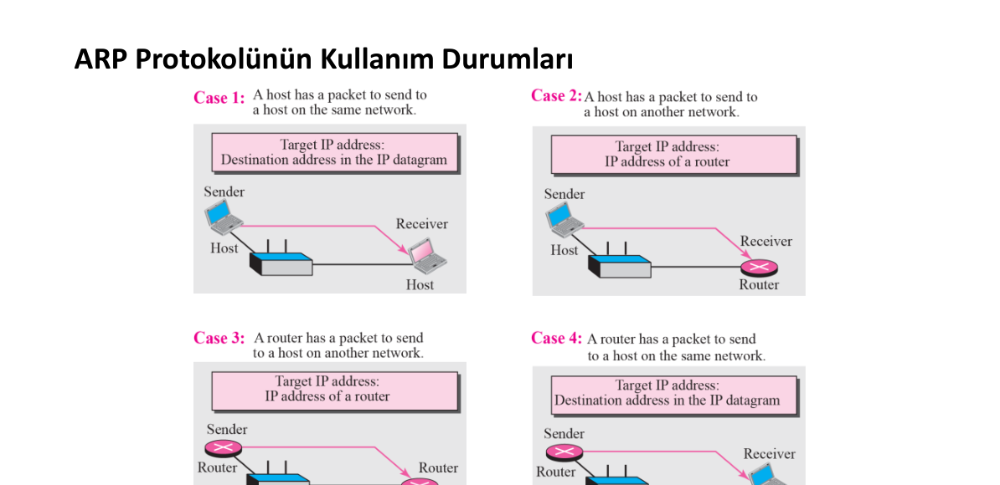

* **Slayt 13 (ARP 4 Kullanım Durumu — Sınav Senaryosu!):**
  * **Case 1 (Host $\rightarrow$ Aynı ağdaki Host):** ARP `Target IP` = IP datagramındaki `Destination IP`.
  * **Case 2 (Host $\rightarrow$ Başka ağdaki Host):** Paket önce yerel ağ geçidine (Router) gitmelidir; bu yüzden ARP `Target IP` = **Router'ın IP adresi** olur!
  * **Case 3 (Router $\rightarrow$ Başka ağdaki Router):** ARP `Target IP` = **Bir sonraki Router'ın IP adresi**.
  * **Case 4 (Router $\rightarrow$ Aynı ağdaki Hedef Host):** ARP `Target IP` = IP datagramındaki `Destination IP`.
* **Slayt 14 (ARP Cache Table Durum Harfleri):** `R` = *Resolved* (Çözümlenmiş, MAC biliniyor), `P` = *Pending* (Beklemede, istek atıldı), `F` = *Free* (Boş satır).

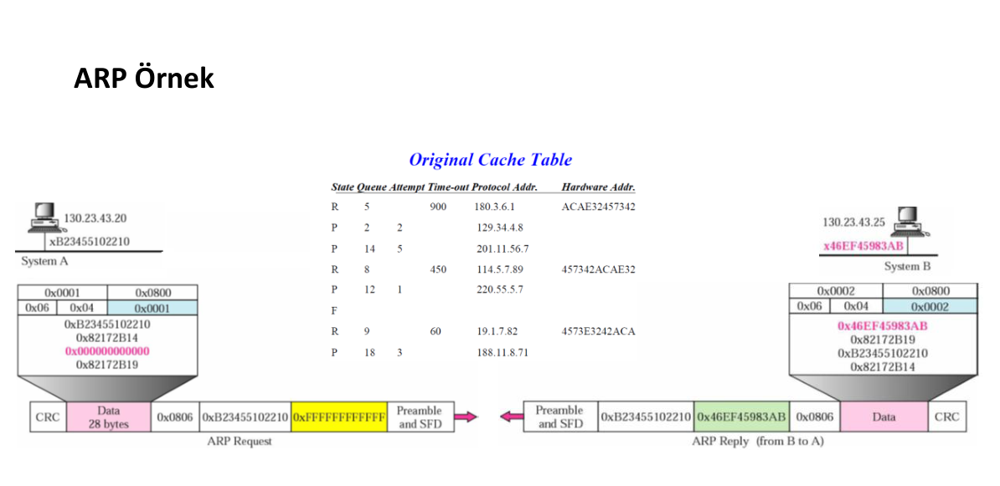

---

## 2.4. Kod Analizi: [`1-arpgonder.c`](./0-Katman2-3%20Kodlar/1-arpgonder.c) (Satır 1–108)

| Dizi İndeksi | Boyut | Katman ve Alan Adı | Kodda Atanan Değer | `1-arpgonder.c` Satır No ve Açıklama |
| :--- | :---: | :--- | :--- | :--- |
| `packet[0..5]` | 6 Byte | Ethernet: Destination MAC | `0xff, 0xff, 0xff, 0xff, 0xff, 0xff` | **[Satır 28–34](./0-Katman2-3%20Kodlar/1-arpgonder.c#L28-L34):** Broadcast MAC adresi (Tüm LAN'a gider). |
| `packet[6..11]` | 6 Byte | Ethernet: Source MAC | `0x54, 0x42, 0x49, 0x02, 0x31, 0x8c` | **[Satır 38–44](./0-Katman2-3%20Kodlar/1-arpgonder.c#L38-L44):** Gönderen cihazın MAC adresi. |
| `packet[12..13]` | 2 Byte | Ethernet: Type (EtherType) | `0x08, 0x06` (`0x0806`) | **[Satır 46–48](./0-Katman2-3%20Kodlar/1-arpgonder.c#L46-L48):** Ethernet Data kısmında **ARP** olduğunu belirtir. |
| `packet[14..15]` | 2 Byte | ARP: Hardware Type | `0x00, 0x01` | **[Satır 53–55](./0-Katman2-3%20Kodlar/1-arpgonder.c#L53-L55):** Donanım tipi `1` = Ethernet. *(Satır 53 yorumundaki `=Request` dizgi hatasıdır)*. |
| `packet[16..17]` | 2 Byte | ARP: Protocol Type | `0x08, 0x00` (`0x0800`) | **[Satır 57–59](./0-Katman2-3%20Kodlar/1-arpgonder.c#L57-L59):** Çözümlenen protokol tipi = IPv4. |
| `packet[18]` | 1 Byte | ARP: Hardware Size | `0x06` | **[Satır 61–62](./0-Katman2-3%20Kodlar/1-arpgonder.c#L61-L62):** MAC adres uzunluğu = 6 byte. |
| `packet[19]` | 1 Byte | ARP: Protocol Size | `0x04` | **[Satır 64–65](./0-Katman2-3%20Kodlar/1-arpgonder.c#L64-L65):** IPv4 adres uzunluğu = 4 byte. |
| `packet[20..21]` | 2 Byte | ARP: Opcode (Operation) | `0x00, 0x01` | **[Satır 67–69](./0-Katman2-3%20Kodlar/1-arpgonder.c#L67-L69):** `1` = **ARP Request** (`2` olsaydı ARP Reply olurdu). |
| `packet[22..27]` | 6 Byte | ARP: Sender MAC | `0x54, 0x42, 0x49, 0x02, 0x31, 0x8c` | **[Satır 71–77](./0-Katman2-3%20Kodlar/1-arpgonder.c#L71-L77):** Gönderen MAC (`packet[6..11]` ile aynı). |
| `packet[28..31]` | 4 Byte | ARP: Sender IP | `0x0a, 0x09, 0x1b, 0xe1` | **[Satır 79–83](./0-Katman2-3%20Kodlar/1-arpgonder.c#L79-L83):** Gönderen IP: `10.9.27.225`. |
| `packet[32..37]` | 6 Byte | ARP: Target MAC | `0x00, 0x00, 0x00, 0x00, 0x00, 0x00` | **[Satır 85–91](./0-Katman2-3%20Kodlar/1-arpgonder.c#L85-L91):** Hedef MAC henüz bilinmediği için `0` doldurulur (Slayt 12). |
| `packet[38..41]` | 4 Byte | ARP: Target IP | `0x0a, 0x09, 0x1b, 0x64` | **[Satır 93–97](./0-Katman2-3%20Kodlar/1-arpgonder.c#L93-L97):** MAC adresi sorulan hedef IP: `10.9.27.100`. |

---
## 2.5. Hafta 2 Değerlendirme Soruları (20 Soru & Çözümleri)

### Soru 1: Ethernet (IEEE 802.3) ve Alohanet Kökeni
**Soru:** IEEE 802.3 Ethernet protokolü tarihsel olarak 1960'larda Hawaii Üniversitesi'nde geliştirilen hangi öncü ağ mimarisinin uzantısı ve geliştirilmiş halidir?  
- A) ARPANET  
- B) Alohanet  
- C) Token Ring  
- D) SNA (IBM)  

<details>
<summary><b>💡 Çözümü ve Açıklamayı Gör</b></summary>

**Doğru Cevap: B**  
**Açıklama (Hafta 2 Katman 2 PDF Sayfa 2, Slayt 3):** Slayt 3'te belirtildiği üzere Ethernet, 1960'ların sonlarında Hawaii Üniversitesi'nde radyo paket ağı olarak geliştirilen **Alohanet**'in devamı ve genişletilmiş şeklidir.
</details>

---

### Soru 2: Ethernet'in Yaygınlaşma Nedenleri
**Soru:** Slayt 3'te Ethernet protokolünün yerel alan ağlarında (LAN) en yaygın kullanılan teknoloji olmasını sağlayan temel nedenler arasında hangisi **sayılmamıştır**?  
- A) Kolay anlaşılır, kurulumu ve bakımı kolay olması  
- B) Düşük maliyetli ve güvenilir olması  
- C) Farklı ağ teknolojileri ve hız artışlarına kolay ölçeklenebilmesi  
- D) Ağdaki tüm paketleri otomatik olarak uçtan uca şifrelemesi  

<details>
<summary><b>💡 Çözümü ve Açıklamayı Gör</b></summary>

**Doğru Cevap: D**  
**Açıklama (Hafta 2 Katman 2 Slayt 3):** Standart Ethernet (Katman 2) şifreleme sağlamaz; veriyi açık çerçeve olarak iletir. Avantajları: Kurulum kolaylığı, güvenilirlik, ölçeklenebilirlik ve düşük maliyettir.
</details>

---

### Soru 3: CSMA/CD Açılımı ve Anlamı
**Soru:** CSMA/CD (Carrier Sense Multiple Access with Collision Detection) terimindeki bileşenlerin anlamı aşağıdakilerden hangisinde doğru eşleştirilmiştir?  
- A) Carrier Sense: Hatta çarpışma sinyali gönderme | Multiple Access: Tek bir bilgisayarın iletim yapması | Collision Detection: Hatta sinyal olup olmadığını dinleme  
- B) Carrier Sense: İletim hattında sinyal olup olmadığını kontrol etme (dinleme) | Multiple Access: Hattı tüm düğümlerin eşit hakla paylaşması | Collision Detection: İki istasyon aynı anda veri yolladığında oluşan çarpışmayı algılama  
- C) Carrier Sense: Paketleri yönlendirme | Multiple Access: Jeton dolaştırma | Collision Detection: Hata düzeltme  
- D) Carrier Sense: MAC adresini kontrol etme | Multiple Access: Broadcast yayın | Collision Detection: Çerçeveyi yeniden numaralandırma  

<details>
<summary><b>💡 Çözümü ve Açıklamayı Gör</b></summary>

**Doğru Cevap: B**  
**Açıklama (Hafta 2 Katman 2 Slayt 4):**
* **Carrier Sense (Taşıyıcı Sezme):** Gönderim öncesinde kabloda sinyal/veri olup olmadığını dinler.
* **Multiple Access (Çoklu Erişim):** Ortam paylaşımlıdır, tüm istasyonlar aynı iletim hattına bağlıdır.
* **Collision Detection (Çarpışma Tespiti):** Veri gönderirken aynı anda başka sinyal gelirse çarpışmayı sezebilir.
</details>

---

### Soru 4: Ethernet IFG (Interframe Gap) Süresi
**Soru:** Slayt 5'teki CSMA/CD akış şemasına göre hat boş bulunduğunda çerçeve gönderilmeden hemen önce neden **`Wait IFG time`** (Interframe Gap) kadar beklenir?  
- A) Bilgisayarın IP adresini yenilemek için  
- B) Alıcı istasyonun ağ kartının önceki çerçeveyi işleyip yeni çerçeveyi almaya hazır hale gelmesini sağlamak ve hat stabilizasyonu için  
- C) Router'ın yönlendirme tablosunu güncellemesi için  
- D) ARP önbelleğini temizlemek için  

<details>
<summary><b>💡 Çözümü ve Açıklamayı Gör</b></summary>

**Doğru Cevap: B**  
**Açıklama (Hafta 2 Katman 2 Slayt 5):** İki Ethernet çerçevesi arasında donanımın toparlanması ve alıcı cihazın çerçeveyi ayırt edebilmesi için standart bir boşluk süresi (**IFG - Interframe Gap**, 96 bit zamanı) beklenir.
</details>

---

### Soru 5: CSMA/CD Backoff Sayacı Sınırı
**Soru:** CSMA/CD Backoff algoritmasında bir istasyon üst üste çarpışma yaşadığında deneme sayacını ($k$) 1 artırır ($k = k + 1$). Slayt 5'teki akış şemasında iletim denemesi en fazla kaça kadar tekrarlanır, limit aşılırsa ne olur?  
- A) En fazla 3 deneme; aşılırsa bilgisayar kilitlenir  
- B) En fazla 10 veya 16 deneme; limit aşılırsa gönderim iptal edilir (`Abort`) ve üst katmana hata bildirilir  
- C) Sonsuza kadar denenir  
- D) Sadece 1 kez denenir  

<details>
<summary><b>💡 Çözümü ve Açıklamayı Gör</b></summary>

**Doğru Cevap: B**  
**Açıklama (Hafta 2 Katman 2 Slayt 5):** Şemada $k < 10$ kontrolü bulunur. Çarpışma sayısı limiti aşarsa iletim **`Abort`** edilir; ağda aşırı yoğunluk veya fiziksel kablo arızası olduğu anlaşılır.
</details>

---

### Soru 6: Ethernet II Çerçevesinde EtherType Değerleri
**Soru:** Ethernet II başlığında yer alan 2 baytlık `Packet Type` (EtherType - `packet[12..13]`) alanına IPv4 ve ARP protokolleri için sırasıyla hangi hex değerler yazılır?  
- A) IPv4: `0x0806`, ARP: `0x0800`  
- B) IPv4: `0x0800`, ARP: `0x0806`  
- C) IPv4: `0x0600`, ARP: `0x0100`  
- D) IPv4: `0xFFFF`, ARP: `0x0000`  

<details>
<summary><b>💡 Çözümü ve Açıklamayı Gör</b></summary>

**Doğru Cevap: B**  
**Açıklama (Hafta 2 Katman 2 Slayt 6 & `1-arpgonder.c` Satır 46–48 & `2-icmpgonder.c` Satır 40–41):**
* **IPv4 için:** `0x08, 0x00` (`0x0800`)
* **ARP için:** `0x08, 0x06` (`0x0806`)
</details>

---

### Soru 7: Ethernet Minimum ve Maksimum Payload (Veri) Boyutu
**Soru:** Standart bir Ethernet çerçevesinin veri taşıma (Payload / MTU) kapasitesi kaç bayt aralığında olmak zorundadır?  
- A) 14 – 60 Bayt  
- B) 46 – 1500 Bayt  
- C) 20 – 65,535 Bayt  
- D) 28 – 50 Bayt  

<details>
<summary><b>💡 Çözümü ve Açıklamayı Gör</b></summary>

**Doğru Cevap: B**  
**Açıklama (Hafta 2 Katman 2 Slayt 6):** Ethernet çerçevesinin `Data` kısmı **en az 46 bayt, en fazla 1500 bayt (standart MTU)** olabilir. Veri 46 bayttan küçükse araya padding (dolgu) baytları eklenir.
</details>

---

### Soru 8: MAC Adresi Formatı ve Boyutu
**Soru:** Fiziksel donanım adresi olan MAC adresi kaç bittir (kaç bayttır) ve genellikle nasıl gösterilir?  
- A) 32 bit (4 Bayt), noktalı ondalık  
- B) 48 bit (6 Bayt), iki basamaklı 6 adet onaltılık (hexadecimal) blok halinde  
- C) 64 bit (8 Bayt), ikili bloklar  
- D) 128 bit (16 Bayt), iki nokta ile  

<details>
<summary><b>💡 Çözümü ve Açıklamayı Gör</b></summary>

**Doğru Cevap: B**  
**Açıklama (Hafta 2 Katman 2 Slayt 6 & 7):** MAC adresi **48 bit (6 bayt)** uzunluğundadır (örneğin: `00:11:22:33:44:55` veya `00-11-22-33-44-55`).
</details>

---

### Soru 9: ARP Protokolünün Temel Görevi
**Soru:** Bilgisayar ağlarında ARP (Address Resolution Protocol) protokolünün temel varoluş amacı nedir?  
- A) Alan adlarını (Domain Name) IP adresine dönüştürmek  
- B) Mantıksal IP adresini bilinen bir cihazın fiziksel donanım (MAC) adresini bulmak ve eşleştirmek  
- C) IP paketlerini parçalamak  
- D) Ağ kartlarının hızını belirlemek  

<details>
<summary><b>💡 Çözümü ve Açıklamayı Gör</b></summary>

**Doğru Cevap: B**  
**Açıklama (Hafta 2 Katman 2 Slayt 8):** Paketin yerel ağda bir cihaza teslim edilebilmesi için IP yetmez, o cihazın fiziksel MAC adresi gereklidir. ARP, IP adresini alıp yerel ağda sorarak karşılık gelen MAC adresini çözer.
</details>

---

### Soru 10: CSMA/CD Backoff Algoritması ve 1-Persistent
**Soru:** IEEE 802.3 Ethernet'te CSMA/CD iletiminde hat meşgulse istasyonun hattı sürekli dinlemesi ve hat boşaldığı anda iletime geçmesi prensibine ne ad verilir?  
- A) Non-persistent  
- B) p-persistent  
- C) 1-persistent  
- D) Aloha  

<details>
<summary><b>💡 Çözümü ve Açıklamayı Gör</b></summary>

**Doğru Cevap: C**  
**Açıklama (Hafta 2 Katman 2 PDF Sayfa 3, Slayt 5):** Slayt 5'teki akış şemasında görüldüğü üzere istasyon hat boşalana kadar sürekli dinler (`Sense carrier, Busy? Yes -> Sense carrier`), boşaldığı anda IFG süresi bekleyip gönderir. Bu `1-persistent` stratejisidir.
</details>

---

### Soru 11: CSMA/CD Çarpışma ve Jam Sinyali
**Soru:** CSMA/CD çalıştıran bir Ethernet kartı, çerçeveyi gönderirken aynı anda hatta gerilim seviyesinin yükseldiğini görüp çarpışma (collision) sezdiğinde derhal ne yapar?  
- A) Gönderimi iptal edip hemen aynı çerçeveyi baştan gönderir  
- B) İletimi durdurur ve diğer tüm istasyonları uyarmak için hatta bozucu bir "Jam Signal" gönderir  
- C) Bilgisayarı yeniden başlatır  
- D) Paketi doğrudan router'a yönlendirir  

<details>
<summary><b>💡 Çözümü ve Açıklamayı Gör</b></summary>

**Doğru Cevap: B**  
**Açıklama (Hafta 2 Katman 2 Slayt 5):** Çarpışma tespit edildiğinde istasyon derhal çerçeveyi keser, diğer düğümler de çarpışmayı fark etsin diye hatta **Jam Signal** basar ve deneme sayacını ($k$) 1 artırarak rastgele bekleme süresine (backoff) geçer.
</details>

---

### Soru 12: Ethernet II Başlık Boyutu ve Alanları
**Soru:** Ethernet II çerçeve başlığı yazılım katmanında (C programlamada) kaç bayttır ve hangi 3 temel alandan oluşur?  
- A) 20 Bayt (Kaynak IP, Hedef IP, Tip)  
- B) 14 Bayt (Hedef MAC [6B], Kaynak MAC [6B], Tip [2B])  
- C) 28 Bayt (Donanım Tipi, Protokol Tipi, MAC'ler)  
- D) 18 Bayt (Preamble [8B], MAC'ler [6B], CRC [4B])  

<details>
<summary><b>💡 Çözümü ve Açıklamayı Gör</b></summary>

**Doğru Cevap: B**  
**Açıklama (Hafta 2 Katman 2 Slayt 6):**
* Hedef MAC: 6 Bayt (`packet[0..5]`)
* Kaynak MAC: 6 Bayt (`packet[6..11]`)
* Tip (EtherType): 2 Bayt (`packet[12..13]`)
* Toplam = $6 + 6 + 2 = \mathbf{14\text{ Bayt}}$.
</details>

---

### Soru 13: Preamble ve CRC'nin C Kodunda Bulunmama Sebebi
**Soru:** Ethernet çerçevesinin donanım seviyesinde başında 8 bayt Preamble ve sonunda 4 bayt CRC (FCS) bulunmasına rağmen `1-arpgonder.c` veya `2-icmpgonder.c` kodlarında Ethernet başlığı neden 14 bayt olarak dizide tanımlanır?  
- A) Kod yazarı CRC eklemeyi unutmuştur  
- B) Preamble ve CRC hesaplaması ağ arayüz kartı (NIC) donanımı tarafından fiziksel iletim anında yapılıp eklendiği için  
- C) Linux çekirdeği CRC kullanımını yasakladığı için  
- D) Libpcap kütüphanesi sadece 14 baytlık paketleri desteklediği için  

<details>
<summary><b>💡 Çözümü ve Açıklamayı Gör</b></summary>

**Doğru Cevap: B**  
**Açıklama (Hafta 2 Katman 2 Slayt 6):** Preamble (alıcının saatini senkronize etmek için) ve FCS/CRC (fiziksel iletim hatası tespiti için) donanım (PHY/MAC çipi) tarafından otomatik eklenir ve paket yakalanırken donanım tarafından soyulur; bu yüzden yazılım katmanında 14 baytlık başlık kullanılır.
</details>

---

### Soru 14: Multicast Ethernet MAC Kalıbı
**Soru:** Bir Ethernet çerçevesinin hedef MAC adresi hangi özel 3 baytlık önek ile başlıyorsa bu çerçevenin bir **Multicast** grubu hedeflediği anlaşılır?  
- A) `FF:FF:FF`  
- B) `00:00:00`  
- C) `01:00:5E`  
- D) `192:168:1`  

<details>
<summary><b>💡 Çözümü ve Açıklamayı Gör</b></summary>

**Doğru Cevap: C**  
**Açıklama (Hafta 2 Katman 2 Slayt 7):** Slayt 7'deki şemaya göre Multicast MAC adresleri her zaman **`01-00-5E`** hex öneki ile başlar (Örnek: `01-00-5E-00-00-01`).
</details>

---

### Soru 15: Broadcast MAC Adresi
**Soru:** Yerel ağdaki (LAN) tüm cihazların ağ kartlarının kabul etmesi amacıyla gönderilen bir Ethernet çerçevesinde hedef MAC adresi ne olarak atanır?  
- A) `00:00:00:00:00:00`  
- B) `FF:FF:FF:FF:FF:FF`  
- C) `255.255.255.255`  
- D) `01:00:5E:FF:FF:FF`  

<details>
<summary><b>💡 Çözümü ve Açıklamayı Gör</b></summary>

**Doğru Cevap: B**  
**Açıklama (Hafta 2 Katman 2 Slayt 7 & `1-arpgonder.c` Satır 28-34):** Broadcast MAC adresi 6 baytın tamamının 1 (`0xFF`) yapıldığı **`FF-FF-FF-FF-FF-FF`** adresidir.
</details>

---

### Soru 16: ARP Paket Boyutu ve Kapsülleme
**Soru:** Standart bir ARP Request veya Reply paketinin kendi gövde boyutu kaç bayttır? Ethernet çerçevesine kapsüllendiğinde toplam paket boyutu kaç bayt olur?  
- A) 20B ARP + 14B Ethernet = 34 Byte  
- B) 28B ARP + 14B Ethernet = 42 Byte  
- C) 28B ARP + 20B IP + 14B Ethernet = 62 Byte  
- D) 32B ARP + 14B Ethernet = 46 Byte  

<details>
<summary><b>💡 Çözümü ve Açıklamayı Gör</b></summary>

**Doğru Cevap: B**  
**Açıklama (Hafta 2 Katman 2 Slayt 11 & 12):** ARP paketinde IP başlığı yoktur! 28 Baytlık ARP şablonu doğrudan Ethernet'in Veri (Data) kısmına yazılır:
$$\mathbf{14\text{ Byte Ethernet Başlığı}} + \mathbf{28\text{ Byte ARP Şablonu}} = \mathbf{42\text{ Byte}}$$
(`1-arpgonder.c` dosyasında `u_char packet[42]` tanımlanmasının sebebi budur).
</details>

---

### Soru 17: ARP Request Alan Değerleri
**Soru:** Bir ARP Request paketi oluşturulurken ARP başlığındaki `Opcode` alanına ve henüz bilinmeyen `Target MAC` alanına sırasıyla hangi değerler atanmalıdır?  
- A) `Opcode = 2`, `Target MAC = FF:FF:FF:FF:FF:FF`  
- B) `Opcode = 1`, `Target MAC = 00:00:00:00:00:00`  
- C) `Opcode = 1`, `Target MAC = FF:FF:FF:FF:FF:FF`  
- D) `Opcode = 2`, `Target MAC = 00:00:00:00:00:00`  

<details>
<summary><b>💡 Çözümü ve Açıklamayı Gör</b></summary>

**Doğru Cevap: B**  
**Açıklama (Hafta 2 Katman 2 Slayt 12 & `1-arpgonder.c` Satır 67-69 & 85-91):**
* `Opcode = 1` $\rightarrow$ ARP Request (`2` olsaydı Reply olurdu).
* `Target MAC` henüz bilinmediği için sıfırlanır (`00:00:00:00:00:00`).
* *(Not: Ethernet başlığındaki Hedef MAC ise tüm ağ duysun diye `FF:FF:FF:FF:FF:FF` yapılır).*
</details>

---

### Soru 18: ARP Farklı Ağa Gönderim Senaryosu (Case 2)
**Soru:** A bilgisayarı (`10.0.1.5`), farklı bir alt ağda bulunan B bilgisayarına (`10.0.2.80`) bir IP paketi göndermek istiyor. A bilgisayarı yerel ağda ARP Request yayınlarken ARP paketindeki `Target IP` alanına hangi adresi yazar?  
- A) B bilgisayarının IP adresini (`10.0.2.80`)  
- B) Kendi IP adresini (`10.0.1.5`)  
- C) Kendi yerel ağ geçidinin (Varsayılan Router) IP adresini  
- D) `255.255.255.255`  

<details>
<summary><b>💡 Çözümü ve Açıklamayı Gör</b></summary>

**Doğru Cevap: C**  
**Açıklama (Hafta 2 Katman 2 Slayt 13 - Case 2):** Farklı ağdaki bir cihaza doğrudan ulaşılamaz; paket router üzerinden çıkmalıdır. Bu yüzden kaynak bilgisayar paketi router'a teslim edebilmek için **Router'ın IP adresini** `Target IP` olarak sorgulayıp Router'ın MAC adresini öğrenir.
</details>

---

### Soru 19: ARP Tablosu Durum Harfleri
**Soru:** Slayt 14'te verilen ARP Önbellek Tablosunda yer alan bir satırda `State` (Durum) sütununda **`P`** harfi görülüyorsa bu ne anlama gelir?  
- A) Resolved (Çözümlenmiş, MAC adresi biliniyor)  
- B) Pending (Beklemede, ARP isteği yollandı henüz cevap gelmedi)  
- C) Permanent (Kalıcı statik kayıt)  
- D) Free (Boş satır)  

<details>
<summary><b>💡 Çözümü ve Açıklamayı Gör</b></summary>

**Doğru Cevap: B**  
**Açıklama (Hafta 2 Katman 2 Slayt 14):**
* `R` = *Resolved* (Çözümlendi)
* `P` = *Pending* (Beklemede - istek çıktı yanıt bekleniyor)
* `F` = *Free* (Kullanılabilir boş satır)
</details>

---

### Soru 20: `1-arpgonder.c` Kodundaki Yorum Hatası
**Soru:** `1-arpgonder.c` dosyasının 53. satırında `packet[14]=0x00; packet[15]=0x01;` kodunun yanına `//0x0001=Request` şeklinde bir açıklama yazılmıştır. Bu satırın gerçek protokol görevi nedir ve asıl `Opcode = Request` hangi satırda atanmaktadır?  
- A) Gerçekte donanım tipidir (Ethernet = 1); asıl Opcode Satır 67-69'da (`packet[20..21]`) atanmıştır.  
- B) Gerçekte IP protokol tipidir; asıl Opcode Satır 46'da atanmıştır.  
- C) Kod doğrudur, ARP'de iki kez Request bayrağı yazılır.  
- D) Gerçekte hedef MAC adresidir.  

<details>
<summary><b>💡 Çözümü ve Açıklamayı Gör</b></summary>

**Doğru Cevap: A**  
**Açıklama (`1-arpgonder.c` Satır 53 vs 67-69 & Hafta 2 Katman 2 Slayt 12):**
* `packet[14..15]` ARP şablonunun ilk 2 baytı olan **Donanım Tipi (Hardware Type)** alanıdır (`1 = Ethernet`). Yorumdaki `=Request` ifadesi dizgi/yorum hatasıdır.
* Asıl **İşlem Kodu (Opcode)** Satır 67-69'daki `packet[20] = 0x00; packet[21] = 0x01;` atamasıdır.
</details>

---

# 3. Ders (Bölüm 1): Hafta 3 – Katman 3: IPv4, Fragmantasyon, Opsiyonlar, Checksum ve IPv6 ⭐ [VİZE TEST]
**Kaynak Sunum:** `Hafta-3 Katman 3 Protokolleri.pdf` *(PDF Sayfa 1–10, Slayt 1–20)*

## 3.1. IPv4 Temel Özellikleri ve Başlık Yapısı (PDF Sayfa 2–3, Slayt 3–5)
* **Slayt 4 (IPv4 Özellikleri):** Ağ katmanı paketlerine **datagram** denir. **Bağlantısız**, **en iyi teslim (best-effort)** ve **ortam bağımsız** bir protokoldür.
* **Boyut Kuralları (Slayt 4):** IP Başlığı **20–60 bayt** aralığındadır (Sabit kısım **20 bayt**, Opsiyonlar **0–40 bayt**). Toplam datagram boyutu **20–65,535 bayt** aralığındadır.
* **Slayt 5 (`Protocol` Alanı Değerleri Tablosu — `packet[23]`):** **`1` = ICMP**, **`2` = IGMP**, **`6` = TCP**, **`17` = UDP**, **`89` = OSPF**.

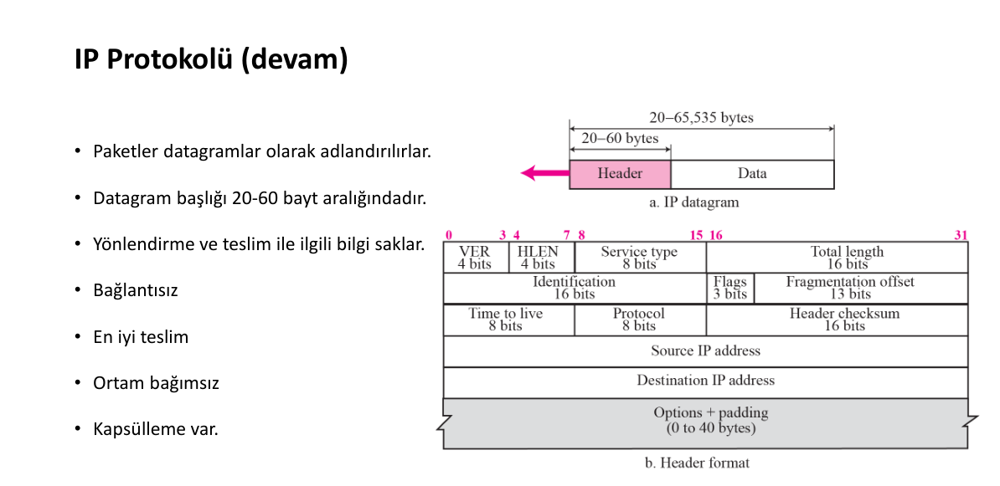
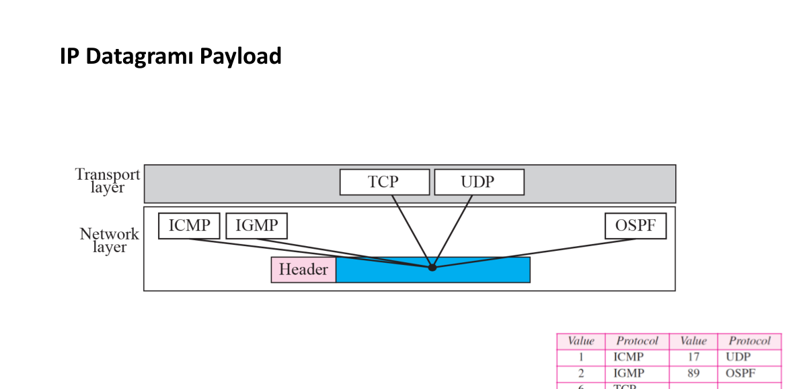

---

## 3.2. IPv4 Fragmantasyon (Parçalama) ve Sayısal Hesaplama (PDF Sayfa 3–4, Slayt 6–7)
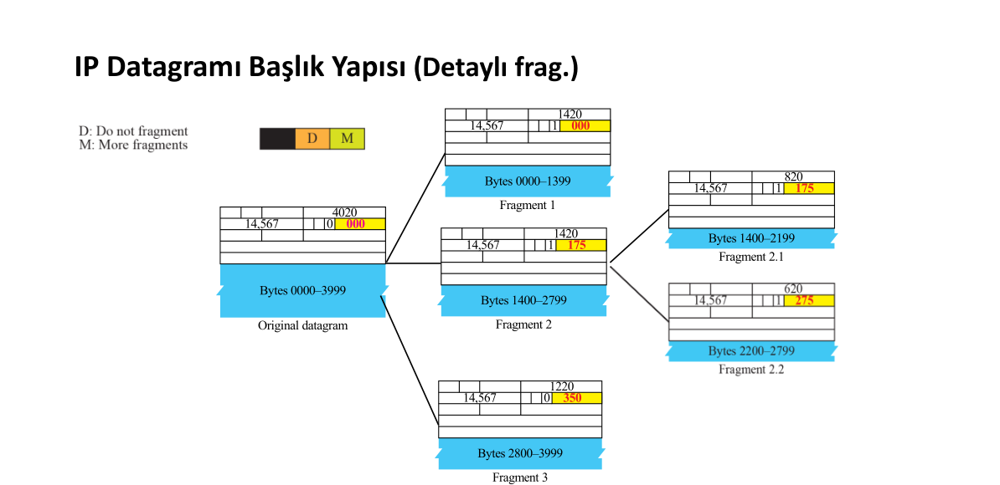

> [!TIP]
> **Fragmantasyon Sayısal Çözüm Formülleri (Slayt 7):**
> * **Bayraklar (3 Bit):** `D (Do not fragment) = 1` ise parçalanamaz. `M (More fragments) = 1` ise arkadan başka parçalar gelecek, `M = 0` ise bu son parçadır.
> * **Total Length (Toplam Uzunluk):** Her parçaya 20 Byte IP başlığı eklendiği için $\text{Total Length} = \text{Parça Veri Boyutu} + 20$.
> * **Fragmentation Offset:** Son parça hariç her parçadaki veri boyutu **8'in katı** olmalıdır: $\text{Offset} = \text{İlk Veri Baytının Sıra Numarası} \div 8$.
> * **Slayt 7 Örneğinin Adım Adım Çözümü (Orijinal Veri: 4000 Byte [`0000–3999`], Total Length: `4020`, ID: `14,567`):**
>   * **Fragment 1 (`0000–1399`, 1400B veri):** `Total Length` = $1400 + 20 = \mathbf{1420}$ | `M = 1` | `Offset` = $0 \div 8 = \mathbf{000}$.
>   * **Fragment 2 (`1400–2799`, 1400B veri):** `Total Length` = $1400 + 20 = \mathbf{1420}$ | `M = 1` | `Offset` = $1400 \div 8 = \mathbf{175}$.
>     * *Fragment 2.1 (`1400–2199`, 800B veri):* `Total Length` = $800 + 20 = \mathbf{820}$ | `M = 1` | `Offset` = $1400 \div 8 = \mathbf{175}$.
>     * *Fragment 2.2 (`2200–2799`, 600B veri):* `Total Length` = $600 + 20 = \mathbf{620}$ | **`M = 1`** *(arkada hala Fragment 3 var!)* | `Offset` = $2200 \div 8 = \mathbf{275}$.
>   * **Fragment 3 (`2800–3999`, 1200B veri):** `Total Length` = $1200 + 20 = \mathbf{1220}$ | **`M = 0`** *(Son parça!)* | `Offset` = $2800 \div 8 = \mathbf{350}$.

---

## 3.3. IPv4 Başlık Opsiyonları (Seçenekler) (PDF Sayfa 4–9, Slayt 8–17)
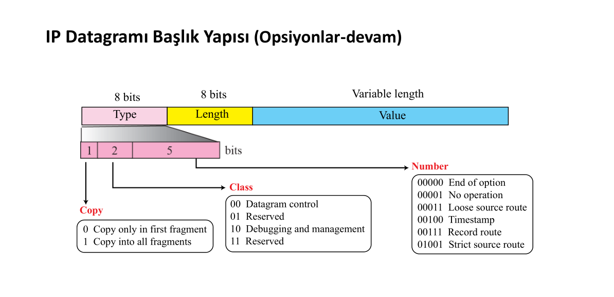
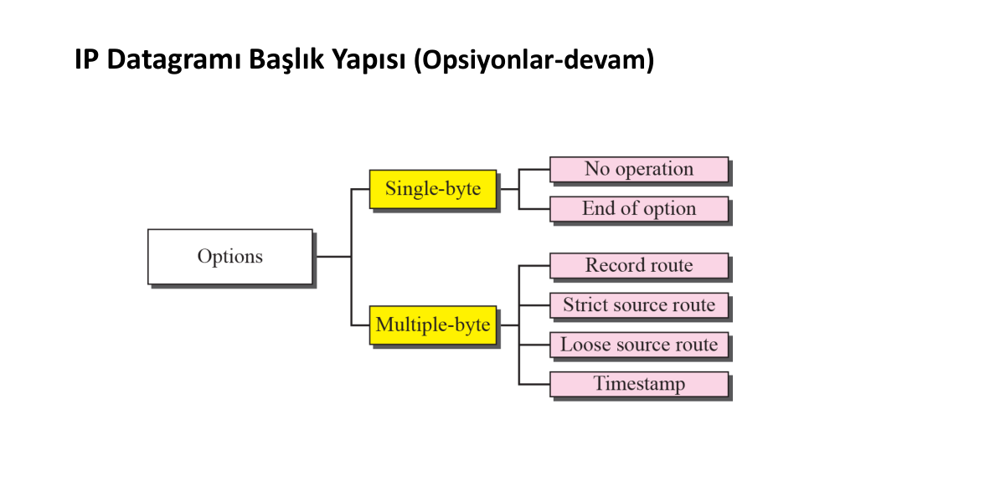

| Kategori (Slayt 10) | Opsiyon Adı | Type / Code Değeri | Slayt No | Görevi ve Çalışma Mantığı |
| :--- | :--- | :---: | :---: | :--- |
| **Single-byte** | **No operation (`NO-OP`)** | `Type: 1` (`00000001`) | Slayt 11 | Seçenekleri 16/32-bit sınırına **hizalamak (align)** için kullanılır. |
| **Single-byte** | **End of option (`END-OP`)**| `Type: 0` (`00000000`) | Slayt 11 | Seçeneklerin sonunu **doldurmak (padding)** için kullanılır. |
| **Multiple-byte**| **Record route** | `Type: 7` (`00000111`) | Slayt 11–12| Başlangıçta boş olan (maks. **9 adreslik**) listeye, paketin geçtiği her router kendi çıkış IP adresini kaydeder (`Pointer` 4 artar). |
| **Multiple-byte**| **Strict source route** | `Type: 137` (`10001001`)| Slayt 13–14| **Kesin Kaynak Yönlendirme:** Gönderen, geçilecek **tüm** router IP'lerini baştan belirler; paket liste dışındaki hiçbir router'dan geçemez! |
| **Multiple-byte**| **Loose source route** | `Type: 131` (`10000011`)| Slayt 15 | **Esnek Kaynak Yönlendirme:** Paket listedeki router'lara uğramak zorundadır ama aralarında başka router'lardan da geçebilir. |
| **Multiple-byte**| **Timestamp** | `Code: 68` (`01000100`) | Slayt 16–17| Geçilen her router'ın IP adresini ve paketin işlendiği **zaman damgasını** kaydeder. |

---

## 3.4. IPv4 Kontrol Toplamı (Checksum), İşletim Modülleri ve IPv6 (PDF Sayfa 9–10, Slayt 18–20)
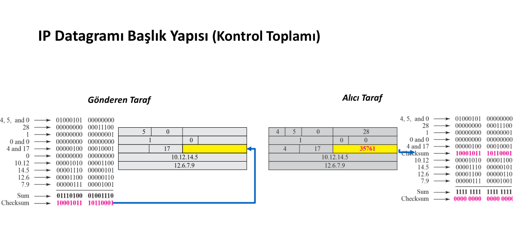
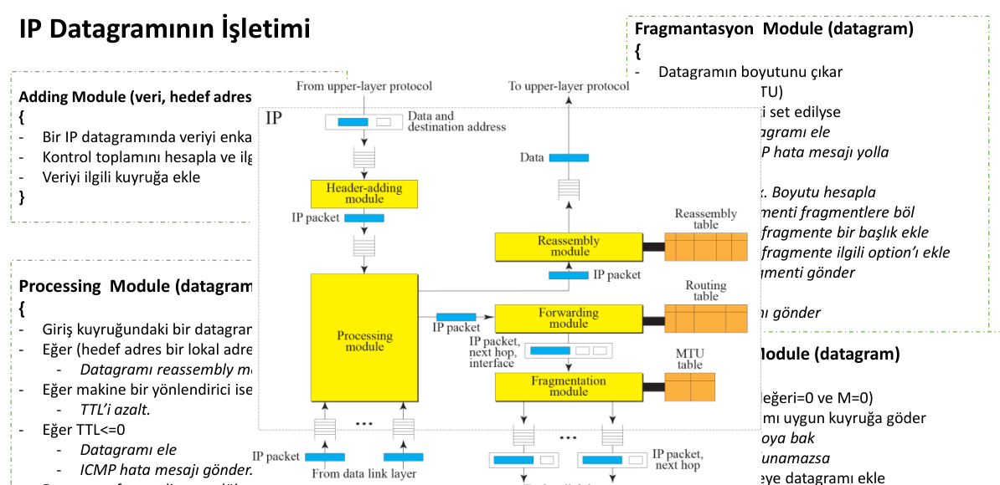
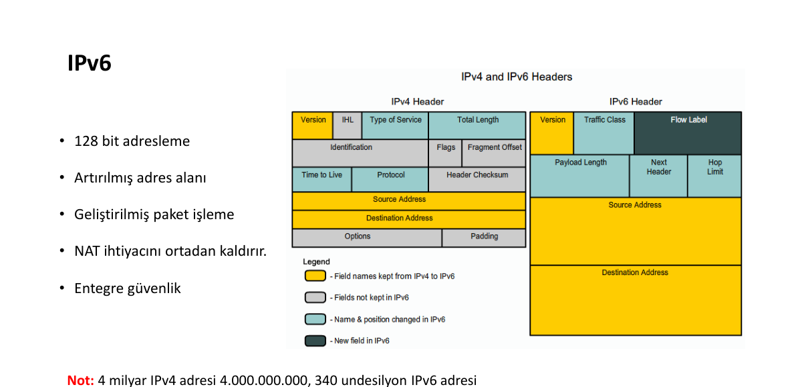

* **Slayt 18 (Kontrol Toplamı / Checksum):** Başlık 16-bitlik satırlara bölünür. Gönderende Checksum alanı `0` yapılarak toplanır (`Sum`) ve **1'e tümleyeni (bitlerin tersi)** alınarak Checksum alanına (`35761`) yazılır. Alıcıda tüm başlık (Checksum dahil) toplandığında `Sum = 11111111 11111111` ve tersi alındığında **`Checksum = 0000 0000 0000 0000`** çıkmalıdır.
* **Slayt 19 (4 İşletim Modülü):** `Adding Module`, `Processing Module` (Router ise `TTL` azaltır, `TTL <= 0` ise atıp ICMP hata döner), `Fragmantasyon Module` (`Boyut > MTU` ve `D=1` ise atıp ICMP hata döner), `Reassembly Module` (Süre aşımı olursa tüm fragmentleri düşürüp ICMP hata döner).
* **Slayt 20 (IPv6):** **128 bit adresleme** (340 undesilyon adres), **NAT ihtiyacını ortadan kaldırır**, entegre güvenlik. IPv6 başlığında `IHL`, `Identification`, `Flags`, `Fragment Offset` ve `Header Checksum` kaldırılmış; `TTL` $\rightarrow$ `Hop Limit`, `Protocol` $\rightarrow$ `Next Header`, `Type of Service` $\rightarrow$ `Traffic Class` olmuş ve **`Flow Label`** eklenmiştir.

---

# 4. Ders (Bölüm 2): Hafta 3 – Katman 3: ICMP Protokolü ve 3 C Kodu ⭐ [VİZE KLASİK & TEST]
**Kaynak Sunum ve Kodlar:** `Hafta-3 Katman 3 Protokolleri.pdf` *(PDF Sayfa 11–16, Slayt 21–32)* & [`2-icmpgonder.c`](./0-Katman2-3%20Kodlar/2-icmpgonder.c), [`ping_server.c`](./0-Katman2-3%20Kodlar/Ping%20Uygulaması/ping_server.c), [`ping_client.c`](./0-Katman2-3%20Kodlar/Ping%20Uygulaması/ping_client.c)

## 4.1. ICMP Kapsüllemesi, 8 Byte Başlık ve Mesaj Kategorileri (PDF Sayfa 11–12, Slayt 21–23)
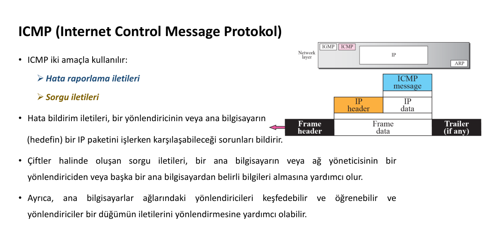
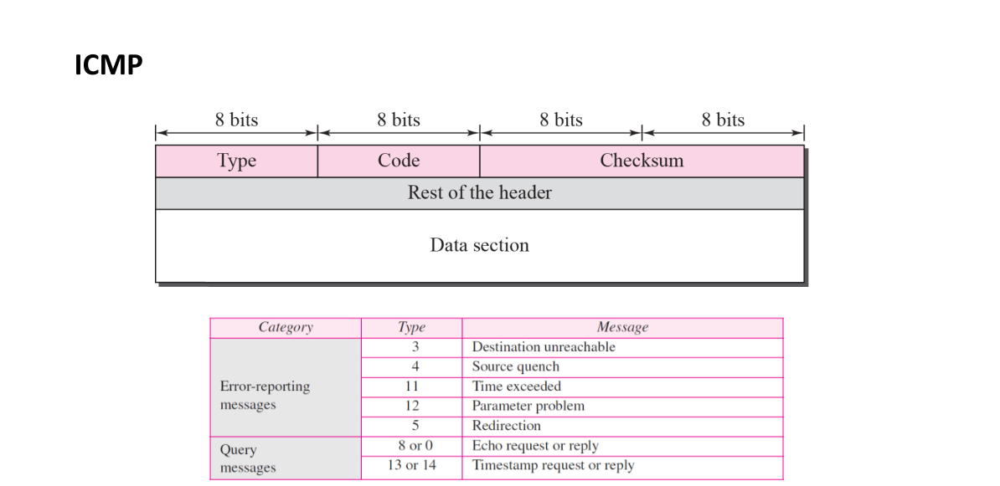

## 4.2. ICMP Hata Raporlama ve Sorgu Mesajları Kuralları (PDF Sayfa 12–16, Slayt 24–31)
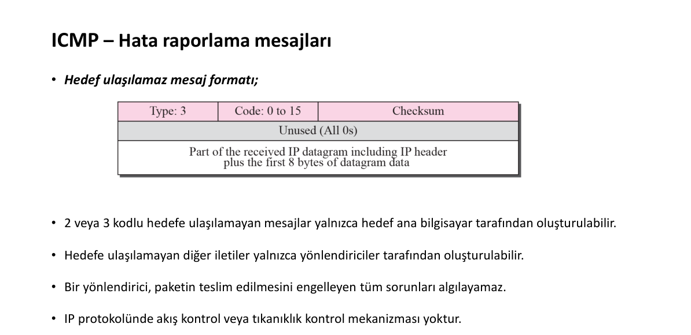
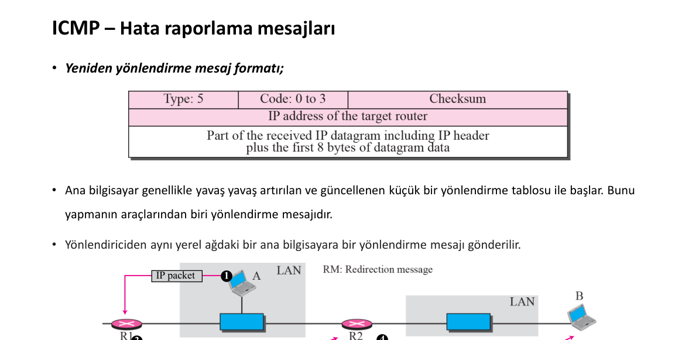
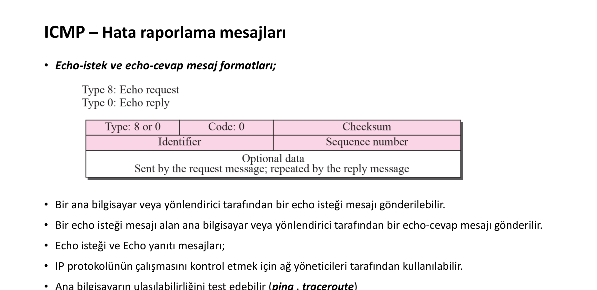

> [!IMPORTANT]
> **Sınavda Kesin Sorulabilecek ICMP Hata Kuralları (Slayt 24–30):**
> * **Ortak Kural (Slayt 24–28):** Tüm ICMP hata mesajları, hataya sebep olan paketin **IP başlığını + orijinal verinin ilk 8 baytını** (`IP header plus the first 8 bytes of datagram data`) içerir.
> * **1) Hedef Ulaşılamaz (`Type: 3, Code: 0..15` — Slayt 24):**
>   * **`Code 2` (Protokol ulaşılamaz) ve `Code 3` (Port ulaşılamaz)** mesajları **YALNIZCA hedef ana bilgisayar (Host)** tarafından oluşturulabilir!
>   * Diğer tüm `Type 3` iletileri **YALNIZCA yönlendiriciler (Router)** tarafından oluşturulabilir!
> * **2) Kaynak Söndürme (`Type: 4, Code: 0` — Slayt 25):** Yönlendirici veya hedefteki tıkanıklık nedeniyle **atılan her datagram için** gönderilir; kaynağın gönderimi yavaşlatmasını ister.
> * **3) Zaman Aşımı (`Type: 11, Code: 0 veya 1` — Slayt 26):**
>   * **`Code 0`:** Yalnızca **yönlendiriciler (Router)** tarafından `TTL = 0` olduğunda gönderilir.
>   * **`Code 1`:** Yalnızca **hedef ana bilgisayar (Host)** tarafından, parçalanmış datagramın tüm parçaları süresi içinde gelmediğinde gönderilir.
> * **4) Parametre Problemi (`Type: 12, Code: 0 veya 1` — Slayt 27):** Yönlendirici veya hedef host tarafından oluşturulabilir; `Pointer` alanı hatanın olduğu baytı gösterir.
> * **5) Yeniden Yönlendirme / Redirection (`Type: 5, Code: 0..3` — Slayt 28):** Yönlendiriciden (`R1`), **aynı yerel ağdaki (LAN)** bir ana bilgisayara (`Host A`) gönderilerek yönlendirme tablosunu hedef yönlendirici (`R2`) ile güncellemesini sağlar.
> * **6) Sorgu Mesajları (Slayt 29–30):** `Type 8 / 0` (Echo Request / Reply — `ping, traceroute`) ve `Type 13 / 14` (Timestamp Request / Reply — **saatler senkronize olmasa bile** gidiş-dönüş süresi RTT hesabı ve saat eşitleme yapar).

---

## 4.3. Kod Analizi 1: [`2-icmpgonder.c`](./0-Katman2-3%20Kodlar/2-icmpgonder.c) (Satır 1–118) — 50 Byte ICMP Echo Request

**Toplam Boyut:** `14 Byte` (Ethernet Başlığı) + `20 Byte` (IPv4 Başlığı) + `16 Byte` (8B ICMP Başlığı + 8B Veri) = **`50 Byte`** (`u_char packet[50]`)

| Dizi İndeksi | Boyut | Katman ve Alan Adı | Kodda Atanan Değer | `2-icmpgonder.c` Satır No ve Açıklama |
| :--- | :---: | :--- | :--- | :--- |
| `packet[0..5]` | 6 Byte | L2 Ethernet: Hedef MAC | `00:50:56:fc:18:27` | **[Satır 24–29](./0-Katman2-3%20Kodlar/2-icmpgonder.c#L24-L29):** Alıcı MAC adresi. |
| `packet[6..11]` | 6 Byte | L2 Ethernet: Kaynak MAC | `00:0c:29:cd:27:50` | **[Satır 32–37](./0-Katman2-3%20Kodlar/2-icmpgonder.c#L32-L37):** Gönderen MAC adresi. |
| `packet[12..13]` | 2 Byte | L2 Ethernet: Tip (EtherType) | `0x08, 0x00` (`0x0800`) | **[Satır 40–41](./0-Katman2-3%20Kodlar/2-icmpgonder.c#L40-L41):** Üst katmanın **IPv4** olduğunu belirtir. |
| `packet[14]` | 1 Byte | L3 IPv4: Version + HLEN | `0x45` | **[Satır 45](./0-Katman2-3%20Kodlar/2-icmpgonder.c#L45):** `4` = IPv4, `5` = $5 \times 4 = 20\text{ Byte}$ IP başlığı. |
| `packet[15]` | 1 Byte | L3 IPv4: Service Type | `0x00` | **[Satır 48](./0-Katman2-3%20Kodlar/2-icmpgonder.c#L48):** Servis alanı (TOS). |
| `packet[16..17]` | 2 Byte | L3 IPv4: Total Length | `0x00, 0x24` (`36 Byte`) | **[Satır 51–52](./0-Katman2-3%20Kodlar/2-icmpgonder.c#L51-L52):** $20\text{B IP} + 16\text{B ICMP} = 36\text{ Byte}$ (Hex `0x24`). |
| `packet[18..19]` | 2 Byte | L3 IPv4: Identification | `0x10, 0xfd` | **[Satır 55–56](./0-Katman2-3%20Kodlar/2-icmpgonder.c#L55-L56):** Paket kimlik numarası. |
| `packet[20..21]` | 2 Byte | L3 IPv4: Flags + Offset | `0x00, 0x00` | **[Satır 59–60](./0-Katman2-3%20Kodlar/2-icmpgonder.c#L59-L60):** Parçalanma yok. |
| `packet[22]` | 1 Byte | L3 IPv4: TTL | `0x40` (`64`) | **[Satır 63](./0-Katman2-3%20Kodlar/2-icmpgonder.c#L63):** Yaşam süresi = 64 (`ping_client.c` Satır 182'de okunur!). |
| `packet[23]` | 1 Byte | L3 IPv4: Protocol | `0x01` (`1 = ICMP`) | **[Satır 66](./0-Katman2-3%20Kodlar/2-icmpgonder.c#L66):** IP'nin içinde **ICMP** taşındığını belirtir (Slayt 5). |
| `packet[24..25]` | 2 Byte | L3 IPv4: Header Checksum | `0x00, 0x00` | **[Satır 69–70](./0-Katman2-3%20Kodlar/2-icmpgonder.c#L69-L70):** IP başlık kontrol toplamı. |
| `packet[26..29]` | 4 Byte | L3 IPv4: Kaynak IP | `0xc0, 0xa8, 0x0b, 0x80` | **[Satır 73–76](./0-Katman2-3%20Kodlar/2-icmpgonder.c#L73-L76):** `192.168.11.128`. |
| `packet[30..33]` | 4 Byte | L3 IPv4: Hedef IP | `0xd8, 0x3a, 0xce, 0xc4` | **[Satır 79–82](./0-Katman2-3%20Kodlar/2-icmpgonder.c#L79-L82):** `216.58.206.196`. |
| `packet[34]` | 1 Byte | ICMP: Tip Alanı (Type) | `0x08` | **[Satır 86](./0-Katman2-3%20Kodlar/2-icmpgonder.c#L86):** `8` = **ICMP Echo Request** (Cevapta `0x00` yapılır). |
| `packet[35]` | 1 Byte | ICMP: Kod Alanı (Code) | `0x00` | **[Satır 89](./0-Katman2-3%20Kodlar/2-icmpgonder.c#L89):** `0` *(Not: `ping_client.c` Satır 295'te özel olarak `0x08` verilmiştir)*. |
| `packet[36..37]` | 2 Byte | ICMP: Checksum | `0x00, 0x00` | **[Satır 92–93](./0-Katman2-3%20Kodlar/2-icmpgonder.c#L92-L93):** ICMP kontrol toplamı. |
| `packet[38..41]` | 4 Byte | ICMP: Rest of Header | `0x11, 0x8d, 0x00, 0x1b` | **[Satır 96–99](./0-Katman2-3%20Kodlar/2-icmpgonder.c#L96-L99):** Identifier (2B) + Sequence Number (2B) (Slayt 29). |
| `packet[42..49]` | 8 Byte | ICMP: Zaman Damgası (Data) | `0xa6, 0x5d, 0x4d, 0x5e...` | **[Satır 102–109](./0-Katman2-3%20Kodlar/2-icmpgonder.c#L102-L109):** 8 byte isteğe bağlı veri / zaman damgası. |

---

## 4.4. Kod Analizi 2: [`ping_server.c`](./0-Katman2-3%20Kodlar/Ping%20Uygulaması/ping_server.c) ve [`ping_client.c`](./0-Katman2-3%20Kodlar/Ping%20Uygulaması/ping_client.c)

* **1) Dinamik BPF Filtresi Oluşturma (`filter_ip_address` — [`ping_server.c` Satır 148–176](./0-Katman2-3%20Kodlar/Ping%20Uygulaması/ping_server.c#L148-L176) & [`ping_client.c` Satır 186–212](./0-Katman2-3%20Kodlar/Ping%20Uygulaması/ping_client.c#L186-L212)):**
  * `pcap_findalldevs(&alldevs, error_buffer)` ile tüm ağ arayüzlerini bağlı liste olarak alır.
  * `strcmp(d->name, device) == 0` ile aktif cihazı bulur; `a->addr->sa_family == AF_INET` kontrolüyle IPv4 adresini `inet_ntoa(((struct sockaddr_in *)a->addr)->sin_addr)` ile stringe çevirir ve `" icmp && dst <kendi_IP_adresi>"` filtresini oluşturur.
* **2) Sunucuda Echo Request Yakalayıp Echo Reply Gönderme ([`ping_server.c` Satır 82–137](./0-Katman2-3%20Kodlar/Ping%20Uygulaması/ping_server.c#L82-L137)):**

```c
// ping_server.c Satır 107-118: Kaynak/Hedef MAC ve IP Adreslerini Takas Edip Echo Reply Gönderme
for (int i = 0; i < 4; i++) {
    swap(&my_packet[i + 0], &my_packet[i + 6]);   // MAC adresi ilk 4 byte takası (packet[0..3] <-> packet[6..9])
    swap(&my_packet[i + 26], &my_packet[i + 30]); // IP adresi 4 byte takası (packet[26..29] <-> packet[30..33])
}
swap(&my_packet[4], &my_packet[10]); // MAC 5. byte takası
swap(&my_packet[5], &my_packet[11]); // MAC 6. byte takası (Çünkü MAC 6 byte, IP ise 4 byte'tır!)

my_packet[34] = 0x00; // ICMP Type: Echo Request (0x08) -> Echo Reply (0x00) yapılır!
pcap_sendpacket(handle, my_packet, 50);
```

---
## 4.5. Hafta 3 Değerlendirme Soruları (20 Soru & Çözümleri)

### Soru 1: IPv4 Başlık Boyutu ve HLEN Alanı
**Soru:** Bir IPv4 datagram başlığının sabit boyutu kaç bayttır ve opsiyonlarla en fazla kaç bayt olabilir? 4 bitlik HLEN (Header Length) alanı bu boyutu nasıl gösterir?  
- A) Sabit 14B, maks 42B; bayt sayısı doğrudan yazılır  
- B) Sabit 20B, maks 60B; 4 baytlık kelime sayısını tutar ($5 \times 4 = 20$, $15 \times 4 = 60$)  
- C) Sabit 32B, maks 64B; 2 baytlık kelime sayısını tutar  
- D) Sabit 20B, maks 65,535B; bit sayısı yazılır  

<details>
<summary><b>💡 Çözümü ve Açıklamayı Gör</b></summary>

**Doğru Cevap: B**  
**Açıklama (Hafta 3 PDF Sayfa 2, Slayt 4):** IPv4 başlığı sabit 20 bayt, opsiyonlarla (0–40 bayt) en fazla 60 bayttır. HLEN alanı 4 bitlik olduğundan ($0\text{--}15$) başlık uzunluğunu 4 baytlık bloklar cinsinden saklar. Bu nedenle HLEN değeri $5 \le \text{HLEN} \le 15$ aralığındadır.
</details>

---

### Soru 2: IPv4 Protokol Alanı Eşleştirmesi
**Soru:** Bir IPv4 paketinin başlığındaki `Protocol` (Slayt 5) alanında ICMP, TCP ve UDP protokolleri için sırasıyla hangi ondalık değerler yer alır?  
- A) 1, 6, 17  
- B) 2, 6, 89  
- C) 1, 17, 6  
- D) 6, 1, 17  

<details>
<summary><b>💡 Çözümü ve Açıklamayı Gör</b></summary>

**Doğru Cevap: A**  
**Açıklama (Hafta 3 Slayt 5 & `2-icmpgonder.c` Satır 66):**
* `1` = ICMP (`packet[23] = 0x01`)
* `2` = IGMP
* `6` = TCP
* `17` = UDP
* `89` = OSPF
</details>

---

### Soru 3: Fragmantasyon Bayrakları (Flags)
**Soru:** IPv4 başlığındaki 3 bitlik Bayraklar (Flags) alanında yer alan `D` (Do not fragment) ve `M` (More fragments) bitlerinin `D = 0, M = 1` olması ne anlama gelir?  
- A) Paket parçalanamaz ve bu son parçadır  
- B) Paket parçalanabilir ve arkasından gelen başka parçalar vardır  
- C) Paket parçalanamaz ve bu ilk parçadır  
- D) Paket bozuktur, atılmalıdır  

<details>
<summary><b>💡 Çözümü ve Açıklamayı Gör</b></summary>

**Doğru Cevap: B**  
**Açıklama (Hafta 3 Slayt 6 & 7):**
* `D = 0`: Parçalanmaya izin verilmiştir.
* `M = 1`: Arkadan daha fazla parça gelecektir (More fragments).
* `M = 0`: Bu parça son parçadır.
</details>

---

### Soru 4: Parçalama Ofseti (Fragmentation Offset) Kuralı
**Soru:** IP fragmantasyonunda her parçadaki veri boyutunun (son parça hariç) mutlaka **8'in katı** olmasının matematiksel sebebi nedir?  
- A) Ağ kartlarının sadece 8 bitlik veri işleyebilmesi  
- B) Fragmentation Offset alanının 13 bit olması ve bayt numarasını 8'e bölerek ($8\text{ baytlık birimler}$) saklaması  
- C) IPv4 adreslerinin 4 bayt (32 bit) olması  
- D) Checksum alanının 8 bitlik olması  

<details>
<summary><b>💡 Çözümü ve Açıklamayı Gör</b></summary>

**Doğru Cevap: B**  
**Açıklama (Hafta 3 Slayt 7):** Toplam veri boyutu 65,535 bayta kadar çıkabilirken offset alanı 13 bittir ($2^{13} = 8192$). 65,535 sayısını 8192 içine sığdırmak için her offset değeri 8 baytlık bloğu temsil eder ($\text{Offset} = \text{Bayt No} \div 8$). Bu yüzden veri boyutu 8'e tam bölünmelidir.
</details>

---

### Soru 5: Sayısal Fragmantasyon Problemi
**Soru (Slayt 7 Örneği):** 4000 baytlık veri taşıyan bir IP datagramı (Toplam Uzunluk = 4020, ID = 14567) MTU = 1420 olan bir hattan geçerken 3 parçaya ayrılıyor:
* 1. Parça: 0 – 1399 baytlar (1400B)
* 2. Parça: 1400 – 2799 baytlar (1400B)
* 3. Parça: 2800 – 3999 baytlar (1200B)  
Buna göre **2. parçanın** Total Length, M biti ve Offset değeri sırasıyla nedir?  
- A) Total Length = 1400, M = 0, Offset = 175  
- B) Total Length = 1420, M = 1, Offset = 175  
- C) Total Length = 1420, M = 1, Offset = 1400  
- D) Total Length = 1400, M = 1, Offset = 0  

<details>
<summary><b>💡 Çözümü ve Açıklamayı Gör</b></summary>

**Doğru Cevap: B**  
**Açıklama (Hafta 3 Slayt 7):**
1. $\text{Total Length} = 1400\text{ (veri)} + 20\text{ (IP başlığı)} = \mathbf{1420}$
2. Arkadan 3. parça geleceği için $\mathbf{M = 1}$
3. $\text{Offset} = \frac{\text{İlk Bayt Numarası}}{8} = \frac{1400}{8} = \mathbf{175}$
*(3. parça için Total Length = 1220, M = 0, Offset = 2800 / 8 = 350 olurdu).*
</details>

---

### Soru 6: Tek Baytlık Opsiyonlar: NO-OP ve END-OP
**Soru:** IPv4 başlık opsiyonlarında tek baytlık (Single-byte) seçeneklerden `NO-OP (Type: 1)` ve `END-OP (Type: 0)` hangi amaçla kullanılır?  
- A) NO-OP hatalı paketleri düşürür, END-OP paketi sonlandırır  
- B) NO-OP seçenekleri 32-bit (4 bayt) sınırına hizalamak (alignment), END-OP ise kalan boşluğu doldurmak (padding) için kullanılır  
- C) NO-OP şifreleme yapar, END-OP rotayı kaydeder  
- D) İkisi de yönlendirme amacıyla kullanılır  

<details>
<summary><b>💡 Çözümü ve Açıklamayı Gör</b></summary>

**Doğru Cevap: B**  
**Açıklama (Hafta 3 Slayt 10 & 11):** Başlık uzunluğunun 4 baytın katı olması zorunludur. Araya gelen seçenekleri hizalamak için aralara `NO-OP (1)`, seçenekler listesinin bittiğini belirtip kalan alanı sıfırlamak için `END-OP (0)` eklenir.
</details>

---

### Soru 7: Record Route Opsiyonu Maksimum Adres Sayısı
**Soru:** IPv4 başlığında `Record Route (Type: 7)` seçeneği kullanıldığında bir paketin başlığına en fazla kaç adet yönlendirici (Router) IP adresi kaydedilebilir?  
- A) 5  
- B) 9  
- C) 10  
- D) 15  

<details>
<summary><b>💡 Çözümü ve Açıklamayı Gör</b></summary>

**Doğru Cevap: B**  
**Açıklama (Hafta 3 Slayt 11 & 12):** IP başlığında opsiyonlar için maksimum alan 40 bayttır. Record Route seçeneğinin 3 baytlık kendi başlığı vardır (`Type=1B, Length=1B, Pointer=1B`). Geriye $40 - 3 = 37\text{ bayt}$ kalır. Her IPv4 adresi 4 bayt olduğundan: $\lfloor 37 \div 4 \rfloor = \mathbf{9\text{ adres}}$ kaydedilebilir.
</details>

---

### Soru 8: Strict vs Loose Source Route Farkı
**Soru:** Kaynak Yönlendirme seçeneklerinden `Strict Source Route (Type: 137)` ile `Loose Source Route (Type: 131)` arasındaki temel fark nedir?  
- A) Strict şifrelidir, Loose şifresizdir  
- B) Strict'te paket YALNIZCA belirtilen router'lardan geçebilir, araya başka router giremez; Loose'ta ise listelenen router'lara uğramak şartıyla aradaki diğer router'lardan da geçebilir  
- C) Loose'ta router sınırı yoktur, Strict'te 3 router sınırı vardır  
- D) Strict yerel ağda, Loose geniş ağda kullanılır  

<details>
<summary><b>💡 Çözümü ve Açıklamayı Gör</b></summary>

**Doğru Cevap: B**  
**Açıklama (Hafta 3 Slayt 13, 14, 15):**
* **Strict (Kesin):** Gönderici tüm yolu baştan belirler. Paket listede olmayan tek bir router'a dahi uğrarsa paket atılır ve ICMP hatası üretilir.
* **Loose (Esnek):** Paket listedeki duraklara mutlaka uğramak zorundadır ancak duraklar arasında istediği router'lar üzerinden geçebilir.
</details>

---

### Soru 9: IPv4 Kontrol Toplamı (Checksum) Hesabı
**Soru:** Gönderici bilgisayar IPv4 başlık kontrol toplamını (Header Checksum) hesaplarken Checksum alanına önce ne yazar ve toplama işleminin ardından hangi matematiksel işlemi uygular?  
- A) Rastgele bir sayı yazar ve 2'ye böler  
- B) Checksum alanını 0x0000 yapar, tüm 16-bitlik kelimeleri toplar ve toplamın 1'e tümleyenini (bit tersini) alarak bu alana yazar  
- C) Checksum alanına 0xFFFF yazar ve CRC-32 hesaplar  
- D) IP adreslerinin XOR işlemini alır  

<details>
<summary><b>💡 Çözümü ve Açıklamayı Gör</b></summary>

**Doğru Cevap: B**  
**Açıklama (Hafta 3 Slayt 18):** Checksum alanına önce sıfır yazılır. Başlık 16-bitlik bloklar halinde toplanır (elde bitleri en alta eklenir). Elde edilen sonucun **1'e tümleyeni (bitlerin tersi: 1 $\rightarrow$ 0, 0 $\rightarrow$ 1)** alınarak Checksum alanına yerleştirilir.
</details>

---

### Soru 10: Checksum Alıcı Sağlaması
**Soru:** Alıcı cihaz bir IPv4 paketi aldığında Checksum alanı dahil tüm başlığı 16-bitlik bloklar halinde toplar ve sonucun 1'e tümleyenini alır. Paketin hatasız kabul edilmesi için sonucun ne çıkması gerekir?  
- A) `0xFFFF` (1111 1111 1111 1111)  
- B) `0x0000` (0000 0000 0000 0000)  
- C) Göndericinin IP adresi  
- D) Paketin toplam uzunluğu  

<details>
<summary><b>💡 Çözümü ve Açıklamayı Gör</b></summary>

**Doğru Cevap: B**  
**Açıklama (Hafta 3 Slayt 18):** Başlığın kendisi ile kendi tersi (checksum) toplandığında tüm bitler 1 (`1111...`) olur. Bunun 1'e tümleyeni (tersi) alındığında sonucun kesinlikle **`0000 0000 0000 0000`** çıkması gerekir; aksi halde paket bozulmuştur ve atılır.
</details>

---

### Soru 11: IP İşletim Modüllerinde TTL ve ICMP
**Soru:** Slayt 19'daki IP İşletim Modüllerinden `Processing Module`, bir yönlendiriciden geçen paket için TTL değerini 1 azalttığında `TTL <= 0` olursa ne yapar?  
- A) Paketi hedefe ulaştırıp geri dönmesini ister  
- B) Paketi düşürür (discard) ve kaynağa `ICMP Time Exceeded (Type 11)` hata mesajı gönderir  
- C) TTL değerini tekrar 64 yapar  
- D) Paketi doğrudan bir sonraki router'a devreder  

<details>
<summary><b>💡 Çözümü ve Açıklamayı Gör</b></summary>

**Doğru Cevap: B**  
**Açıklama (Hafta 3 Slayt 19 & Slayt 26):** Paketlerin döngüye girip ağı tıkamasını engellemek için TTL sıfır olduğunda router paketi atar ve kaynak düğüme `ICMP Type 11 Code 0` (Zaman Aşımı) hata bildirimi döner (`traceroute` bu mantıkla çalışır).
</details>

---

### Soru 12: IPv6 Başlığında Yapılan Temel Değişiklikler
**Soru:** IPv6 protokolünde IPv4 başlığına kıyasla aşağıdaki değişikliklerden hangisi **yapılmamıştır**?  
- A) Adres uzunluğu 32 bitten 128 bite çıkarılmıştır  
- B) Başlık Checksum alanı kaldırılarak yönlendiricilerin işlem yükü azaltılmıştır  
- C) Gerçek zamanlı akışlar için `Flow Label` (Akış Etiketi) alanı eklenmiştir  
- D) Başlık boyutu değişken yapılarak 20 ile 120 bayt arasına çıkarılmıştır  

<details>
<summary><b>💡 Çözümü ve Açıklamayı Gör</b></summary>

**Doğru Cevap: D**  
**Açıklama (Hafta 3 Slayt 20):** IPv6 temel başlığı değişken değil, **sabit 40 bayt** boyutundadır! Opsiyonlar başlık içine değil, uzantı başlıkları (Extension Headers) olarak araya eklenir. Checksum, IHL, Fragmantasyon alanları temel başlıktan tamamen kaldırılmıştır.
</details>

---

### Soru 13: ICMP Başlık Formatı ve Kapsülleme
**Soru:** ICMP protokol başlığı kaç bayttır ve ilk 4 baytı hangi alanlardan oluşur?  
- A) 20 Bayt: Type (4B), Code (4B), Checksum (4B), Rest (8B)  
- B) 8 Bayt: Type (1B), Code (1B), Checksum (2B), Rest of Header (4B)  
- C) 14 Bayt: Source (6B), Destination (6B), Type (2B)  
- D) 4 Bayt: Type (1B), Code (1B), Checksum (2B)  

<details>
<summary><b>💡 Çözümü ve Açıklamayı Gör</b></summary>

**Doğru Cevap: B**  
**Açıklama (Hafta 3 Slayt 22 & `2-icmpgonder.c` Satır 86-99):** ICMP başlığı sabit 8 bayttır:
* `Type`: 1 Bayt (`packet[34]`)
* `Code`: 1 Bayt (`packet[35]`)
* `Checksum`: 2 Bayt (`packet[36..37]`)
* `Rest of Header`: 4 Bayt (`packet[38..41]` - ID ve Sequence No)
</details>

---

### Soru 14: ICMP Hata Mesajlarının Ortak Gövde Kuralı
**Soru:** Ağdaki bir hata nedeniyle oluşturulan tüm ICMP hata mesajlarının veri (payload) kısmında hataya yol açan orijinal pakete ait hangi bilgiler yer alır?  
- A) Yalnızca kaynak MAC adresi  
- B) Orijinal paketin IP başlığı + datagram verisinin ilk 8 baytı  
- C) Orijinal paketin tüm verisi  
- D) Yalnızca ICMP başlığı  

<details>
<summary><b>💡 Çözümü ve Açıklamayı Gör</b></summary>

**Doğru Cevap: B**  
**Açıklama (Hafta 3 Slayt 24, 25, 26, 27, 28):** Tüm ICMP hata mesajları standart olarak `IP header plus the first 8 bytes of original datagram data` içerir. Böylece hatayı alan kaynak, hangi protokole ve hangi porta ait segmentin hata verdiğini ilk 8 bayttaki TCP/UDP port numaralarına bakarak anlar.
</details>

---

### Soru 15: ICMP Type 3 (Destination Unreachable) Kritik Kuralı
**Soru:** ICMP Hedef Ulaşılamaz (Type 3) mesajlarında yer alan `Code 2` (Protokol ulaşılamaz) ve `Code 3` (Port ulaşılamaz) iletileri kim tarafından oluşturulabilir?  
- A) Yalnızca ağdaki yönlendiriciler (Router)  
- B) YALNIZCA hedef ana bilgisayar (Destination Host)  
- C) Kaynak ana bilgisayar  
- D) Güvenlik duvarı (Firewall)  

<details>
<summary><b>💡 Çözümü ve Açıklamayı Gör</b></summary>

**Doğru Cevap: B**  
**Açıklama (Hafta 3 Slayt 24):** Slayt 24'teki nota göre:
* **`Code 2` (Protokol ulaşılamaz) ve `Code 3` (Port ulaşılamaz)** YALNIZCA hedef ana bilgisayar (Host) tarafından oluşturulabilir.
* Diğer tüm Type 3 iletileri (Ağ ulaşılamaz, Host ulaşılamaz vb.) ise YALNIZCA yönlendiriciler (Router) tarafından oluşturulabilir.
</details>

---

### Soru 16: ICMP Zaman Aşımı (Type 11) Code 0 vs Code 1
**Soru:** ICMP Time Exceeded (Type 11) mesajında `Code 0` ile `Code 1` ayrımı aşağıdakilerden hangisinde doğru açıklanmıştır?  
- A) Code 0 router tarafından TTL=0 olduğunda; Code 1 hedef host tarafından tüm parçalar süre aşımında tamamlanamadığında üretilir  
- B) Code 0 bağlantı kurulurken; Code 1 bağlantı koparken üretilir  
- C) Code 0 host tarafından; Code 1 router tarafından TTL bittiğinde üretilir  
- D) İkisi de aynı durum için kullanılır  

<details>
<summary><b>💡 Çözümü ve Açıklamayı Gör</b></summary>

**Doğru Cevap: A**  
**Açıklama (Hafta 3 Slayt 26):**
* **`Code 0`:** Yönlendirici (Router) paketin TTL sayacı sıfırlandığında paketi atar ve bu mesajı döner.
* **`Code 1`:** Hedef ana bilgisayar (Host) parçalanmış bir paketin ilk parçası geldikten sonra süre aşımı (Reassembly timer) dolmasına rağmen diğer parçalar gelmediğinde tüm parçaları atıp bu mesajı döner.
</details>

---

### Soru 17: ICMP Yeniden Yönlendirme (Type 5 - Redirection)
**Soru:** ICMP Redirection (Type 5) mesajının temel amacı nedir?  
- A) Web sitelerini başka bir URL'ye yönlendirmek  
- B) Bir yerel ağdaki yönlendiricinin (R1), ana bilgisayara (Host A) belirli bir hedefe giderken kendisi yerine aynı yerel ağdaki daha uygun başka bir yönlendiriciyi (R2) kullanması gerektiğini bildirerek yönlendirme tablosunu güncellemesini sağlamak  
- C) Paketleri döngüye sokarak ağ trafiğini test etmek  
- D) DNS sunucu adresini değiştirmek  

<details>
<summary><b>💡 Çözümü ve Açıklamayı Gör</b></summary>

**Doğru Cevap: B**  
**Açıklama (Hafta 3 Slayt 28):** Slayt 28'deki topolojiye göre R1, aynı LAN'daki Host A'ya paketi R2 üzerinden göndermesinin daha kısa yol olduğunu söyler ve Host A yönlendirme tablosundaki ilgili satırı R2 ile günceller.
</details>

---

### Soru 18: `2-icmpgonder.c` Paket Boyutu Analizi
**Soru:** `2-icmpgonder.c` kodunda kabloya gönderilen `packet` dizisi `u_char packet[50]` olarak tanımlanmıştır. Bu 50 baytın katmanlara göre dağılımı aşağıdakilerden hangisidir?  
- A) 14B Ethernet + 20B IPv4 + 16B ICMP (8B Başlık + 8B Veri)  
- B) 14B Ethernet + 28B ARP + 8B ICMP  
- C) 20B Ethernet + 20B IPv4 + 10B ICMP  
- D) 14B Ethernet + 24B IPv4 + 12B ICMP  

<details>
<summary><b>💡 Çözümü ve Açıklamayı Gör</b></summary>

**Doğru Cevap: A**  
**Açıklama (`2-icmpgonder.c` Satır 24-109):**
* `packet[0..13]`: 14 Byte Ethernet Başlığı
* `packet[14..33]`: 20 Byte IPv4 Başlığı
* `packet[34..41]`: 8 Byte ICMP Başlığı (Type 0x08 Echo Request)
* `packet[42..49]`: 8 Byte ICMP Veri / Zaman Damgası
* Toplam = $14 + 20 + 8 + 8 = \mathbf{50\text{ Bayt}}$.
</details>

---

### Soru 19: `ping_server.c` Takas (Swap) Algoritması
**Soru:** `ping_server.c` programında yakalanan bir ICMP Echo Request paketine Echo Reply cevabı oluşturulurken MAC ve IP adresleri için neden iki ayrı `swap` döngüsü kurulmuştur?  
- A) MAC adresleri 6 bayt, IPv4 adresleri ise 4 bayt olduğu için  
- B) MAC adresleri şifreli olduğu için  
- C) IPv4 adresleri ters sırada saklandığı için  
- D) Kod yazarı döngü sınırını yanlış hesapladığı için  

<details>
<summary><b>💡 Çözümü ve Açıklamayı Gör</b></summary>

**Doğru Cevap: A**  
**Açıklama (`ping_server.c` Satır 107-118):** Kodda `for(int i=0; i<4; i++)` döngüsüyle ilk 4 byte'lık MAC (`packet[0..3]` $\leftrightarrow$ `packet[6..9]`) ve 4 byte'lık IP (`packet[26..29]` $\leftrightarrow$ `packet[30..33]`) takas edilir. MAC 6 bayt olduğundan kalan 2 bayt (`packet[4..5]` $\leftrightarrow$ `packet[10..11]`) döngü dışında ayrıca takas edilir.
</details>

---

### Soru 20: `ping_server.c` ICMP Type Dönüşümü
**Soru:** `ping_server.c` kodunda gelen Echo Request paketi Echo Reply'a dönüştürülürken `packet[34]` baytına hangi değer atanır?  
- A) `0x08`  
- B) `0x00`  
- C) `0x01`  
- D) `0xFF`  

<details>
<summary><b>💡 Çözümü ve Açıklamayı Gör</b></summary>

**Doğru Cevap: B**  
**Açıklama (`ping_server.c` Satır 120 & Hafta 3 Slayt 29):**
* `Type: 8` (`0x08`) = ICMP Echo Request (İstek)
* `Type: 0` (`0x00`) = ICMP Echo Reply (Cevap)
Sunucu isteği cevaplamak için `my_packet[34] = 0x00;` ataması yapar.
</details>

---

# 5. Ders (Bölüm 1): Hafta 4 – Katman 4: TCP Segment Yapısı, 3-Way Handshake, Durum Şeması, Akış ve Hata Kontrolü ⭐ [VİZE TEST]
**Kaynak Sunum:** `Hafta-4 Katman 4 Protokolleri.pdf` *(PDF Sayfa 1–12, Slayt 1–24)*

## 5.1. TCP Temel Özellikleri, Portlar, Segment Yapısı ve Akış Gönderimi (PDF Sayfa 2–4, Slayt 3–7)
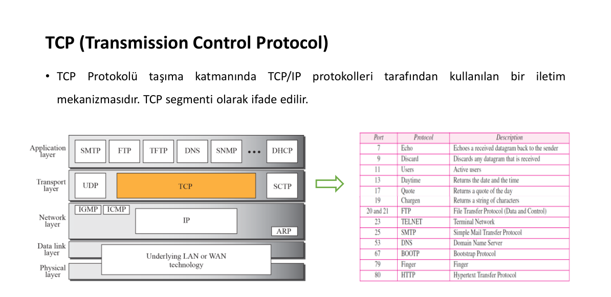
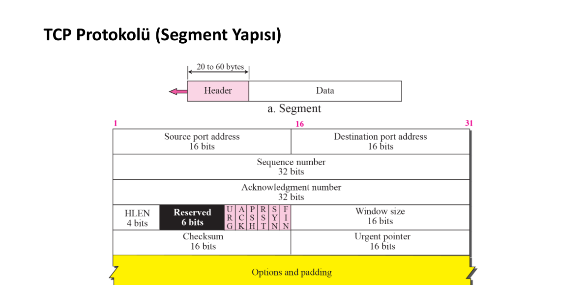
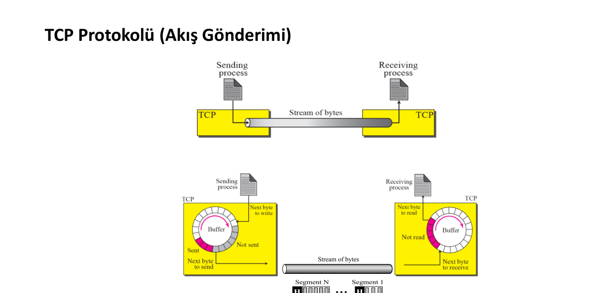
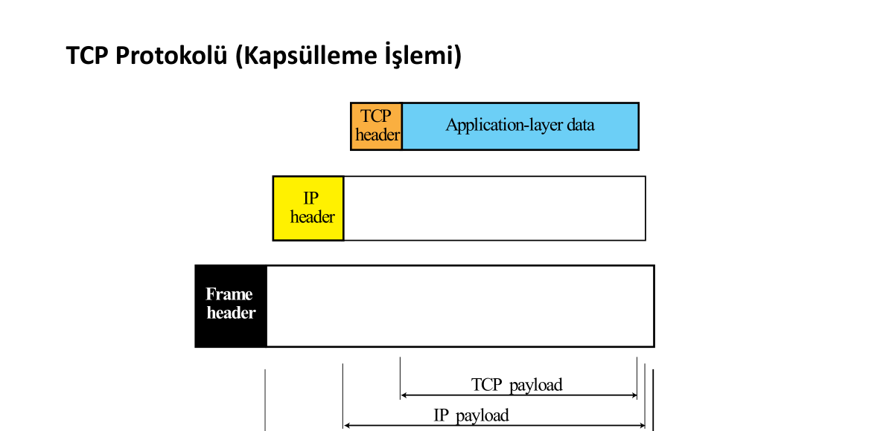

* **Slayt 3 (TCP Genel Bilgiler):**
  * **TCP (Transmission Control Protocol):** **Bağlantı yönelimlidir (Connection-oriented)** ve **güvenilirdir (Reliable)**.
  * Kaynak ve hedef arasında **sanal bir yol** oluşturur; bir mesaja ait tüm segmentler bu sanal yol üzerinden gönderilir.
  * **Hata kontrolü**, **akış kontrolü** ve **tıkanıklık kontrolü** mekanizmalarını barındırır.
  * Her bağlantıda aktarılan veri baytları **rastgele oluşturulmuş bir numara (ISN)** ile başlayarak TCP tarafından numaralandırılır:
    * **Sıra Numarası (`Sequence Number`):** O segmentte bulunan **ilk veri baytına** atanan sayıyı tanımlar.
    * **Onay Numarası (`Acknowledgment Number`):** Bir tarafın karşıdan **almayı beklediği bir sonraki bayt** sayısını tanımlar ve **kümülatif (birikimli)** bir değerdir.
* **Slayt 4 (İyi Bilinen TCP Port Numaraları Tablosu):**
  * `7`: Echo | `9`: Discard | `11`: Users | `13`: Daytime | `17`: Quote | `19`: Chargen
  * **`20 and 21`: FTP (Data and Control)** | **`23`: TELNET** | **`25`: SMTP** | **`53`: DNS** | **`67`: BOOTP** | `79`: Finger | **`80`: HTTP**
* **Slayt 5 (TCP Segment Başlığı = `20–60 Byte`):**
  * Sabit başlık **20 Byte**, opsiyonlarla (**0–40 Byte**) en fazla **60 Byte** olur.
  * **`HLEN` (4 bit):** Başlık uzunluğunu 4 baytlık kelimeler cinsinden tutar ($\text{HLEN} \in [5, 15] \Rightarrow 20\text{–}60\text{ Byte}$).
  * **6 Kontrol Bayrağı (6 bit):** `URG` (Acil işaretçi geçerli), `ACK` (Onay numarası geçerli), `PSH` (Tamponda bekletmeden aktar), `RST` (Bağlantıyı sıfırla), `SYN` (Sıra numaralarını senkronize et / bağlantı kur), `FIN` (Bağlantıyı sonlandır).
* **Slayt 6–7 (Akış Gönderimi ve Kapsülleme):** Gönderici ve alıcıda dairesel tamponlar (`Buffer`) bulunur. Uygulama verisi + `TCP header` = `TCP payload` $\rightarrow$ `IP header` eklendiğinde `IP payload` $\rightarrow$ `Frame header` eklendiğinde `Data-link layer payload` olur.

---

## 5.2. 3 Yollu El Sıkışma (3-Way Handshake): Kurulum, Veri Transferi ve Sonlandırma (PDF Sayfa 4–5, Slayt 8–10)
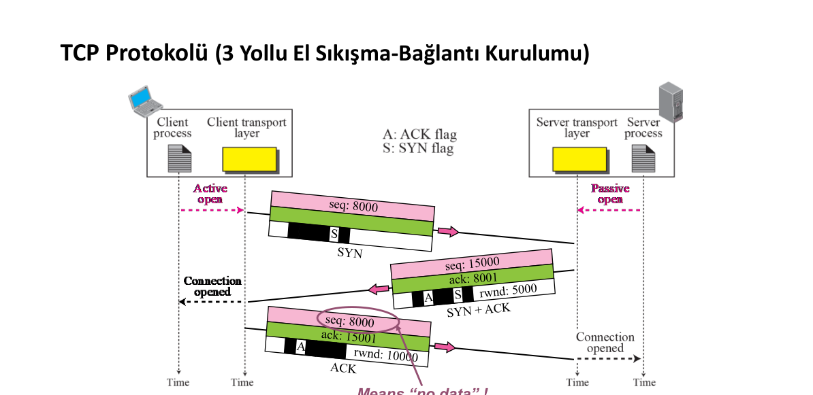
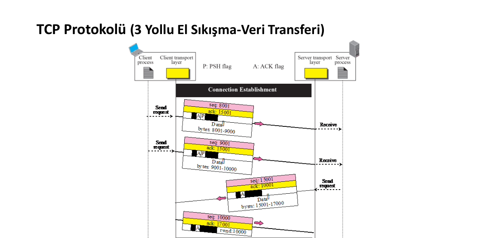
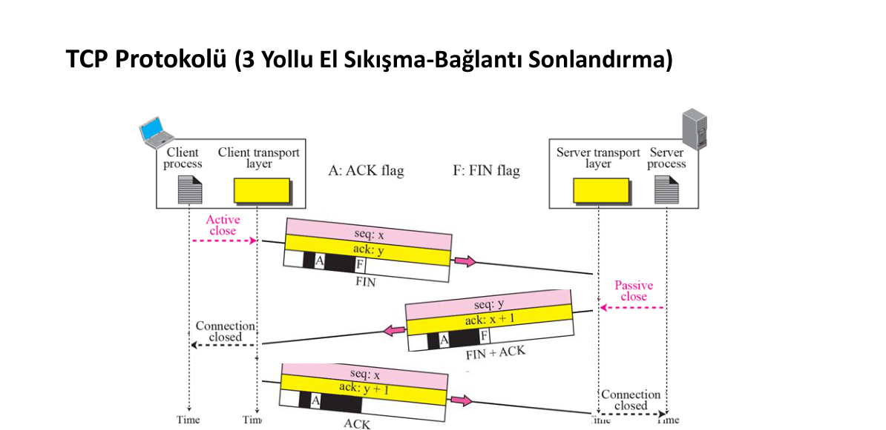

> [!IMPORTANT]
> **Sınavda `Seq` ve `Ack` Numarası Takibi Kuralları (Slayt 8, 9, 10):**
> * **1) Bağlantı Kurulumu (Slayt 8):**
>   * **Adım 1 (Client $\rightarrow$ Server):** `seq: 8000`, Bayrak: `SYN`. *(SYN segmenti veri taşımaz ama **1 sıra numarası tüketir!**)*
>   * **Adım 2 (Server $\rightarrow$ Client):** `seq: 15000`, `ack: 8001` ($8000 + 1$), Bayrak: `SYN + ACK`, `rwnd: 5000`.
>   * **Adım 3 (Client $\rightarrow$ Server):** `seq: 8000` *(Slayttaki not: `Means "no data"! seq: 8001 if piggybacking` — veri taşımayan saf ACK sıra numarası tüketmez!)*, `ack: 15001` ($15000 + 1$), Bayrak: `ACK`, `rwnd: 10000`.
> * **2) Veri Transferi (Slayt 9):**
>   * İstemci `seq: 8001, ack: 15001` ile `8001..9000` (1000B) ve `seq: 9001, ack: 15001` ile `9001..10000` (1000B) gönderir (`ACK + PSH`).
>   * Sunucu `seq: 15001, ack: 10001` ile hem 10000'e kadar olan baytları onaylar hem de kendi `15001..17000` (2000B) verisini gönderir.
>   * İstemci `seq: 10000, ack: 17001, rwnd: 10000` ile onaylar.
> * **3) Bağlantı Sonlandırma (Slayt 10):**
>   * İstemci `seq: x, ack: y` ile `FIN + ACK` gönderir $\rightarrow$ Sunucu `seq: y, ack: x + 1` ile `FIN + ACK` döner (*`FIN` bayrağı 1 sıra numarası tüketir*) $\rightarrow$ İstemci `seq: x, ack: y + 1` ile son `ACK` gönderir.

---

## 5.3. Zaman Çizelgesi, Durum Geçiş Şeması ve Bağlantı Red/İptal (`RST`) (PDF Sayfa 6–7, Slayt 11–13)
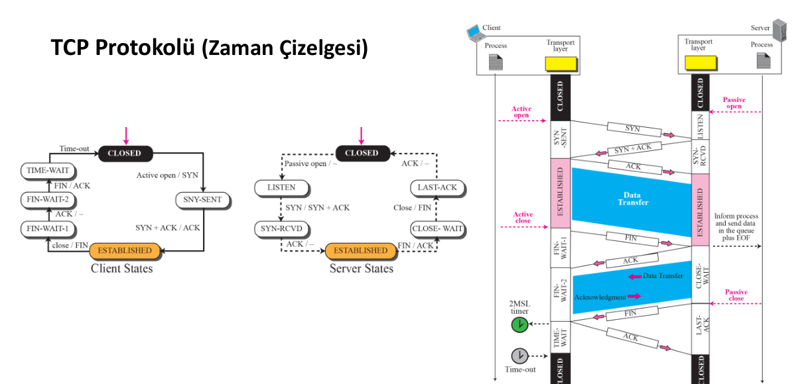
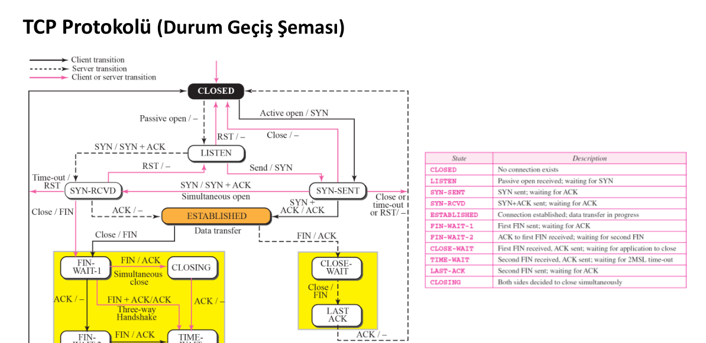
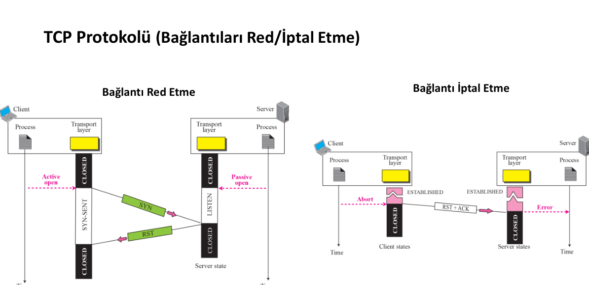

* **Slayt 11–12 (11 TCP Durumu ve Durum Geçiş Tablosu):**
  * `CLOSED`: Bağlantı yok.
  * `LISTEN`: Pasif açılış alındı; `SYN` bekleniyor.
  * `SYN-SENT`: `SYN` gönderildi; `ACK` bekleniyor.
  * `SYN-RCVD`: `SYN + ACK` gönderildi; `ACK` bekleniyor.
  * `ESTABLISHED`: Bağlantı kuruldu; veri aktarımı devam ediyor.
  * `FIN-WAIT-1`: İlk `FIN` gönderildi; `ACK` bekleniyor.
  * `FIN-WAIT-2`: İlk `FIN`'in `ACK` onayı alındı; karşıdan ikinci `FIN` bekleniyor.
  * `CLOSE-WAIT`: İlk `FIN` alındı, `ACK` gönderildi; uygulamanın bağlantıyı kapatması bekleniyor.
  * `TIME-WAIT`: İkinci `FIN` alındı, `ACK` gönderildi; **`2MSL` (Maksimum Segment Ömrünün 2 katı)** zaman aşımı bekleniyor.
  * `LAST-ACK`: İkinci `FIN` gönderildi; son `ACK` bekleniyor.
  * `CLOSING`: Her iki taraf aynı anda kapatmaya karar verdi (*Simultaneous close*).
* **Slayt 13 (Bağlantıları Red / İptal Etme — `RST`):**
  * **Bağlantı Red Etme (Sol Şema):** İstemci `SYN` gönderdiğinde sunucu portu kapalıysa sunucu **`RST`** göndererek bağlantıyı reddeder.
  * **Bağlantı İptal Etme (Sağ Şema):** `ESTABLISHED` durumundayken bir taraf normal `FIN` beklemek yerine **`RST + ACK`** göndererek bağlantıyı derhal sonlandırır (`Abort` $\rightarrow$ `CLOSED`).

---

## 5.4. Pencere Kavramı (`Send/Receive Window`) ve Akış Kontrolü (`rwnd`) (PDF Sayfa 7–8, Slayt 14–16)
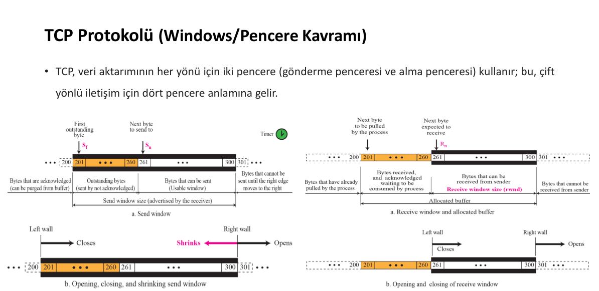
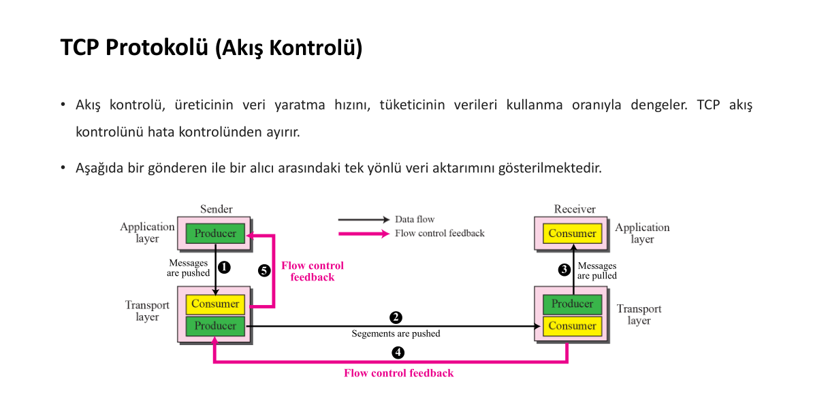
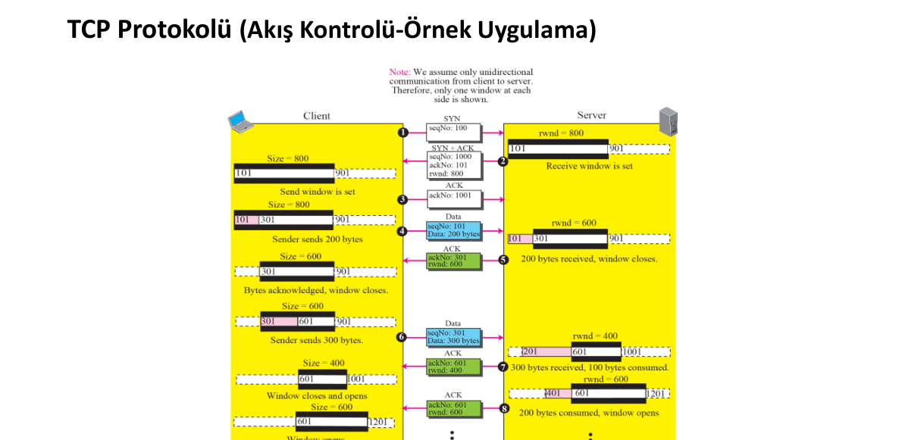

> [!TIP]
> **Pencere Duvarları ve Akış Kontrolü Sayısal Takibi (Slayt 14–16):**
> * **Slayt 14:** TCP çift yönlü iletişimde her yön için 2 (gönderme ve alma) olmak üzere **toplam 4 pencere** kullanır.
>   * **Pencere Kapanması (`Closing`):** Sol duvarın sağa hareket etmesi (gönderilen verilerin onaylanması / alınması).
>   * **Pencere Açılması (`Opening`):** Sağ duvarın sağa hareket etmesi (alıcı uygulamanın tampondan veri çekip boş yer açması).
>   * **Pencere Küçülmesi (`Shrinking`):** Sağ duvarın sola hareket etmesi (alıcı penceresinde izin verilmez).
> * **Slayt 16 (Örnek Uygulama Adım Adım `rwnd` Hesabı — Alıcı Tamponu = `800 Byte`):**
>   1. Bağlantı kurulurken sunucu `rwnd: 800` bildirir $\rightarrow$ İstemci penceresi `101..900` (`Size = 800`).
>   2. İstemci **`200 byte`** (`101..300`) gönderir $\rightarrow$ Sunucu tamponuna 200B girer, boş yer: $\text{rwnd} = 800 - 200 = \mathbf{600}$, `ackNo: 301` döner.
>   3. İstemci **`300 byte`** (`301..600`) gönderir $\rightarrow$ Sunucu 300B alır ve uygulama tampondan **100B okur (tüketir)** $\rightarrow$ Boş yer: $\text{rwnd} = 600 - 300 + 100 = \mathbf{400}$, `ackNo: 601` döner (`401..600` tamponda bekliyor).
>   4. Sunucu uygulaması kalan **200B'yi de okur** $\rightarrow$ Tampon tamamen boşalır, sunucu `ackNo: 601, rwnd: 800` göndererek pencereyi tekrar 800 bayta (`601..1400`) açar!

---

## 5.5. TCP Hata Kontrolü: ARQ Yöntemleri ve 4 Kayıp Senaryosu (PDF Sayfa 9–12, Slayt 17–24)
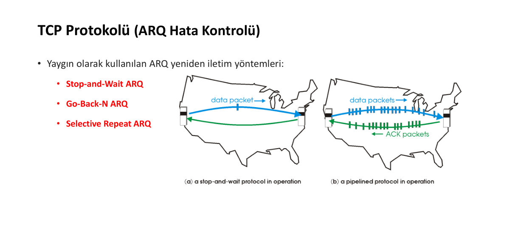
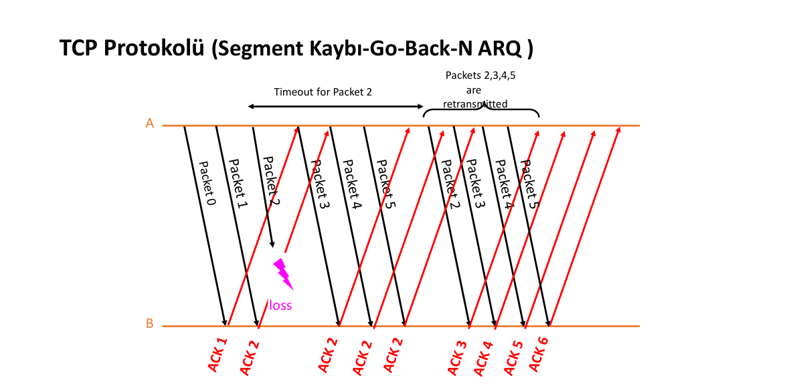
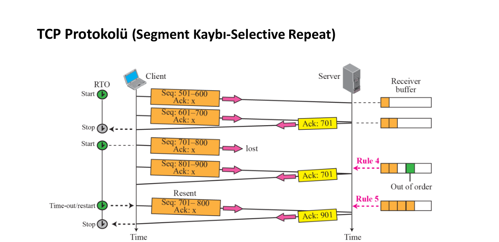
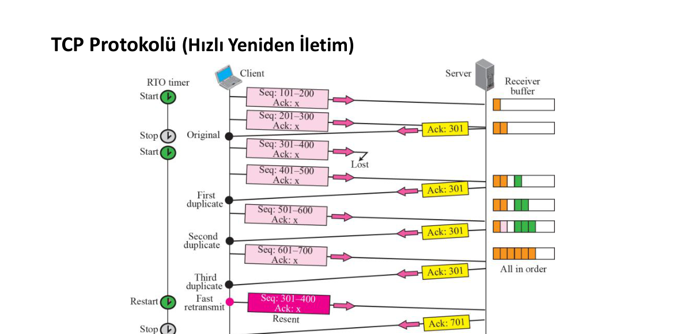
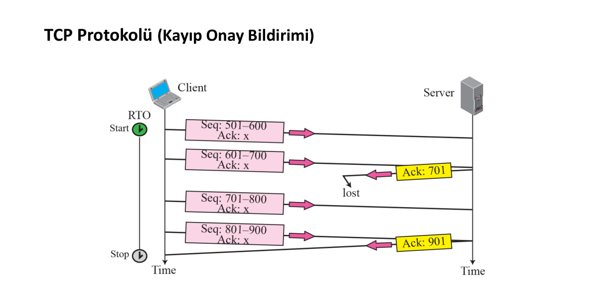
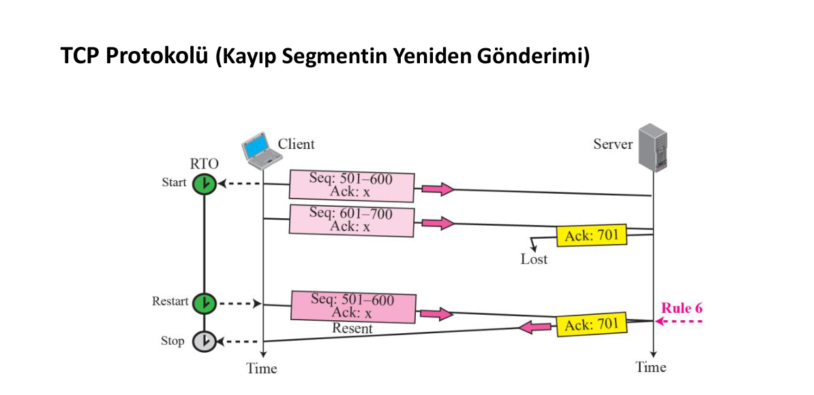

* **Slayt 17–18 (Hata Denetimi ve ARQ):**
  * TCP'de hata denetimi **3 araç** ile sağlanır: **1) Checksum**, **2) Onay (`ACK`)**, **3) Zaman aşımı (`Timeout`)**.
  * Kaybolan veya bozulan paketlerin sezimi ve yeniden iletimi **ARQ (*Automatic Repeat Request*)** olarak adlandırılır: **Stop-and-Wait ARQ**, **Go-Back-N ARQ**, **Selective Repeat ARQ**.
* **Slayt 19–24 (4 Temel Hata Senaryosu):**
  1. **Segment Kaybı (`Go-Back-N` vs `Selective Repeat` — Slayt 20–21):**
     * **Go-Back-N (Slayt 20):** `Packet 2` kaybolduğunda, arkadan gelen `Packet 3, 4, 5` alıcı tarafından atılır ve alıcı sürekli `ACK 2` döner. `Packet 2` için zaman aşımı (`Timeout`) oluştuğunda gönderici **`Packets 2, 3, 4, 5`'in tamamını** baştan gönderir.
     * **Selective Repeat (Slayt 21):** `Seq: 701–800` kaybolduğunda, arkadan gelen `Seq: 801–900` atılmaz; alıcı tamponda **sırasız (*Out of order*)** olarak saklanır ve `Ack: 701` gönderilir. `RTO` süresi dolunca **yalnızca kaybolan `Seq: 701–800`** yeniden gönderilir; alıcı iki parçayı birleştirip kümülatif **`Ack: 901`** döner.
  2. **Hızlı Yeniden İletim (`Fast Retransmit` — Slayt 22):**
     * `Seq: 301–400` kaybolduğunda, arkadan gelen `401–500`, `501–600`, `601–700` segmentlerinin her biri için alıcı `Ack: 301` gönderir.
     * Gönderici `RTO` zamanlayıcısının dolmasını beklemeden **3 adet yinelenen onay (`First, Second, Third duplicate ACK = 301`)** alır almaz `Seq: 301–400` segmentini anında yeniden gönderir (`Fast retransmit`)!
  3. **Kayıp Onay Bildirimi (`Lost ACK` — Slayt 23):**
     * `Ack: 701` yolda kaybolsa bile, bir sonraki segmentin onayı olan **`Ack: 901`** kümülatif olduğu için gönderici `501–700` aralığının da ulaştığını anlar ve yeniden iletim yapmaz!
  4. **Kayıp Onay Sonrası Yeniden Gönderim (Slayt 24):**
     * `Ack: 701` kaybolur ve arkadan başka onay gelmeden `RTO` süresi dolarsa, gönderici `Seq: 501–600`'ü tekrar gönderir; alıcı bu baytları zaten aldığı için segmenti atar (**Rule 6**) ve tekrar `Ack: 701` gönderir.

---
## 5.6. Hafta 4 Değerlendirme Soruları (20 Soru & Çözümleri)

### Soru 1: TCP Süreçten Sürece İletişim ve Port Kavramı
**Soru:** Taşıma katmanında TCP protokolünün aynı bilgisayar üzerinde çalışan farklı uygulama süreçlerini (process) birbirinden ayırt etmek için kullandığı adresleme bilgisi nedir?  
- A) MAC Adresi (48 bit)  
- B) IP Adresi (32 bit)  
- C) Port Numarası (16 bit)  
- D) Sekans Numarası (32 bit)  

<details>
<summary><b>💡 Çözümü ve Açıklamayı Gör</b></summary>

**Doğru Cevap: C**  
**Açıklama (Hafta 4 PDF Sayfa 2, Slayt 3):** IP adresi bilgisayarı (host), Port numarası ise o bilgisayar içinde çalışan spesifik uygulama sürecini (process-to-process) tanımlar.
</details>

---

### Soru 2: İyi Bilinen TCP Port Eşleştirmesi
**Soru:** Slayt 4'te verilen iyi bilinen TCP port numaralarından FTP Data, FTP Control, TELNET ve HTTP için port numaraları sırasıyla hangileridir?  
- A) 20, 21, 23, 80  
- B) 21, 20, 25, 80  
- C) 20, 21, 53, 443  
- D) 23, 25, 80, 110  

<details>
<summary><b>💡 Çözümü ve Açıklamayı Gör</b></summary>

**Doğru Cevap: A**  
**Açıklama (Hafta 4 Slayt 4):**
* `20`: FTP Data
* `21`: FTP Control
* `23`: TELNET
* `25`: SMTP
* `53`: DNS
* `80`: HTTP
</details>

---

### Soru 3: Soket Adresi ve TCP 4-Tuple
**Soru:** Bir TCP bağlantısını küresel internet üzerinde benzersiz (unique) olarak tanımlayan 4'lü demet (4-tuple) hangi bileşenlerden oluşur?  
- A) Kaynak MAC, Hedef MAC, Tip, CRC  
- B) Kaynak IP, Kaynak Port, Hedef IP, Hedef Port  
- C) Sekans No, Ack No, Window Size, Checksum  
- D) İstemci IP, Sunucu IP, URL, Protokol  

<details>
<summary><b>💡 Çözümü ve Açıklamayı Gör</b></summary>

**Doğru Cevap: B**  
**Açıklama (Hafta 4 Slayt 5):** $\text{Soket Adresi} = \text{IP Adresi} + \text{Port Numarası}$'dır. Çift yönlü bir TCP oturumu **Kaynak IP, Kaynak Port, Hedef IP, Hedef Port** kombinasyonu ile tekilleştirilir.
</details>

---

### Soru 4: Sıra Numarası ve Kümülatif Onay Mantığı
**Soru:** TCP segment başlığındaki Sıra Numarası (Sequence Number) ile Onay Numarası (Acknowledgment Number) alanları neyi ifade eder?  
- A) Seq: Paket sırasını (1, 2, 3); Ack: Toplam paket sayısını  
- B) Seq: O segmentteki ilk veri baytının numarasını; Ack: Karşı taraftan alınması beklenen bir sonraki baytın numarasını (kümülatif)  
- C) Seq: Port numarasını; Ack: Pencere boyutunu  
- D) Seq: Gönderilen bayt sayısını; Ack: Alınan son baytın numarasını  

<details>
<summary><b>💡 Çözümü ve Açıklamayı Gör</b></summary>

**Doğru Cevap: B**  
**Açıklama (Hafta 4 Slayt 3 & 5):** TCP bayt akışı tabanlıdır. `Seq` segmentteki ilk baytın numarasıdır. `Ack` ise karşı tarafa "bu numaraya kadar olan tüm baytları eksiksiz aldım, şimdi senden bu numaralı baytı bekliyorum" mesajını iletir (**kümülatif onay**).
</details>

---

### Soru 5: TCP Başlık Boyutu ve HLEN Alanı
**Soru:** Bir TCP segment başlığında HLEN (Header Length) alanı `1000` (ikili) yani ondalık `8` değerini taşımaktadır. Bu TCP başlığının toplam boyutu kaç bayttır ve kaç bayt opsiyon içermektedir?  
- A) Toplam 32 bayt başlık, 12 bayt opsiyon  
- B) Toplam 20 bayt başlık, opsiyon yok  
- C) Toplam 8 bayt başlık, opsiyon yok  
- D) Toplam 40 bayt başlık, 20 bayt opsiyon  

<details>
<summary><b>💡 Çözümü ve Açıklamayı Gör</b></summary>

**Doğru Cevap: A**  
**Açıklama (Hafta 4 Slayt 5 & 7):** HLEN alanı 4 baytlık kelimeleri sayar. $\text{Başlık Boyutu} = 8 \times 4 = \mathbf{32\text{ Bayt}}$. Sabit başlık 20 bayt olduğuna göre opsiyon boyutu: $32 - 20 = \mathbf{12\text{ Bayt}}$ olur.
</details>

---

### Soru 6: TCP Kontrol Bayrakları (Flags)
**Soru:** Bir TCP segmentinde `RST` bayrağının `1` olması ile `PSH` bayrağının `1` olması sırasıyla ne anlama gelir?  
- A) Bağlantı kuruluyor; acil veri taşınıyor  
- B) Bağlantı derhal sıfırlanıyor/kapatılıyor; veri tamponda bekletilmeden doğrudan uygulama katmanına iletiliyor  
- C) Bağlantı sonlandırılıyor; pencere boyutu sıfırlanıyor  
- D) Sıra numaraları eşitleniyor; paket düşürülüyor  

<details>
<summary><b>💡 Çözümü ve Açıklamayı Gör</b></summary>

**Doğru Cevap: B**  
**Açıklama (Hafta 4 Slayt 8):**
* `RST (Reset)`: Bağlantıyı anormal şekilde derhal sonlandırır veya reddeder.
* `PSH (Push)`: Alıcı TCP'ye tamponun dolmasını beklemeden gelen baytları anında tüketici uygulamaya iletmesini söyler.
</details>

---

### Soru 7: TCP Checksum ve Sözde Başlık (Pseudoheader)
**Soru:** TCP başlığındaki Checksum hesaplanırken segment verilerine ek olarak neden IP katmanından 12 baytlık "Sözde Başlık" (Pseudoheader) eklenir?  
- A) IP başlığı şifreli olduğu için  
- B) Paketin yanlış bir IP adresine veya yanlış bir protokole teslim edilmediğini garanti altına almak için  
- C) TCP başlığını 64 bayta tamamlamak için  
- D) Yönlendiricilerin TCP paketlerini okumasını hızlandırmak için  

<details>
<summary><b>💡 Çözümü ve Açıklamayı Gör</b></summary>

**Doğru Cevap: B**  
**Açıklama (Hafta 4 Slayt 9):** Sözde başlık Kaynak IP, Hedef IP, Protokol (6) ve TCP Uzunluk bilgilerini içerir. Böylece IP katmanında hedef IP veya protokol alanı bozulmuş bir paket alıcı TCP tarafından tespit edilip düşürülür.
</details>

---

### Soru 8: 3 Yollu El Sıkışmada Sıra Numarası Tüketimi
**Soru:** İstemci sunucuya bağlantı açmak için `seq: 8000, SYN` segmenti gönderdiğinde; bu SYN segmenti herhangi bir veri taşımadığı halde sunucunun döneceği `ack` numarası neden `8001` olur?  
- A) TCP'de tüm baytlar 1'den başladığı için  
- B) `SYN` kontrol bayrağı, bağlantı kurulumunu garanti etmek ve sahte paketleri önlemek için mantıksal olarak **1 sıra numarası tüketir**  
- C) Sunucu istemcinin sekans numarasını beğenmediği için  
- D) Hata kontrolü için 1 eklenir  

<details>
<summary><b>💡 Çözümü ve Açıklamayı Gör</b></summary>

**Doğru Cevap: B**  
**Açıklama (Hafta 4 Slayt 8 & 10):** Kural: Veri taşımayan `SYN` ve `FIN` segmentleri mantıksal olarak **1 sıra numarası tüketir**. Bu yüzden sunucu $8000 + 1 = \mathbf{8001}$ numaralı baytı onaylar.
</details>

---

### Soru 9: Saf ACK Segmentinin Sıra Numarası Tüketimi
**Soru:** 3 Yollu El Sıkışmanın 3. adımında istemcinin sunucuya gönderdiği veri içermeyen saf `ACK` segmenti sıra numarası tüketir mi?  
- A) Evet, 1 sıra numarası tüketir  
- B) Hayır; veri taşımayan saf ACK segmentleri sıra numarası **tüketmez**  
- C) Evet, pencere boyutu kadar tüketir  
- D) Yalnızca bağlantı kapanırken tüketir  

<details>
<summary><b>💡 Çözümü ve Açıklamayı Gör</b></summary>

**Doğru Cevap: B**  
**Açıklama (Hafta 4 Slayt 8):** Slayt 8'deki alt notta açıkça belirtilmiştir: `Means "no data"! seq: 8001 if piggybacking`. Veri taşımayan saf ACK segmentleri sıra numarası tüketmez; bir sonraki veri paketi yine aynı sıra numarasıyla başlar.
</details>

---

### Soru 10: Piggybacking (Sırtlama) Tekniği
**Soru:** TCP veri transferinde "Piggybacking" (Sırtlama) kavramı neyi ifade eder?  
- A) Bir paketin arkasına birden fazla IP başlığı eklenmesi  
- B) Alınan verilere ait onay numarasının (ACK), karşı tarafa gönderilecek veri segmentinin içine yerleştirilerek tek bir segment halinde iletilmesi  
- C) Verilerin sıkıştırılarak gönderilmesi  
- D) Ağ kartının çift yönlü çalışması  

<details>
<summary><b>💡 Çözümü ve Açıklamayı Gör</b></summary>

**Doğru Cevap: B**  
**Açıklama (Hafta 4 Slayt 9):** Sunucu istemciden veri aldığında ayrı bir boş ACK segmenti göndermek yerine, istemciye göndereceği kendi veri segmentinin `Acknowledgment Number` alanına bu onayı iliştirir. Buna sırtlama (piggybacking) denir ve ağ trafiğini azaltır.
</details>

---

### Soru 11: TCP Yarım Kapanma (Half-Close)
**Soru:** TCP bağlantı sonlandırma sürecinde "Yarım Kapanma" (Half-Close) durumu oluştuğunda ne gerçekleşir?  
- A) Bağlantı her iki taraf için de anında kopar  
- B) İstemci `FIN` göndererek kendi gönderme yönünü kapatır ancak sunucu elindeki verileri istemciye göndermeye devam edebilir; istemci bu verileri almaya devam eder  
- C) Sadece sunucu veri gönderebilir, istemci çöker  
- D) Paketler UDP üzerinden iletilir  

<details>
<summary><b>💡 Çözümü ve Açıklamayı Gör</b></summary>

**Doğru Cevap: B**  
**Açıklama (Hafta 4 Slayt 10 & 14):** TCP çift yönlüdür. Bir tarafın veri gönderimi bitince `FIN` yollar (`FIN-WAIT-1`). Karşı taraf `ACK` döner (`CLOSE-WAIT`). Bu durumda istemci artık veri gönderemez ama karşı tarafın göndereceği verileri `FIN` gelene kadar kabul etmeye devam eder.
</details>

---

### Soru 12: Durum Geçiş Şeması: LISTEN $\rightarrow$ SYN-RCVD
**Soru:** Sunucu tarafında `LISTEN` durumunda bekleyen bir TCP soketi istemciden bir `SYN` paketi aldığında `SYN + ACK` göndererek hangi bağlantı durumuna geçer?  
- A) `ESTABLISHED`  
- B) `SYN-SENT`  
- C) `SYN-RCVD`  
- D) `CLOSE-WAIT`  

<details>
<summary><b>💡 Çözümü ve Açıklamayı Gör</b></summary>

**Doğru Cevap: C**  
**Açıklama (Hafta 4 Slayt 11 & 12):** Sunucu pasif dinlemedeyken (`LISTEN`) gelen `SYN` isteğini kabul edip `SYN+ACK` yolladığında **`SYN-RCVD`** durumuna geçer. İstemciden son `ACK` geldiğinde ise **`ESTABLISHED`** olur.
</details>

---

### Soru 13: `TIME-WAIT` Durumu ve `2MSL` Bekleme Süresi
**Soru:** Aktif kapatma yapan taraf (Client) son `ACK` paketini gönderdikten sonra neden hemen `CLOSED` durumuna geçmez ve `TIME-WAIT` durumunda `2MSL` (Maximum Segment Lifetime'ın 2 katı) kadar bekler?  
- A) İşletim sistemi belleğini temizlemek için  
- B) Gönderdiği son ACK kaybolursa sunucunun yeniden ileteceği FIN paketini alıp tekrar ACK dönebilmek ve ağda geciken eski paketlerin yeni açılacak bağlantıya karışmasını önlemek için  
- C) Sunucunun onay vermesini beklemek için  
- D) DNS önbelleğini boşaltmak için  

<details>
<summary><b>💡 Çözümü ve Açıklamayı Gör</b></summary>

**Doğru Cevap: B**  
**Açıklama (Hafta 4 Slayt 11, 12, 16):** Eğer son ACK yolda kaybolursa sunucu `LAST-ACK` durumunda takılı kalır ve FIN'i tekrar yollar. İstemci `2MSL` (genelde 1-2 dakika) boyunca `TIME-WAIT`'te bekleyerek bu FIN'i yakalar ve yeniden ACK göndererek sunucunun temiz kapanmasını sağlar.
</details>

---

### Soru 14: Kapalı Porta Bağlantı İsteği ve `RST`
**Soru:** Bir istemci, üzerinde herhangi bir sunucu uygulamasının dinleme yapmadığı kapalı bir porta `SYN` paketi gönderdiğinde hedef işletim sistemi nasıl yanıt verir?  
- A) Paketi sessizce düşürür  
- B) `RST` (Reset) bayraklı bir segment göndererek bağlantı isteğini derhal reddeder  
- C) `FIN` paketi gönderir  
- D) Portu otomatik olarak açar  

<details>
<summary><b>💡 Çözümü ve Açıklamayı Gör</b></summary>

**Doğru Cevap: B**  
**Açıklama (Hafta 4 Slayt 13):** Slayt 13'teki "Bağlantı Red Etme" şemasına göre port kapalıysa sunucu TCP katmanı istemciye **`RST`** paketi döndürerek portun kapalı olduğunu ve bağlantının reddedildiğini bildirir.
</details>

---

### Soru 15: TCP'de Çift Yönlü İletişim ve Pencere Sayısı
**Soru:** Çift yönlü (full-duplex) çalışan bir TCP bağlantısında her iki tarafın veri alışverişini yönetmek için toplam kaç adet pencere (window) yapısı kullanılır?  
- A) 1  
- B) 2  
- C) 4 (Her iki taraf için 1 Gönderme ve 1 Alma penceresi)  
- D) 8  

<details>
<summary><b>💡 Çözümü ve Açıklamayı Gör</b></summary>

**Doğru Cevap: C**  
**Açıklama (Hafta 4 Slayt 14):** Slayt 14: *"TCP, veri aktarımının her yönü için iki pencere (gönderme penceresi ve alma penceresi) kullanır; bu, çift yönlü iletişim için dört pencere anlamına gelir."*
</details>

---

### Soru 16: Alıcı Penceresi (`rwnd`) Hesaplama Formülü
**Soru:** TCP akış kontrolünde alıcının göndericiye bildirdiği Alıcı Penceresi boyutu (`rwnd`) hangi formülle hesaplanır?  
- A) $\text{rwnd} = \text{MSS} \times 2$  
- B) $\text{rwnd} = \text{Toplam Tampon Boyutu} - \text{Tamponda Tüketilmeyi Bekleyen (Okunmamış) Veri Miktarı}$  
- C) $\text{rwnd} = \text{Sekans No} + \text{Ack No}$  
- D) $\text{rwnd} = \text{Bant Genişliği} \times \text{RTT}$  

<details>
<summary><b>💡 Çözümü ve Açıklamayı Gör</b></summary>

**Doğru Cevap: B**  
**Açıklama (Hafta 4 Slayt 14, 15, 16):** Alıcı tamponundaki boş alan göndericiye bildirilir. Boş alan kalmadığında $\text{rwnd} = 0$ olur ve gönderici veri göndermeyi durdurur (kilitlenme engellenir).
</details>

---

### Soru 17: Sayısal Akış Kontrolü Örneği
**Soru (Slayt 16 Örneği):** Alıcı tamponu 800 bayt olarak belirlenmiştir. İstemci 200 bayt veri gönderir. Alıcı bu 200 baytı tamponuna alır fakat alıcı uygulama tampondan **hiçbir veri okumamıştır**. Alıcının göndereceği onay segmentindeki yeni `rwnd` değeri kaç bayttır?  
- A) 800 Bayt  
- B) 600 Bayt  
- C) 400 Bayt  
- D) 0 Bayt  

<details>
<summary><b>💡 Çözümü ve Açıklamayı Gör</b></summary>

**Doğru Cevap: B**  
**Açıklama (Hafta 4 Slayt 16):**
$$\text{Yeni rwnd} = \text{Toplam Tampon (800)} - \text{Bekleyen Veri (200)} = \mathbf{600\text{ Bayt}}$$
Alıcı `ackNo: 201, rwnd: 600` döner.
</details>

---

### Soru 18: Go-Back-N ile Selective Repeat ARQ Ayrımı
**Soru:** Hata kontrolünde `Go-Back-N ARQ` ile `Selective Repeat ARQ` yöntemleri arasındaki en belirgin fark nedir?  
- A) Go-Back-N TCP'de hiç kullanılmaz  
- B) Go-Back-N'de kaybolan paketten sonra gelen sağlam paketler de atılır ve hepsi baştan gönderilir; Selective Repeat'te ise gelen sağlam paketler alıcı tamponda tutulur ve yalnızca kaybolan paket yeniden iletilir  
- C) Selective Repeat onay numarası kullanmaz  
- D) Go-Back-N daha hızlıdır  

<details>
<summary><b>💡 Çözümü ve Açıklamayı Gör</b></summary>

**Doğru Cevap: B**  
**Açıklama (Hafta 4 Slayt 20 & 21):**
* **Go-Back-N (Slayt 20):** Paket 2 kaybolunca sonraki 3, 4, 5 paketleri atılır; zaman aşımında 2, 3, 4, 5 hepsi tekrar yollanır.
* **Selective Repeat (Slayt 21):** Paket kaybolunca sonrakiler sırasız (out of order) tamponlanır; zaman aşımında yalnızca kaybolan paket yeniden yollanır.
</details>

---

### Soru 19: Hızlı Yeniden İletim (Fast Retransmit) Kuralı
**Soru:** TCP'de "Hızlı Yeniden İletim" (Fast Retransmit) mekanizması, RTO zamanlayıcısının süresinin dolmasını beklemeden kayıp segmenti yeniden göndermek için hangi olayın gerçekleşmesini şart koşar?  
- A) Sunucudan RST paketi gelmesi  
- B) Göndericinin arka arkaya **3 adet yinelenen onay (3 Duplicate ACKs)** alması  
- C) Alıcı penceresinin sıfırlanması  
- D) RTT süresinin 1 saniyeyi aşması  

<details>
<summary><b>💡 Çözümü ve Açıklamayı Gör</b></summary>

**Doğru Cevap: B**  
**Açıklama (Hafta 4 Slayt 22):** Alıcı aradaki bir paket kaybolduğunda, sonraki gelen her segment için eksik olan ilk baytı isteyen mükerrer ACK yollar. Gönderici **3 adet yinelenen ACK** aldığında paketin yolda kaybolduğunu kesinleştirir ve zamanlayıcıyı beklemeden paketi anında yeniden basar (**Fast Retransmit**).
</details>

---

### Soru 20: Kayıp Onay (Lost ACK) Durumu
**Soru:** Gönderici 501–700 aralığını göndermiş ve alıcı `Ack: 701` üretmiştir ancak bu onay paketi yolda kaybolmuştur. Hemen ardından alıcı 701–900 segmentini de alıp `Ack: 901` gönderdiğinde gönderici tarafında neden yeniden iletim (retransmit) yapılmaz?  
- A) Alıcı bağlantıyı kapattığı için  
- B) TCP onay numaraları **kümülatif (birikimli)** olduğu için; `Ack: 901` onayı 900'e kadar olan tüm önceki baytların da eksiksiz alındığını garanti eder  
- C) Gönderici kaybolan onayı önemsemediği için  
- D) Çekirdek seviyesinde bayrak silindiği için  

<details>
<summary><b>💡 Çözümü ve Açıklamayı Gör</b></summary>

**Doğru Cevap: B**  
**Açıklama (Hafta 4 Slayt 23):** Kümülatif onay özelliği sayesinde aradaki münferit bir ACK paketi düşse dahi, arkasından gelen daha büyük numaralı bir ACK paketi önceki tüm baytların başarıyla ulaştığını doğrulamış olur.
</details>

---

# 6. Ders (Bölüm 2): Hafta 4 – Katman 4: TCP Tıkanıklık Kontrolü, 4 Zamanlayıcı, RTT/RTO Hesabı, Opsiyonlar ve UDP
**Kaynak Sunum:** `Hafta-4 Katman 4 Protokolleri.pdf` *(PDF Sayfa 13–22, Slayt 25–44)*

---

## 6.7. TCP Yeniden İletim Zamanlayıcısı (Retransmission Timer) ve RTO Temelleri (PDF Sayfa 13, Slayt 25)
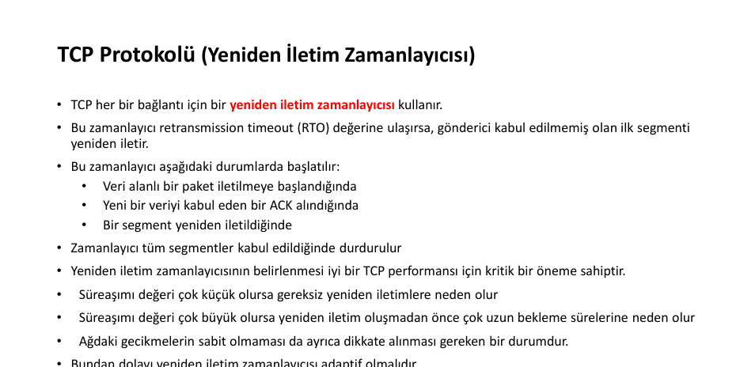

* **RTO (Retransmission Time-Out) Tanımı:** TCP, her bir bağlantı için bir yeniden iletim zamanlayıcısı kullanır. Bu sayaç RTO değerine ulaştığında gönderici, karşıdan onayı (`ACK`) gelmemiş olan ilk segmenti kayıp kabul eder ve yeniden iletir.
* **Zamanlayıcının Başlatılma ve Durdurulma Kuralları (Slayt 25):**
  * **Sayaç Başlatılır:**
    1. Veri içeren bir segment kabloya iletilmeye başlandığında.
    2. Yeni bir veriyi kabul eden bir ACK segmenti alındığında.
    3. Kayıp bir segment yeniden iletildiğinde.
  * **Sayaç Durdurulur:** İletilmiş olan tüm segmentlerin onayı (`ACK`) eksiksiz alındığında.
* **RTO'nun Adaptif Olma Zorunluluğu (Sınavın Altın Kuralı):**
  * Süre aşımı değeri **çok küçük** olursa: Ağdaki normal gecikmeler kayıp zannedilir ve gereksiz yeniden iletimler yapılarak ağ gereksiz tıkanır.
  * Süre aşımı değeri **çok büyük** olursa: Gerçek paket kayıplarında sistem yeniden iletim yapmadan önce çok uzun süre bekler ve bağlantı aşırı yavaşlar.
  * Bu nedenle TCP'de RTO süresi statik olamaz; ağın anlık gecikmesine göre dinamik (**adaptif**) olarak hesaplanır.

---

## 6.8. TCP Sıkışıklık Kontrolü (Congestion Control) ve Algoritmalar (PDF Sayfa 13–14, Slayt 26–27)
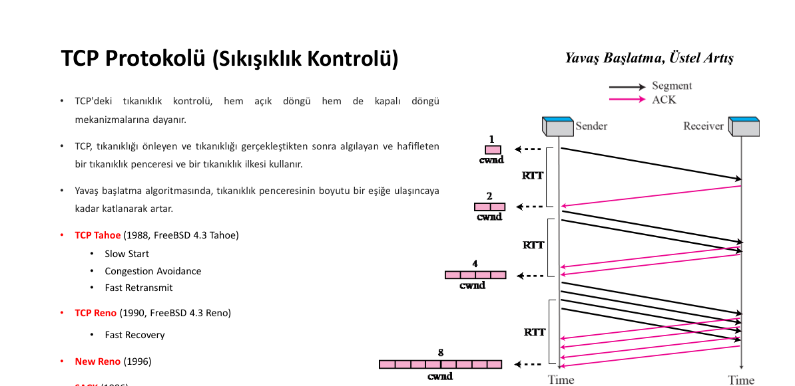
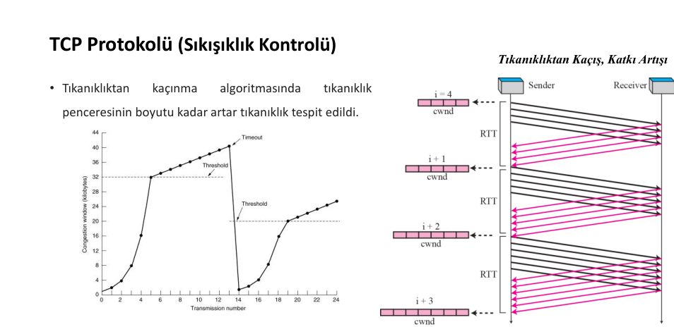

* **Akış Kontrolü vs Sıkışıklık Kontrolü Farkı:**
  * **Akış Kontrolü (`rwnd`):** Alıcının tamponunun taşmasını engeller (Alıcı odaklı).
  * **Sıkışıklık Kontrolü (`cwnd`):** Ağdaki yönlendirici (Router) kuyruklarının taşmasını engeller (Ağ odaklı).
  * **Gerçek Gönderim Penceresi:** $\mathbf{\text{Pencere Boyutu} = \min(\text{cwnd}, \text{rwnd})}$.
* **1) Yavaş Başlatma (Slow Start) – Üstel Artış (Slayt 26):**
  * Bağlantı ilk kurulduğunda $\text{cwnd} = 1\text{ MSS}$ (Maksimum Segment Boyutu) ile başlar.
  * Alınan her geçerli ACK için $\text{cwnd}$ değeri 1 MSS artırılır.
  * Bu durum her gidiş-dönüşte (RTT) pencerenin **2 katına çıkması** anlamına gelir: $\mathbf{1 \rightarrow 2 \rightarrow 4 \rightarrow 8 \rightarrow 16...}$ (**Üstel Artış**).
* **2) Tıkanıklıktan Kaçınma (Congestion Avoidance) – Katkı Artışı (Slayt 27):**
  * cwnd değeri belirlenen eşik değerine (**Threshold / `ssthresh`**, örneğin 32 KB) ulaştığında üstel artış durur.
  * Bu aşamadan sonra her RTT döngüsünde pencere yalnızca **+1 MSS** kadar artırılır: $\mathbf{32 \rightarrow 33 \rightarrow 34 \rightarrow 35...}$ (**Katkı Artışı / Doğrusal Artış**).
* **3) Tıkanıklık Algılandığında Ne Yapılır? (Slayt 26–27):**
  * **Zaman Aşımı (Timeout) Olduğunda (Tahoe Mantığı):**
    * Yeni Eşik Değeri: $\mathbf{\text{ssthresh} = \text{Mevcut cwnd} / 2}$ yapılır (Grafikte $40 \div 2 = 20$).
    * Tıkanıklık penceresi sıfırlanır: $\mathbf{\text{cwnd} = 1\text{ MSS}}$'e düşürülür ve tekrar Yavaş Başlatma ile yeni eşiğe (20) kadar üstel büyütülür.
  * **3 Yinelenen ACK (Fast Retransmit & Fast Recovery - Reno Mantığı):**
    * Paket hala akıyordur (hafif tıkanıklık). Bu yüzden Reno'da cwnd 1'e düşürülmez; $\text{ssthresh} = \text{cwnd} / 2$ yapılır ve doğrudan $\text{cwnd} = \text{ssthresh}$ seviyesinden katkı artışına devam edilir (**Fast Recovery**).

---

## 6.9. TCP'nin 4 Temel Zamanlayıcısı (4 Timers) (PDF Sayfa 14–16, Slayt 28–32)
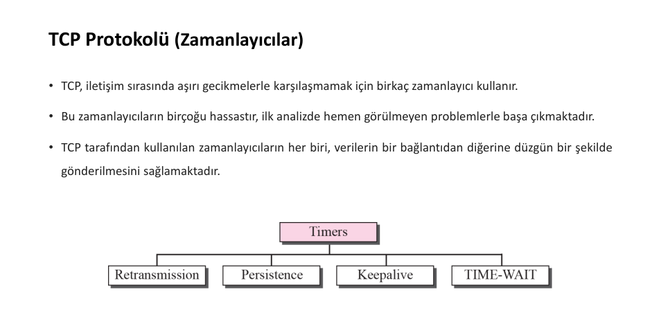
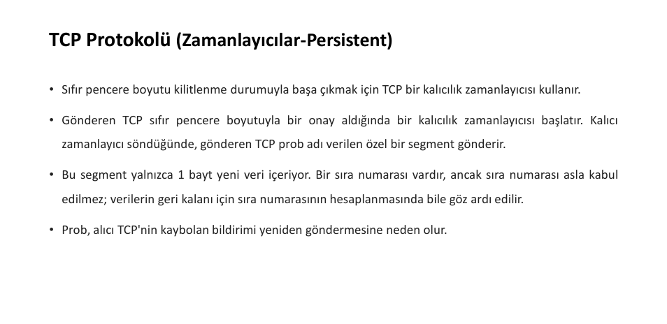
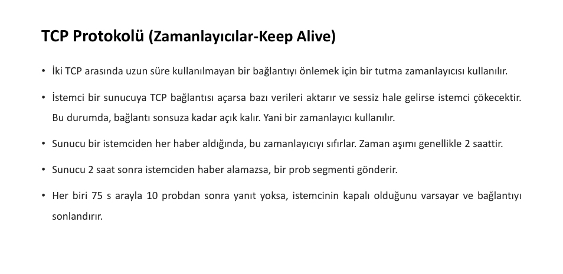


| Zamanlayıcı No | Zamanlayıcı Adı | Slayt No | Görevi ve Çalışma Prensibi (Sınav Tanımları) |
| :---: | :--- | :---: | :--- |
| **1** | **Retransmission Timer** | Slayt 29 | Gönderilen segmentlerin kaybolma ihtimaline karşı RTO süresini sayar. Süre biterse segment yeniden iletilir. |
| **2** | **Persistence Timer** *(Kalıcılık / Israr)* | Slayt 30 | **Sıfır Pencere Kilitlenmesi (Deadlock) Çözümü:** Alıcı `rwnd = 0` bildirdikten sonra pencereyi açan yeni `ACK (rwnd > 0)` gönderse ve bu onay yolda kaybolsa iki taraf sonsuza kadar kilitlenir. Gönderici bu zamanlayıcı dolunca **1 baytlık özel Prob (Sonda) segmenti** yollar; alıcı güncel `rwnd` değerini tekrar göndermek zorunda kalır. |
| **3** | **Keepalive Timer** *(Canlı Tutma)* | Slayt 31 | **Çöken İstemcileri Temizleme:** İstemci veri aktarıp aniden çöker veya sessizleşirse sunucu portu sonsuza kadar açık kalmasın diye **2 saatlik** sayaç başlatılır. 2 saat haber alınamazsa **75 saniye arayla 10 adet prob** yollanır; yanıt yoksa bağlantı sonlandırılır (`CLOSED`). |
| **4** | **TIME-WAIT Timer** *(Sessiz Sayaç)* | Slayt 32 | **Temiz Kapanma ve Eski Paket Koruması:** Aktif kapatma yapan taraf son ACK'yı attıktan sonra **2 MSL (Maksimum Segment Ömrünün 2 katı)** kadar bekler. Son ACK kaybolursa sunucunun yeniden atacağı FIN'i karşılayabilmeyi ve eski bağlantının paketlerinin yeni oturuma karışmamasını sağlar. |

---

## 6.10. RTT ve RTO Değerlerinin Sayısal Hesabı (PDF Sayfa 15–17, Slayt 29, 33–34)


> [!TIP]
> ### 🧮 Sınavda Kesin Çıkabilecek RTT / RTO Sayısal Soru Kalıbı
> 
> **Temel Formüller (Standart Sabitler: $\alpha = 1/8$, $\beta = 1/4$):**
> 1. **Düzeltilmiş Ortalama RTT:**  
>    $$\mathbf{RTT_s = \frac{7}{8} RTT_s + \frac{1}{8} RTT_m}$$
> 2. **Sapma (Dalgalanma) Değeri:**  
>    $$\mathbf{RTT_d = \frac{3}{4} RTT_d + \frac{1}{4} |RTT_s - RTT_m|}$$
> 3. **Yeniden İletim Süresi:**  
>    $$\mathbf{RTO = RTT_s + 4 \times RTT_d}$$
> 
> ---
> 
> **Slayt 33 ve 34'teki Örnek Problemin Adım Adım Çözümü:**
> 
> * **Adım 1: Bağlantı Başlatma (`SYN` Gönderildiğinde):**
>   * Henüz hiçbir ölçüm yoktur ($RTT_m, RTT_s, RTT_d$ tanımsızdır).
>   * Başlangıç varsayılanı olarak: $\mathbf{RTO = 6.00\text{ s}}$ atanır.
> 
> * **Adım 2: `SYN + ACK` Geldiğinde (İlk Ölçüm: $RTT_m = 1.5\text{ s}$):**
>   * $RTT_s = RTT_m = \mathbf{1.50\text{ s}}$
>   * İlk sapma değeri kural gereği ölçülen değerin yarısıdır: $RTT_d = \frac{1.5}{2} = \mathbf{0.75\text{ s}}$
>   * $\mathbf{RTO} = RTT_s + 4 \times RTT_d = 1.50 + 4 \times (0.75) = 1.50 + 3.00 = \mathbf{4.50\text{ s}}$
> 
> * **Adım 3: İlk Veri Segmenti Gönderilip ACK Alındığında (İkinci Ölçüm: $RTT_m = 2.5\text{ s}$):**
>   * $RTT_s = \left(\frac{7}{8} \times 1.50\right) + \left(\frac{1}{8} \times 2.50\right) = 1.3125 + 0.3125 = \mathbf{1.625\text{ s}}$
>   * $RTT_d = \left(\frac{3}{4} \times 0.75\right) + \left(\frac{1}{4} \times |1.625 - 2.50|\right) = 0.5625 + \left(\frac{1}{4} \times 0.875\right) = 0.5625 + 0.21875 \approx \mathbf{0.78\text{ s}}$
>   * $\mathbf{RTO} = RTT_s + 4 \times RTT_d = 1.625 + 4 \times (0.78) = 1.625 + 3.12 = \mathbf{4.74\text{ s}}$

---

## 6.11. TCP Opsiyonları ve İletim Kontrol Bloğu (TCB) (PDF Sayfa 18, Slayt 35–36)


* **Slayt 35 (TCP Başlık Opsiyonları – Maksimum 40 Byte):**
  * **Tek Baytlık Seçenekler (Single-byte):**
    * `End of option list (0)`: Opsiyon alanının sonunu belirtir, padding doldurur.
    * `No operation (1)`: Seçenekleri 32-bit (4 bayt) kelime sınırına hizalamak için aralara boşluk atar.
  * **Çok Baytlık Seçenekler (Multiple-byte):**
    * `Maximum segment size (MSS)`: İstemci ve sunucunun tek bir segmentte kabul edebileceği maksimum veri boyutunu belirtir (Yalnızca SYN segmentlerinde iletilir!).
    * `Window scale factor`: Pencere boyutu alanını (16 bit) sola kaydırarak 1 Gigabayta kadar genişletir (Yüksek hızlı ağlar için).
    * `Timestamp`: RTT ölçümünü hassaslaştırmak için gidiş ve dönüş zaman damgalarını taşır.
    * `SACK-permitted` ve `SACK`: Sırasız gelen blokların tek tek onaylanmasını sağlar.
* **Slayt 36 (TCB - Transmission Control Block):**
  * İşletim sisteminin her aktif TCP oturumu için bellekte tuttuğu veri yapısıdır.
  * İçeriğinde: Bağlantı durumu (`State`), Süreç kimliği (`Process`), Yerel ve Uzak IP/Portlar, Alıcı/Gönderici tampon işaretçileri (`Pointers & Buffers`) ve 4 adet zamanlayıcı yer alır.

---

## 6.12. UDP (User Datagram Protocol): Yapısı, Başlığı ve Çalışma Modülleri (PDF Sayfa 19–22, Slayt 37–43)


* **Slayt 37 (UDP Temel Özellikleri):**
  * Taşıma katmanında çalışır, veri birimine **Datagram** denir.
  * **Bağlantısızdır (Connectionless):** Gönderimden önce el sıkışma veya sanal yol kurma yoktur.
  * **Güvenilmezdir (Unreliable):** Akış kontrolü, tıkanıklık kontrolü ve paket onay (`ACK`) mekanizması **YOKTUR**.
  * **Hata Durumu:** Kısıtlı hata kontrolü yapar; Checksum bozuk çıkarsa **paketi doğrudan atar (drop)**.
  * **Kullanım Alanı:** Gecikmenin tolere edilemeyeceği gerçek zamanlı uygulamalar (**Multimedia streaming, VoIP, DNS, DHCP, TFTP, SNMP, NTP**).
* **Slayt 38 (UDP Başlığı = `8 Byte`):**
  * Sabit 8 bayttır, opsiyon alanı yoktur.
  * `Source Port` (**16 bit** / 2 Byte)
  * `Destination Port` (**16 bit** / 2 Byte)
  * `Total Length` (**16 bit** / 2 Byte): UDP Başlığı + UDP Verisinin toplam bayt sayısıdır ($\text{Min} = 8\text{ B}$, $\text{Maks} = 65,535\text{ B}$).
  * `Checksum` (**16 bit** / 2 Byte): İsteğe bağlıdır (Hesaplanmazsa tamamı 0 doldurulur).
* **Slayt 39 (UDP Kontrol Toplamı / Checksum Hesabı):**
  * Tıpkı TCP gibi IP katmanından alınan **12 Baytlık Sözde Başlığı (Pseudoheader)** hesaplamaya dahil eder:
    $$\text{Kaynak IP (4B)} + \text{Hedef IP (4B)} + \text{Tümü 0 (1B)} + \text{Protokol: 17 (1B)} + \text{UDP Toplam Uzunluk (2B)} = \mathbf{12\text{ Byte}}$$
  * Eğer veri bayt sayısı tek ise, 16-bitlik bloklara tamamlamak için sonuna geçici olarak **1 baytlık `0x00` (Padding)** eklenir. Toplama işleminden sonra bu padding atılır, kabloya iletilmez.
* **Slayt 41 (UDP Kuyruklama / Queuing):**
  * Her bir UDP portu için bir **Gelen Kuyruğu (Incoming Queue)** ve **Giden Kuyruğu (Outgoing Queue)** bulunur.
  * Bir istemci bir porta veri gönderdiğinde, eğer hedef port için dinleyen bir süreç yoksa veya kuyruk tamamen doluysa paket düşürülür ve kaynak bilgisayara **`ICMP Port Unreachable (Type 3 Code 3)`** hata mesajı döndürülür!
* **Slayt 42 (Multiplexing & Demultiplexing):**
  * **Multiplexing (Çoğullama):** Farklı uygulamalardan gelen mesajlara UDP başlığı eklenip IP katmanına aktarılması.
  * **Demultiplexing (Ayırma):** IP katmanından gelen datagramların hedef port numarasına göre doğru uygulama sürecinin giriş kuyruğuna dağıtılması.

---

# 7. Ders: Hafta 5 – Soket Programlama (C, Java ve Endianness) ⭐ [VİZE KLASİK & TEST]
**Kaynak Sunum ve Kodlar:** `Hafta-5 Soket Programlama.pdf` *(Toplam 27 PDF Sayfası / 54 Slayt)* & [`TCP Server-Client C Kodu.pdf`](./TCP%20Server-Client%20C%20Kodu.pdf)


## 6.13. Hafta 4 (Bölüm 2) Değerlendirme Soruları (20 Soru & Çözümleri)

### Soru 1: TCP Yeniden İletim Zamanlayıcısı (Retransmission Timer) Başlatılma Kuralı
**Soru:** TCP'de gönderici tarafında yeniden iletim zamanlayıcısı (Retransmission Timer) çalışmıyorken hangi olay gerçekleştiğinde zamanlayıcı derhal başlatılır? (PDF Sayfa 13, Slayt 25)  
- A) Alıcıdan herhangi bir ACK segmenti alındığında  
- B) İletim kuyruğuna (buffer) yeni bir veri paketi girip hatta gönderildiğinde  
- C) Bağlantı `ESTABLISHED` durumuna geçtiğinde  
- D) Pencere boyutu (rwnd) 0 olduğunda  

<details>
<summary><b>💡 Çözümü ve Açıklamayı Gör</b></summary>

**Doğru Cevap: B**  
**Açıklama (Hafta 4 PDF Sayfa 13, Slayt 25):** Slayt 25'teki sayaç kurallarına göre: *"Kuyrukta bekleyen veri olduğunda eğer sayaç çalışmıyorsa sayaç başlatılır."* Yeni bir segment hatta iletildiğinde sayaç RTO süresini saymaya başlar.
</details>

---

### Soru 2: Retransmission Timer Sıfırlanma (Reset) Şartı
**Soru:** TCP'de çalışan bir yeniden iletim sayacı, hatta bekleyen verilerden biri için geçerli bir ACK alındığında nasıl davranır? (PDF Sayfa 13, Slayt 25)  
- A) Sayacı durdurur ve bağlantıyı sonlandırır  
- B) Sayacı sıfırlar ve kuyrukta hala onay bekleyen veri varsa yeniden başlatır  
- C) RTO değerini iki katına çıkarır  
- D) Sayacın kalan süresine devam eder, hiçbir değişiklik yapmaz  

<details>
<summary><b>💡 Çözümü ve Açıklamayı Gör</b></summary>

**Doğru Cevap: B**  
**Açıklama (Hafta 4 PDF Sayfa 13, Slayt 25):** Kural 3: *"Bekleyen veriler için bir ACK segmenti alındığında sayaç sıfırlanır ve bekleyen başka veri varsa sayaç yeniden başlatılır."* Tüm veriler onaylandığında ise sayaç tamamen durdurulur (Kural 2).
</details>

---

### Soru 3: Yavaş Başlatma (Slow Start) ve cwnd Artış Hızı
**Soru:** TCP Yavaş Başlatma (Slow Start) algoritmasında, her Başarılı RTT (Round Trip Time) süresi sonunda Tıkanıklık Penceresi (`cwnd`) nasıl bir artış sergiler? (PDF Sayfa 13, Slayt 26)  
- A) Her RTT'de 1 MSS sabit artar (Doğrusal artış)  
- B) Her RTT'de 2 katına çıkar (Üstel / Geometrik artış: 1, 2, 4, 8...)  
- C) Her RTT'de yarıya düşer  
- D) Alıcının bildirdiği rwnd değerine anında eşitlenir  

<details>
<summary><b>💡 Çözümü ve Açıklamayı Gör</b></summary>

**Doğru Cevap: B**  
**Açıklama (Hafta 4 PDF Sayfa 13, Slayt 26):** Yavaş başlatma aşamasında `cwnd` başlangıçta 1 MSS'tir. Alınan her geçerli ACK için `cwnd` 1 MSS artırılır; bu da her bir RTT döngüsünde pencere boyutunun **2 katına çıkması (üstel artış)** anlamına gelir. Bu artış `ssthresh` (yavaş başlatma eşiği) değerine kadar devam eder.
</details>

---

### Soru 4: Tıkanıklıktan Kaçınma (Congestion Avoidance)
**Soru:** Tıkanıklık penceresi `cwnd` eşik değeri olan `ssthresh` seviyesine ulaştığında TCP hangi algoritmaya geçer ve artış hızı ne olur? (PDF Sayfa 14, Slayt 27)  
- A) Hızlı Yeniden İletim (Fast Retransmit) algoritmasına geçer ve pencereyi 1 yapar  
- B) Kalıcılık Zamanlayıcısına geçer ve veri iletimini durdurur  
- C) Tıkanıklıktan Kaçınma (Congestion Avoidance) algoritmasına geçer ve her RTT'de 1 MSS artırır (Katkılı Artış)  
- D) Pencere boyutunu dondurur ve hiç artırmaz  

<details>
<summary><b>💡 Çözümü ve Açıklamayı Gör</b></summary>

**Doğru Cevap: C**  
**Açıklama (Hafta 4 PDF Sayfa 14, Slayt 27):** `cwnd >= ssthresh` olduğunda ağ tıkanıklığı riskine karşı üstel artış durdurulur ve **Katkılı Artış (Additive Increase)** evresine geçilir. Bu evrede `cwnd` her tam RTT periyodunda sadece **+1 MSS** kadar doğrusal artar.
</details>

---

### Soru 5: Kalıcılık Zamanlayıcısı (Persistence Timer) ve Zero-Window Deadlock
**Soru:** TCP'de alıcı taraf "rwnd = 0" (Pencerem doldu, gönderme) bildirdikten sonra, tamponu boşalıp gönderdiği "rwnd = 4000" ACK paketinin ağda kaybolması durumunda iki tarafın da birbirini sonsuza kadar beklemesini (Kilitlenme / Deadlock) hangi zamanlayıcı çözer? (PDF Sayfa 14, Slayt 28, 30)  
- A) Retransmission Timer  
- B) Persistence Timer (Kalıcılık Zamanlayıcısı)  
- C) Keepalive Timer  
- D) Time-Wait Timer  

<details>
<summary><b>💡 Çözümü ve Açıklamayı Gör</b></summary>

**Doğru Cevap: B**  
**Açıklama (Hafta 4 PDF Sayfa 14 & 15, Slayt 28, 30):** Kalıcılık zamanlayıcısı alıcı pencere boyutunu 0 ilan ettiğinde başlatılır. Süre dolduğunda gönderici alıcıya 1 baytlık **Probe (Sonda)** segmenti yollar; alıcı buna güncel pencere durumunu içeren ACK ile cevap vermek zorunda kalır ve kilitlenme kırılır.
</details>

---

### Soru 6: Tutma Zamanlayıcısı (Keepalive Timer)
**Soru:** Bir istemci TCP bağlantısı kurulduktan sonra aniden çökerse veya bağlantısı koparsa, sunucunun o istemci için ayırdığı kaynakları sonsuza kadar açık tutmasını engelleyen zamanlayıcı hangisidir ve varsayılan süresi nedir? (PDF Sayfa 14, 16, Slayt 28, 31)  
- A) Time-Wait Timer - 2 dakika  
- B) Retransmission Timer - 5 saniye  
- C) Keepalive Timer - Genellikle 2 saat  
- D) Persistence Timer - 60 saniye  

<details>
<summary><b>💡 Çözümü ve Açıklamayı Gör</b></summary>

**Doğru Cevap: C**  
**Açıklama (Hafta 4 PDF Sayfa 16, Slayt 31):** Keepalive sayacı bağlantı üzerinde belirli bir süre (genellikle **2 saat**) hiçbir veri hareketi olmadığında devreye girer. Sunucu 75 saniye aralıklarla 10 adet probe paketi gönderir; cevap alamazsa bağlantıyı sonlandırır.
</details>

---

### Soru 7: Sessiz Zamanlayıcı (Time-Wait Timer) ve 2MSL
**Soru:** TCP bağlantı kapatma aşamasında aktif kapatmayı yapan tarafın `TIME_WAIT` durumunda bekleme süresi ve temel amacı aşağıdakilerden hangisidir? (PDF Sayfa 16, Slayt 32)  
- A) 1 RTO süresi kadar bekler; amaç sunucuya veri göndermektir  
- B) 2MSL (Maximum Segment Lifetime, 2-4 dakika) kadar bekler; son ACK'nın kaybolması ihtimaline karşı ve ağda dolaşan eski paketlerin yeni bağlantıya karışmasını önler  
- C) 2 saat bekler; amacı bağlantıyı canlı tutmaktır  
- D) Beklemez, `TIME_WAIT`'ten anında `CLOSED` durumuna geçer  

<details>
<summary><b>💡 Çözümü ve Açıklamayı Gör</b></summary>

**Doğru Cevap: B**  
**Açıklama (Hafta 4 PDF Sayfa 16, Slayt 32):** `TIME_WAIT` süresi **2MSL**'dir (tipik olarak 2 veya 4 dakika). Gönderilen son ACK kaybolursa karşı tarafın yeniden yollayacağı FIN segmentini karşılayıp tekrar ACK göndermek ve ağda gecikmiş eski kopyaların yeni kurulacak bağlantıyı kirletmesini önlemek için beklenir.
</details>

---

### Soru 8: RTT_S (Smoothed RTT) Formülü ve Ağırlık Katsayısı
**Soru:** TCP'de düzeltilmiş RTT ($RTT_S$) hesaplanırken kullanılan formül ve RFC 2988 tarafından önerilen $lpha$ (alfa) katsayısı nedir? (PDF Sayfa 15, Slayt 29)  
- A) $RTT_S = RTT_S + RTT_M$, $lpha = 0.5$  
- B) $RTT_S = (1 - lpha) RTT_S + lpha RTT_M$, $lpha = 1/8$ ($0.125$)  
- C) $RTT_S = lpha RTT_S + (1 - lpha) RTT_M$, $lpha = 1/4$ ($0.25$)  
- D) $RTT_S = 4 	imes RTT_D$, $lpha = 0.75$  

<details>
<summary><b>💡 Çözümü ve Açıklamayı Gör</b></summary>

**Doğru Cevap: B**  
**Açıklama (Hafta 4 PDF Sayfa 15, Slayt 29):** Formül: $RTT_S = (1 - lpha) RTT_S + lpha RTT_M$ şeklindedir. Standart $lpha$ değeri $1/8 = 0.125$'tir (%87.5 geçmiş tecrübe, %12.5 yeni ölçüm ağırlığı).
</details>

---

### Soru 9: RTO (Retransmission Time-Out) Hesaplama Formülü
**Soru:** Jacobson algoritmasına göre RTO süresi $RTT_S$ (düzeltilmiş RTT) ve $RTT_D$ (sapma) cinsinden nasıl hesaplanır? (PDF Sayfa 15, Slayt 29)  
- A) $RTO = RTT_S + RTT_D$  
- B) $RTO = 2 	imes RTT_S + RTT_D$  
- C) $RTO = RTT_S + 4 	imes RTT_D$  
- D) $RTO = 4 	imes RTT_S + RTT_D$  

<details>
<summary><b>💡 Çözümü ve Açıklamayı Gör</b></summary>

**Doğru Cevap: C**  
**Açıklama (Hafta 4 PDF Sayfa 15, Slayt 29 & 33):** RTO süresi $RTO = RTT_S + 4 	imes RTT_D$ formülü ile bulunur.
</details>

---

### Soru 10: İlk Segment İçin Başlangıç RTO Hesabı (Sayısal Örnek)
**Soru:** İlk segment gönderildiğinde ölçülen $RTT_M = 100	ext{ ms}$ ise, slayt kurallarına göre ilk hesaplanan $RTT_S$, $RTT_D$ ve $RTO$ değerleri sırasıyla nedir? (PDF Sayfa 16, Slayt 33)  
- A) $RTT_S = 100	ext{ ms}$, $RTT_D = 50	ext{ ms}$, $RTO = 300	ext{ ms}$  
- B) $RTT_S = 100	ext{ ms}$, $RTT_D = 25	ext{ ms}$, $RTO = 200	ext{ ms}$  
- C) $RTT_S = 50	ext{ ms}$, $RTT_D = 50	ext{ ms}$, $RTO = 250	ext{ ms}$  
- D) $RTT_S = 100	ext{ ms}$, $RTT_D = 0	ext{ ms}$, $RTO = 100	ext{ ms}$  

<details>
<summary><b>💡 Çözümü ve Açıklamayı Gör</b></summary>

**Doğru Cevap: A**  
**Açıklama (Hafta 4 PDF Sayfa 16, Slayt 33):** İlk ölçüm kuralına göre:
1. $RTT_S = RTT_M = 100	ext{ ms}$
2. $RTT_D = RTT_M / 2 = 100 / 2 = 50	ext{ ms}$
3. $RTO = RTT_S + 4 	imes RTT_D = 100 + 4 	imes 50 = 100 + 200 = 300	ext{ ms}$.
</details>

---

### Soru 11: İkinci Segment RTT ve RTO Güncellemesi (Sayısal Örnek)
**Soru:** Bir önceki sorudaki bağlantıda ($RTT_S=100	ext{ ms}$, $RTT_D=50	ext{ ms}$), 2. segment için $RTT_M = 120	ext{ ms}$ ölçülmüştür ($lpha=1/8$, $eta=1/4$). Yeni $RTT_S$ ve $RTT_D$ değerleri nedir? (PDF Sayfa 16, Slayt 33)  
- A) $RTT_S = 102.5	ext{ ms}$, $RTT_D = 42.5	ext{ ms}$  
- B) $RTT_S = 110	ext{ ms}$, $RTT_D = 55	ext{ ms}$  
- C) $RTT_S = 120	ext{ ms}$, $RTT_D = 60	ext{ ms}$  
- D) $RTT_S = 105	ext{ ms}$, $RTT_D = 35	ext{ ms}$  

<details>
<summary><b>💡 Çözümü ve Açıklamayı Gör</b></summary>

**Doğru Cevap: A**  
**Açıklama (Hafta 4 PDF Sayfa 16, Slayt 33):**
* $RTT_S = rac{7}{8}(100) + rac{1}{8}(120) = 87.5 + 15 = 102.5	ext{ ms}$
* Sapma farkı: $|102.5 - 120| = 17.5	ext{ ms}$
* $RTT_D = rac{3}{4}(50) + rac{1}{4}(17.5) = 37.5 + 4.375 pprox 42.5	ext{ ms}$ (veya Slayt 33 tablosundaki yuvarlama değeri).
* $RTO = 102.5 + 4 	imes 42.5 = 272.5	ext{ ms}$.
</details>

---

### Soru 12: Karn Algoritması ve Zamanlayıcı Katlama (Timer Backoff)
**Soru:** Karn algoritmasına göre bir TCP segmenti zaman aşımına uğrayıp yeniden iletildiğinde (Retransmission):  
I. Gelen ACK için RTT ölçümü yapılmaz (RTT_M geçersiz sayılır).  
II. RTO değeri iki katına çıkarılır ($RTO = 2 	imes RTO$).  
ifadelerinden hangileri doğrudur? (PDF Sayfa 17, Slayt 34)  
- A) Yalnız I  
- B) Yalnız II  
- C) I ve II  
- D) Hiçbiri  

<details>
<summary><b>💡 Çözümü ve Açıklamayı Gör</b></summary>

**Doğru Cevap: C**  
**Açıklama (Hafta 4 PDF Sayfa 17, Slayt 34):** Karn algoritması gereği: Yeniden iletilen segmentin ACK'sının ilk pakete mi yoksa ikinci pakete mi ait olduğu anlaşılamaz (ACK belirsizliği). Bu yüzden RTT ölçümü yapılmaz ve tıkanıklığı hafifletmek için RTO süresi 2 ile çarpılarak iki katına çıkarılır (Timer Backoff).
</details>

---

### Soru 13: TCP Opsiyon Alanının Maksimum Boyutu
**Soru:** Bir TCP başlığında opsiyonlar alanı (Options) en fazla kaç bayt olabilir? (PDF Sayfa 18, Slayt 35)  
- A) 20 Byte  
- B) 40 Byte  
- C) 60 Byte  
- D) 64 Byte  

<details>
<summary><b>💡 Çözümü ve Açıklamayı Gör</b></summary>

**Doğru Cevap: B**  
**Açıklama (Hafta 4 PDF Sayfa 18, Slayt 35):** TCP başlığının toplam boyutu 20 ile 60 bayt arasındadır (HLEN alanı 4-bit, 4'lük katlarla $15 	imes 4 = 60$ bayt). Sabit başlık 20 bayt olduğuna göre opsiyonlar alanı en fazla $60 - 20 = 40$ bayt olabilir.
</details>

---

### Soru 14: TCP Tek Baytlık Opsiyonlar
**Soru:** TCP opsiyonlarında tür (Kind) değeri 1 bayt olan ve uzunluk (Length) alanı içermeyen tek baytlık seçenekler hangileridir? (PDF Sayfa 18, Slayt 35)  
- A) MSS ve Window Scale  
- B) NOP (No Operation) ve EOP / End of Option List  
- C) SACK ve Timestamp  
- D) Checksum ve URG  

<details>
<summary><b>💡 Çözümü ve Açıklamayı Gör</b></summary>

**Doğru Cevap: B**  
**Açıklama (Hafta 4 PDF Sayfa 18, Slayt 35):** Tek baytlık seçenekler:
* `Kind = 0`: Seçenekler Sonu (End of Option List)
* `Kind = 1`: İşlemsiz (No Operation - NOP, 4 baytlık hizalama için dolgu amaçlı kullanılır). Diğer seçenekler (MSS, SACK, Pencere Ölçeği) çok baytlıdır.
</details>

---

### Soru 15: MSS (Maximum Segment Size) Opsiyonu
**Soru:** TCP başlığında MSS (Maximum Segment Size) seçeneği ne zaman ve hangi amaçla belirlenir? (PDF Sayfa 18, Slayt 35)  
- A) Her veri iletiminde dinamik olarak değişir  
- B) Sadece bağlantı kurma aşamasında (`SYN` segmentinde) taşınır ve tarafın alabileceği maksimum veri baytını bildirir  
- C) Bağlantı kapatılırken `FIN` paketinde gönderilir  
- D) Sadece UDP paketlerinde kullanılır  

<details>
<summary><b>💡 Çözümü ve Açıklamayı Gör</b></summary>

**Doğru Cevap: B**  
**Açıklama (Hafta 4 PDF Sayfa 18, Slayt 35):** MSS opsiyonu yalnızca bağlantı kurulurken el sıkışma (`SYN` bayraklı) paketlerinde bildirilir. Varsayılan değer belirtilmezse 536 bayttır.
</details>

---

### Soru 16: İletim Kontrol Bloğu (TCB - Transmission Control Block)
**Soru:** İşletim sisteminde TCP bağlantısının durumunu, yerel/uzak IP ve portlarını, pencere boyutlarını, RTO sayacını ve gönderme/alma tamponlarını saklayan bellek veri yapısına ne ad verilir? (PDF Sayfa 18, Slayt 36)  
- A) PCB (Process Control Block)  
- B) TCB (Transmission Control Block)  
- C) ARP Tablosu  
- D) Routing Table  

<details>
<summary><b>💡 Çözümü ve Açıklamayı Gör</b></summary>

**Doğru Cevap: B**  
**Açıklama (Hafta 4 PDF Sayfa 18, Slayt 36):** TCP her aktif bağlantı için çekirdek belleğinde bir **TCB (Transmission Control Block)** oluşturur ve bağlantı ömrü boyunca tüm durum parametrelerini bu blokta tutar.
</details>

---

### Soru 17: UDP Başlık Formatı ve Alan Boyutları
**Soru:** UDP başlığının toplam sabit boyutu kaç bayttır ve hangi alanlardan oluşur? (PDF Sayfa 19-20, Slayt 37-38)  
- A) 20 Byte (Kaynak Port, Hedef Port, Sıra No, ACK No)  
- B) 8 Byte (Kaynak Port 2B, Hedef Port 2B, Toplam Uzunluk 2B, Checksum 2B)  
- C) 16 Byte (Portlar ve 32-bit Checksum)  
- D) Değişken boyutlu (8-60 Byte arası)  

<details>
<summary><b>💡 Çözümü ve Açıklamayı Gör</b></summary>

**Doğru Cevap: B**  
**Açıklama (Hafta 4 PDF Sayfa 20, Slayt 38):** UDP başlığı son derece basittir ve sabit **8 bayt**tır. 4 alandan oluşur:
1. Kaynak Port (16 bit / 2 Byte)
2. Hedef Port (16 bit / 2 Byte)
3. Toplam Uzunluk (16 bit / 2 Byte)
4. Kontrol Sağlaması / Checksum (16 bit / 2 Byte).
</details>

---

### Soru 18: UDP Sözde Başlık (Pseudo Header)
**Soru:** UDP'de checksum hesaplanırken Katman 3'ten alınan bilgilerle oluşturulan Sözde Başlık (Pseudo Header) kaç bayttır ve hangi bilgileri içerir? (PDF Sayfa 20, Slayt 39)  
- A) 8 Byte - Sadece IP adresleri  
- B) 12 Byte - Kaynak IP (4B), Hedef IP (4B), 8-bit Sıfır (1B), Protokol No=17 (1B), UDP Toplam Uzunluğu (2B)  
- C) 20 Byte - Standart IPv4 başlığı  
- D) 16 Byte - MAC adresleri ve IP adresleri  

<details>
<summary><b>💡 Çözümü ve Açıklamayı Gör</b></summary>

**Doğru Cevap: B**  
**Açıklama (Hafta 4 PDF Sayfa 20, Slayt 39):** Sözde başlık **12 bayt**tır:
* Kaynak IP Adresi (4 Byte)
* Hedef IP Adresi (4 Byte)
* Tümü sıfır alanı (1 Byte)
* Protokol Numarası (1 Byte, UDP için 17)
* UDP Toplam Uzunluğu (2 Byte).
Bu başlık pakete eklenip gönderilmez, sadece gönderici ve alıcıda checksum hesabı yapılırken bellekte geçici olarak eklenir.
</details>

---

### Soru 19: UDP Checksum Zorunluluğu
**Soru:** IPv4 altında UDP protokolünde Checksum alanı kullanımı hakkında aşağıdakilerden hangisi doğrudur? (PDF Sayfa 20, Slayt 38-39)  
- A) Kullanımı zorunludur, hesaplanmazsa paket atılır  
- B) IPv4'te isteğe bağlıdır (opsiyoneldir); eğer gönderici checksum hesaplamazsa bu alana tamamen sıfır (`0x0000`) yazar  
- C) Sadece broadcast paketlerde zorunludur  
- D) Checksum alanı 32-bit CRC algoritması kullanır  

<details>
<summary><b>💡 Çözümü ve Açıklamayı Gör</b></summary>

**Doğru Cevap: B**  
**Açıklama (Hafta 4 PDF Sayfa 20, Slayt 38):** IPv4'te UDP checksum kullanımı opsiyoneldir. Gönderici hesaplamak istemezse alana `0x0000` yazar. (Not: IPv6'da UDP checksum zorunlu hale getirilmiştir).
</details>

---

### Soru 20: UDP Kuyruklama Mimarisi (Queuing)
**Soru:** UDP'de gelen paketler istemci veya sunucu süreçlerine nasıl teslim edilir? (PDF Sayfa 21, Slayt 41)  
- A) Süreç doğrudan ağ kartındaki ham tamponu okur  
- B) İşletim sistemi her açık UDP portu için bir Giriş Kuyruğu (Incoming Queue) ve Çıkış Kuyruğu (Outgoing Queue) tahsis eder; kuyruk dolarsa gelen paketler sessizce atılır  
- C) Paketler TCP gibi sıralı bir yeniden düzenleme kuyruğuna sokulur  
- D) Alıcı her paket için tek tek ACK gönderir  

<details>
<summary><b>💡 Çözümü ve Açıklamayı Gör</b></summary>

**Doğru Cevap: B**  
**Açıklama (Hafta 4 PDF Sayfa 21, Slayt 41):** UDP kuyruklama modelinde işletim sistemi her soket için gelen ve giden kuyrukları tutar. Süreç kuyruktan veriyi yeterince hızlı çekemezse gelen kuyruğu taşar ve gelen UDP datagramları akış kontrolü olmadığı için kaybolur (drop edilir).
</details>


---

## 7.1. Soket Kavramı ve 3 Temel Soket Türü (PDF Sayfa 2–3, Slayt 3–5)


* **Soket Tanımı (Slayt 3):** Soketler, TCP veya UDP kullanan iki bilgisayar arasındaki genel iletişim mekanizmasını sağlayan standart API'lerdir (*Application Programming Interface*).
* Bir soket mantıksal olarak 3 ana parametrenin birleşimidir:
  $$\mathbf{Soket} = \mathbf{IP\ Adresi} + \mathbf{Port\ Numaras\imath} + \mathbf{Ta\mbox{ş}\imath ma\ Katman\ Protokol\ddot{u}\ (TCP/UDP)}$$
* **Slayt 4 (3 Temel Soket Türü - Sınav Sınıflandırması):**
  1. **Akış Soketleri (`Stream Sockets - SOCK_STREAM`):** **TCP temellidir.** Bağlantı yönelimlidir, güvenilirdir ve çift yönlü kesintisiz bayt akışı sağlar.
  2. **Datagram Soketler (`Datagram Sockets - SOCK_DGRAM`):** **UDP temellidir.** Bağlantısızdır, güvenilmezdir. Mesajlar bağımsız datagramlar halinde iletilir; maksimum mesaj uzunluğu sınırlıdır.
  3. **Ham Soketler (`Raw Sockets - SOCK_RAW`):** Taşıma katmanını atlayarak doğrudan Katman 3 (IP) ve Katman 2 (Ethernet) seviyesinde ham paket oluşturma ve yakalama imkanı sunar (`libpcap` uygulamalarımız ham paket mantığıyla çalışır).
* **Slayt 5 (Tanımlayıcı Tablosu / Descriptor Table):** İşletim sistemi her açık soket için tanımlayıcı tablosunda bir giriş tutar (`Family: PF_INET`, `Service: SOCK_STREAM`, Yerel/Uzak IP ve Port).

---

## 7.2. İstemci-Sunucu Mimarisi ve 10 Temel Soket Prosedürü (PDF Sayfa 3–5, Slayt 6–10)


* **Sunucu (Server - Slayt 6):** Pasif soket yapısı kullanır. Belirli bir portu dinler (`LISTEN`) ve istemcilerden gelen bağlantı isteklerini bekler.
* **İstemci (Client - Slayt 6):** Aktif soket yapısı kullanır. Sunucunun IP ve portunu bilerek bağlantıyı başlatan taraftır (`connect`).

| No | C Fonksiyonu | Görevi ve Sınav Açıklaması (Slayt 7) | TCP / UDP |
| :---: | :--- | :--- | :---: |
| **1** | `socket()` | Uç noktalarda yeni bir soket tanımlayıcısı oluşturur. | Her İkisi |
| **2** | `bind()` | Bir lokal IP ve port numarasını oluşturulan sokete bağlar / ilişkilendirir. | Her İkisi |
| **3** | `listen()` | Soketi pasif dinleme moduna alır; bağlantı kuyruk sınırını belirler. *(Asla veri iletmez!)* | **Yalnızca TCP Sunucu** |
| **4** | `connect()` | İstemcinin uzak sunucu soketine 3 yollu el sıkışma bağlantısını başlatmasını sağlar. | **Yalnızca TCP İstemci** |
| **5** | `accept()` | Kuyrukta bekleyen yeni bir istemci bağlantısını kabul eder ve ona özel yeni bir veri soketi döner. | **Yalnızca TCP Sunucu** |
| **6** | `write()` / `send()` | Akış soketine veri yazar / gönderir. | TCP |
| **7** | `read()` / `recv()` | Akış soketinden veri okur / alır. | TCP |
| **8** | `sendto()` | Bağlantısız UDP soketine hedef adresini belirterek datagram gönderir. | **Yalnızca UDP** |
| **9** | `recvfrom()` | Bağlantısız UDP soketinden datagram okur ve gönderenin adresini alır. | **Yalnızca UDP** |
| **10**| `close()` | Soketi kapatır; kullanılan port numarasını sisteme iade eder. | Her İkisi |

* **Slayt 8 (Adres Yapıları):**
  * `struct sockaddr`: Soket API'sinin kullandığı 16 baytlık genel adres yapısıdır.
  * `struct sockaddr_in`: IPv4 için özelleştirilmiş yapıdır (`sin_family = AF_INET; sin_port = htons(PORT); sin_addr.s_addr = htonl(INADDR_ANY);`). Fonksiyonlara geçirilirken `(struct sockaddr *)` tür dönüşümü (cast) yapılır.

---

## 7.3. TCP ve UDP İletişim Akış Şeması (PDF Sayfa 6, Slayt 11)


> [!IMPORTANT]
> **Sınav Karşılaştırması (TCP vs UDP Akış Adımları):**
> * **TCP Akışı (Stream):**
>   * *Sunucu:* `socket()` $\rightarrow$ `bind()` $\rightarrow$ `listen()` $\rightarrow$ `accept()` (Bloklanır) $\rightarrow$ `read()/write()` $\rightarrow$ `close()`
>   * *İstemci:* `socket()` $\rightarrow$ `connect()` (Senkronizasyon) $\rightarrow$ `write()/read()` $\rightarrow$ `close()`
> * **UDP Akışı (Datagram):**
>   * *Sunucu:* `socket()` $\rightarrow$ `bind()` $\rightarrow$ `recvfrom()` $\rightarrow$ `sendto()` $\rightarrow$ `close()`  
>     *(DİKKAT: Sunucuda KESİNLİKLE `listen()` ve `accept()` ÇAĞRILMAZ!)*
>   * *İstemci:* `socket()` $\rightarrow$ `sendto()` $\rightarrow$ `recvfrom()` $\rightarrow$ `close()`  
>     *(İstemcide `bind()` ve `connect()` çağrılmasına gerek yoktur).*

---

## 7.4. ⭐ [40 PUANLIK KLASİK SINAV KODU] C Dili ile TCP İstemci - Sunucu Kod Analizi
**Kaynak:** [`TCP Server-Client C Kodu.pdf`](./TCP%20Server-Client%20C%20Kodu.pdf) *(Dr. Musa Balta'nın Sınav Kod Dosyası)*


```c
// ============================================================================
// 1) TCP SUNUCU KODU (Server - TCP Server-Client C Kodu.pdf Sayfa 1)
// ============================================================================
#include <stdio.h>
#include <netdb.h>
#include <netinet/in.h>
#include <stdlib.h>
#include <string.h>
#include <sys/socket.h>
#include <sys/types.h>
#include <unistd.h> // read(), write(), close()

#define MAX 80
#define PORT 8080
#define SA struct sockaddr

void func(int connfd) {
    char buff[MAX];
    int n;
    for (;;) {
        bzero(buff, MAX);
        read(connfd, buff, sizeof(buff)); // İstemciden gelen mesajı oku
        printf("From client: %s\t To client : ", buff);
        bzero(buff, MAX);
        n = 0;
        while ((buff[n++] = getchar()) != '\n'); // Sunucudan cevabı al
        write(connfd, buff, sizeof(buff));       // İstemciye gönder
        if (strncmp("exit", buff, 4) == 0) {
            printf("Server Exit...\n");
            break;
        }
    }
}

int main() {
    int sockfd, connfd, len;
    struct sockaddr_in servaddr, cli;

    // 1. Soket oluşturma
    sockfd = socket(AF_INET, SOCK_STREAM, 0);
    if (sockfd == -1) {
        printf("socket creation failed...\n");
        exit(0);
    }
    bzero(&servaddr, sizeof(servaddr));

    // 2. IP ve PORT adresi atama
    servaddr.sin_family = AF_INET;
    servaddr.sin_addr.s_addr = htonl(INADDR_ANY); // Tüm yerel arayüzleri kabul et
    servaddr.sin_port = htons(PORT);              // Port numarasını Big-Endian yap

    // 3. Soketi bağlama (bind)
    if ((bind(sockfd, (SA*)&servaddr, sizeof(servaddr))) != 0) {
        printf("socket bind failed...\n");
        exit(0);
    }

    // 4. Dinleme moduna alma (listen)
    if ((listen(sockfd, 5)) != 0) {
        printf("Listen failed...\n");
        exit(0);
    }
    len = sizeof(cli);

    // 5. İstemci bağlantısını kabul etme (accept) - BLOKLAYAN ÇAĞRI
    connfd = accept(sockfd, (SA*)&cli, &len);
    if (connfd < 0) {
        printf("server accept failed...\n");
        exit(0);
    }

    // 6. İletişim ve Soketi Kapatma
    func(connfd);
    close(sockfd);
}

// ============================================================================
// 2) TCP İSTEMCİ KODU (Client - TCP Server-Client C Kodu.pdf Sayfa 2)
// ============================================================================
#include <arpa/inet.h> // inet_addr()
#include <netdb.h>
#include <stdio.h>
#include <stdlib.h>
#include <string.h>
#include <strings.h> // bzero()
#include <sys/socket.h>
#include <unistd.h> // read(), write(), close()

#define MAX 80
#define PORT 8080
#define SA struct sockaddr

void func(int sockfd) {
    char buff[MAX];
    int n;
    for (;;) {
        bzero(buff, sizeof(buff));
        printf("Enter the string : ");
        n = 0;
        while ((buff[n++] = getchar()) != '\n');
        write(sockfd, buff, sizeof(buff)); // Sunucuya gönder
        bzero(buff, sizeof(buff));
        read(sockfd, buff, sizeof(buff));  // Sunucudan cevabı oku
        printf("From Server : %s", buff);
        if ((strncmp(buff, "exit", 4)) == 0) {
            printf("Client Exit...\n");
            break;
        }
    }
}

int main() {
    int sockfd, connfd;
    struct sockaddr_in servaddr, cli;

    // 1. Soket oluşturma
    sockfd = socket(AF_INET, SOCK_STREAM, 0);
    if (sockfd == -1) {
        printf("socket creation failed...\n");
        exit(0);
    }
    bzero(&servaddr, sizeof(servaddr));

    // 2. Sunucu IP ve PORT adresi atama
    servaddr.sin_family = AF_INET;
    servaddr.sin_addr.s_addr = inet_addr("127.0.0.1"); // Sunucunun IP adresi
    servaddr.sin_port = htons(PORT);

    // 3. Sunucuya bağlanma (connect) - 3 yollu el sıkışmayı başlatır
    if (connect(sockfd, (SA*)&servaddr, sizeof(servaddr)) != 0) {
        printf("connection with the server failed...\n");
        exit(0);
    }

    // 4. İletişim ve Soketi Kapatma
    func(sockfd);
    close(sockfd);
}
```

---

## 7.5. Java Soket Programlama Mimarisi (PDF Sayfa 19–23, Slayt 38–46)


* **Paketler:**
  * `java.net`: Ağ iletişim sınıfları (`ServerSocket`, `Socket`, `DatagramSocket`, `DatagramPacket`).
  * `java.io`: Bayt tabanlı (`InputStream`, `OutputStream`) ve Karakter tabanlı (`BufferedReader`, `PrintWriter`) giriş/çıkış akışları.
* **1) `ServerSocket` Sınıfı (Sunucu - Slayt 41–42):**
  * Kurucular: `ServerSocket(int port)`, `ServerSocket(int port, int backlog)`, `ServerSocket(int port, int backlog, InetAddress address)`.
  * `Socket accept()`: İstemci bağlanana kadar engellenir (bloklanır) ve bağlantı kurulunca `Socket` döner.
  * `int getLocalPort()`: Sunucunun dinlediği yerel portu döner.
  * `void setSoTimeout(int timeout)`: `accept()` için zaman aşımı süresini belirler.
* **2) `Socket` Sınıfı (İstemci & İletişim - Slayt 43–46):**
  * Kurucu: `Socket(String host, int port)` $\rightarrow$ Sunucuya bağlanır.
  * `InputStream getInputStream()`: Soketten veri okuma akışını döner (Uzak soketin çıkış akışına bağlıdır).
  * `OutputStream getOutputStream()`: Sokete veri yazma akışını döner (Uzak soketin giriş akışına bağlıdır).
  * `int getPort()`: Uzak makinenin (sunucunun) portunu döner.
  * `int getLocalPort()`: İstemcinin yerel portunu döner.

---

## 7.6. Mesaj Kodlama ve Byte Dizilimi (Endianness) (PDF Sayfa 24–27, Slayt 47–53)


> [!IMPORTANT]
> ### 🔀 Sınavın Garanti Endianness Konusu:
> * **Little-Endian:** Düşük ağırlıklı bayt (LSB) düşük bellek adresine yazılır (Intel x86/x64).
> * **Big-Endian:** Yüksek ağırlıklı bayt (MSB) düşük bellek adresine yazılır (Ağ standartı!).
> * **Host Byte-Ordering:** Bilgisayarın kendi işlemcisinin bayt sırasıdır (Little-Endian).
> * **Network Byte-Ordering:** Ağ standartı olan bayt sırasıdır: **HER ZAMAN BİG-ENDİAN'DIR!**
> 
> | Fonksiyon | Açılımı | Boyut | Kullanım Yeri |
> | :--- | :--- | :---: | :--- |
> | **`htons(x)`** | *Host to Network Short* | **16 bit** | Port numaralarını Big-Endian'a çevirir (`servaddr.sin_port = htons(PORT)`). |
> | **`htonl(x)`** | *Host to Network Long* | **32 bit** | IP adreslerini Big-Endian'a çevirir (`servaddr.sin_addr.s_addr = htonl(INADDR_ANY)`). |
> | **`ntohs(x)`** | *Network to Host Short* | **16 bit** | Ağdan gelen portu makine formatına çevirir. |
> | **`ntohl(x)`** | *Network to Host Long* | **32 bit** | Ağdan gelen IP'yi makine formatına çevirir. |

---

# 8. Ders: Hafta 6 – Katman 7 Protokolleri (FTP, SMTP, MIME, POP3/IMAP, SNMP, MIB, HTTP)
**Kaynak Sunum:** `Hafta-6 Katman7 Protokolleri.pdf` *(Toplam 28 PDF Sayfası / 55 Slayt)*


## 7.8. Hafta 5 Değerlendirme Soruları (20 Soru & Çözümleri)

### Soru 1: Üç Temel Soket Türü
**Soru:** Berkeley Soket API'sinde `socket()` çağrısında kullanılan soket türlerinden hangisi TCP protokolü ile güvenilir, çift yönlü bayt akışı sağlar? (PDF Sayfa 2-3, Slayt 4-5)  
- A) `SOCK_DGRAM`  
- B) `SOCK_RAW`  
- C) `SOCK_STREAM`  
- D) `SOCK_PACKET`  

<details>
<summary><b>💡 Çözümü ve Açıklamayı Gör</b></summary>

**Doğru Cevap: C**  
**Açıklama (Hafta 5 PDF Sayfa 2, Slayt 4):**
* `SOCK_STREAM`: Bağlantı yönelimli, güvenilir, çift yönlü TCP akış soketidir.
* `SOCK_DGRAM`: Bağlantısız, güvenilmez UDP datagram soketidir.
* `SOCK_RAW`: Doğrudan Katman 3/Katman 2 başlıklarına erişim sağlayan ham sokettir.
</details>

---

### Soru 2: Soket Tanımlayıcısı (Descriptor) Nedir?
**Soru:** `socket()` sistem çağrısı başarıyla tamamlandığında geriye dönen değer nedir? (PDF Sayfa 3, Slayt 5)  
- A) Bir IP adresi dizgisidir  
- B) İşletim sisteminin açık soketler tablosundaki indeksi temsil eden küçük bir pozitif tamsayıdır (file/socket descriptor)  
- C) Bir pointer (hafıza adresi) referansıdır  
- D) Port numarasıdır  

<details>
<summary><b>💡 Çözümü ve Açıklamayı Gör</b></summary>

**Doğru Cevap: B**  
**Açıklama (Hafta 5 PDF Sayfa 3, Slayt 5):** Soket tanımlayıcısı UNIX/Linux ve Windows mimarisinde açık bir dosya/soket girişini gösteren tamsayı (integer / file descriptor) değeridir. Hata durumunda negatif değer (`-1`) döner.
</details>

---

### Soru 3: Sunucu Soket Adımlarının Doğru Sırası
**Soru:** Bir TCP sunucu uygulamasının bağlantı kabul edebilmesi için çağırması gereken prosedürlerin doğru kronolojik sırası hangisidir? (PDF Sayfa 4, Slayt 7)  
- A) `socket()` $
ightarrow$ `listen()` $
ightarrow$ `bind()` $
ightarrow$ `accept()`  
- B) `socket()` $
ightarrow$ `bind()` $
ightarrow$ `listen()` $
ightarrow$ `accept()`  
- C) `bind()` $
ightarrow$ `socket()` $
ightarrow$ `connect()` $
ightarrow$ `accept()`  
- D) `socket()` $
ightarrow$ `connect()` $
ightarrow$ `listen()` $
ightarrow$ `accept()`  

<details>
<summary><b>💡 Çözümü ve Açıklamayı Gör</b></summary>

**Doğru Cevap: B**  
**Açıklama (Hafta 5 PDF Sayfa 4, Slayt 7):** TCP Sunucu yaşam döngüsü:
1. `socket()`: Soket oluşturulur.
2. `bind()`: Yerel IP ve port atanır.
3. `listen()`: Soket dinleme moduna alınıp kuyruk belirlenir.
4. `accept()`: Gelen istemci bağlantısı kabul edilir.
</details>

---

### Soru 4: `bind()` Fonksiyonunun Temel Görevi
**Soru:** C dili soket programlamasında `bind(servSock, (struct sockaddr *)&servAddr, sizeof(servAddr))` fonksiyonunun görevi nedir? (PDF Sayfa 4, 12, Slayt 8, 24)  
- A) Karşı sunucuya aktif TCP bağlantı isteği (SYN) göndermek  
- B) Soket tanımlayıcısını yerel bir IP adresi ve port numarası ile eşleştirmek (bağlamak)  
- C) Soketi dinleme kuyruğuna sokmak  
- D) İstemciden gelen veriyi okumak  

<details>
<summary><b>💡 Çözümü ve Açıklamayı Gör</b></summary>

**Doğru Cevap: B**  
**Açıklama (Hafta 5 PDF Sayfa 4, 12, Slayt 8, 24):** `bind()` fonksiyonu, oluşturulan isimsiz sokete işletim sistemi seviyesinde belirli bir yerel IP ve port adresi atamak için kullanılır.
</details>

---

### Soru 5: `listen()` Fonksiyonundaki İkinci Parametre (`backlog`)
**Soru:** `listen(servSock, 5)` fonksiyonundaki `5` değeri neyi ifade eder? (PDF Sayfa 4, 13, Slayt 9, 25)  
- A) Sunucunun en fazla 5 saniye açık kalacağını  
- B) Sunucunun aynı anda gönderebileceği maksimum bayt sayısını  
- C) `accept()` tarafından henüz kabul edilmemiş bekleyen bağlantı isteklerinin kuyruk uzunluğunu (queue limit)  
- D) Port numarasını  

<details>
<summary><b>💡 Çözümü ve Açıklamayı Gör</b></summary>

**Doğru Cevap: C**  
**Açıklama (Hafta 5 PDF Sayfa 4, 13, Slayt 9, 25):** İkinci parametre olan `backlog`, işletim sistemi çekirdeğinin el sıkışması tamamlanmış ancak henüz `accept()` ile uygulama tarafından teslim alınmamış bekleyen bağlantı kuyruğunun maksimum sınırını belirler.
</details>

---

### Soru 6: `accept()` Fonksiyonunun Dönüş Değeri
**Soru:** TCP sunucusunda çağrılan `clntSock = accept(servSock, ...)` fonksiyonu başarılı olduğunda ne döndürür? (PDF Sayfa 5, 13, Slayt 10, 26)  
- A) 0 değerini döndürür  
- B) Dinleme yapan `servSock` soketini istemci soketine dönüştürür  
- C) O istemci ile özel olarak haberleşecek YEPYENİ bir soket tanımlayıcısı (connected socket descriptor) döndürür  
- D) İstemcinin IP adres dizgisini döndürür  

<details>
<summary><b>💡 Çözümü ve Açıklamayı Gör</b></summary>

**Doğru Cevap: C**  
**Açıklama (Hafta 5 PDF Sayfa 5, 13, Slayt 10, 26):** `accept()` bağlantı kurulduğunda o istemciye özel yeni bir soket tanımlayıcısı (`clntSock`) üretir. Orijinal dinleme soketi (`servSock`) ise yeni gelen bağlantıları dinlemeye devam eder.
</details>

---

### Soru 7: `accept()` Fonksiyonunda Son Parametre Neden İşaretçidir (`&len`)?
**Soru:** `accept(servSock, (struct sockaddr *)&cliAddr, &len)` çağrısında üçüncü parametre neden bir tamsayı değeri değil de adres (`&len`) olarak geçilir? (PDF Sayfa 5, 13, Slayt 10, 26)  
- A) Hata kontrolü yapabilmek için  
- B) Değer-sonuç (value-result) parametresidir; fonksiyona yapının tahsis edilen boyutu verilir, fonksiyon içine bağlanan istemcinin adresinin gerçek boyutunu yazar  
- C) C dilinde tüm parametreler pointer olmak zorundadır  
- D) Port numarasını döndürmek için  

<details>
<summary><b>💡 Çözümü ve Açıklamayı Gör</b></summary>

**Doğru Cevap: B**  
**Açıklama (Hafta 5 PDF Sayfa 5, 13, Slayt 10, 26):** Bu bir **value-result** parametredir. Çağrılmadan önce tahsis edilen hafıza boyutunu taşır; fonksiyon tamamlandığında içine yazılan istemci adres yapısının gerçek bayt uzunluğunu günceller.
</details>

---

### Soru 8: `connect()` Fonksiyonu ve TCP El Sıkışması
**Soru:** İstemci tarafında çağrılan `connect(sock, (struct sockaddr *)&servAddr, sizeof(servAddr))` fonksiyonu ağ düzeyinde hangi TCP mekanizmasını tetikler? (PDF Sayfa 5, 14, Slayt 10, 28)  
- A) İstemcinin portunu kapatır  
- B) Sunucuya bir `FIN` paketi gönderir  
- C) Sunucu ile TCP 3 Yollu El Sıkışmasını (`SYN`, `SYN+ACK`, `ACK`) başlatır  
- D) Sunucudan dosya indirme işlemini başlatır  

<details>
<summary><b>💡 Çözümü ve Açıklamayı Gör</b></summary>

**Doğru Cevap: C**  
**Açıklama (Hafta 5 PDF Sayfa 5, 14, Slayt 10, 28):** `connect()` istemci soketini sunucunun dinlediği IP ve porta bağlamak için TCP 3-way handshake sürecini başlatır ve el sıkışma başarıyla tamamlanana kadar (veya zaman aşımına uğrayana kadar) bloklanır.
</details>

---

### Soru 9: `sockaddr` ile `sockaddr_in` Arasındaki Fark
**Soru:** C dili soket programlamasında `sockaddr` ve `sockaddr_in` yapıları arasındaki ilişki aşağıdakilerden hangisidir? (PDF Sayfa 4, Slayt 8)  
- A) `sockaddr` TCP için, `sockaddr_in` UDP için kullanılır  
- B) `sockaddr` 16 baytlık genel adres arayüzüdür; `sockaddr_in` ise IPv4 internet ailesine özel IP ve port alanlarını içeren yapıdır  
- C) `sockaddr_in` sadece Linux'ta vardır, Windows'ta `sockaddr` kullanılır  
- D) İki yapı tamamen özdeştir, isimleri farklıdır  

<details>
<summary><b>💡 Çözümü ve Açıklamayı Gör</b></summary>

**Doğru Cevap: B**  
**Açıklama (Hafta 5 PDF Sayfa 4, Slayt 8):** Soket API fonksiyonları (`bind`, `connect`, `accept`) genel `struct sockaddr *` işaretçisi bekler. IPv4 programlamasında alanları kolayca doldurmak için `struct sockaddr_in` kullanılır ve fonksiyonlara tür dönüşümü (typecast) yapılarak iletilir.
</details>

---

### Soru 10: `INADDR_ANY` Sabiti
**Soru:** Bir TCP sunucu kodunda `servAddr.sin_addr.s_addr = htonl(INADDR_ANY);` satırının anlamı nedir? (PDF Sayfa 6, 12, Slayt 12, 24)  
- A) Sunucunun sadece 127.0.0.1 loopback adresinden gelen istekleri kabul etmesini sağlar  
- B) Sunucunun bilgisayardaki tüm ağ arayüzlerine (Ethernet, Wi-Fi vb.) gelen bağlantı isteklerini dinlemesini sağlar  
- C) IP adresini otomatik olarak DHCP'den alır  
- D) Sunucuya rastgele bir IP adresi atar  

<details>
<summary><b>💡 Çözümü ve Açıklamayı Gör</b></summary>

**Doğru Cevap: B**  
**Açıklama (Hafta 5 PDF Sayfa 6 & 12, Slayt 12, 24):** `INADDR_ANY` (değeri `0.0.0.0`) sunucu uygulamasının makine üzerindeki hiçbir spesifik IP adresine kilitlenmeden, o makineye gelen tüm arayüzlerdeki paketleri kabul etmesini sağlar.
</details>

---

### Soru 11: Endianness: Little-Endian vs Big-Endian
**Soru:** Bilgisayar mimarisinde bir sayının belleğe yerleşiminde En Düşük Anlamlı Baytın (LSB) en düşük bellek adresine yazıldığı mimariye ne ad verilir? (PDF Sayfa 25, Slayt 50-51)  
- A) Big-Endian  
- B) Middle-Endian  
- C) Little-Endian  
- D) Network Byte Order  

<details>
<summary><b>💡 Çözümü ve Açıklamayı Gör</b></summary>

**Doğru Cevap: C**  
**Açıklama (Hafta 5 PDF Sayfa 25, Slayt 50-51):**
* **Little-Endian:** En düşük anlamlı bayt (LSB) düşük adrese yazılır (x86/Intel mimarisi).
* **Big-Endian:** En yüksek anlamlı bayt (MSB) düşük adrese yazılır (Ağ Bayt Sıralaması / Network Byte Order).
</details>

---

### Soru 12: Network Byte Order Hangi Sıralamadır?
**Soru:** İnternet protokollerinde (TCP/IP) standart olarak kabul edilen Ağ Bayt Sıralaması (Network Byte Order) hangisidir? (PDF Sayfa 25, Slayt 50-51)  
- A) Little-Endian  
- B) Big-Endian  
- C) Bi-Endian  
- D) Bit-Reversed  

<details>
<summary><b>💡 Çözümü ve Açıklamayı Gör</b></summary>

**Doğru Cevap: B**  
**Açıklama (Hafta 5 PDF Sayfa 25, Slayt 50-51):** TCP/IP standartlarında ağ bayt sıralaması daima **Big-Endian** olarak tanımlanmıştır.
</details>

---

### Soru 13: `htons()` Fonksiyonunun Açılımı ve Amacı
**Soru:** C soket kodunda port numarası atanırken çağrılan `htons(8080)` fonksiyonunun tam adı ve görevi nedir? (PDF Sayfa 26, Slayt 52)  
- A) Host to Network Short: 16-bit tamsayıyı ana makine bayt sırasından ağ bayt sırasına çevirir  
- B) Host to Network String: Metin portunu tamsayıya çevirir  
- C) Hexadecimal to Network Short: Onaltılık sayıyı ikiliye çevirir  
- D) High to New Short: Portu sıfırlar  

<details>
<summary><b>💡 Çözümü ve Açıklamayı Gör</b></summary>

**Doğru Cevap: A**  
**Açıklama (Hafta 5 PDF Sayfa 26, Slayt 52):** `htons` = **Host TO Network Short** demektir. 16-bitlik kısa tamsayıları (port numaraları gibi) makinenin yerel formatından Big-Endian ağ formatına dönüştürür.
</details>

---

### Soru 14: `htonl()` Fonksiyonunun Kullanım Yeri
**Soru:** `htonl()` fonksiyonu hangi veri türünü ağ bayt sırasına çevirmek için kullanılır? (PDF Sayfa 26, Slayt 52)  
- A) 16-bit Port numaraları  
- B) 32-bit IPv4 Adresleri (Long integer)  
- C) 64-bit Kayan noktalı sayılar  
- D) 8-bit Karakterler  

<details>
<summary><b>💡 Çözümü ve Açıklamayı Gör</b></summary>

**Doğru Cevap: B**  
**Açıklama (Hafta 5 PDF Sayfa 26, Slayt 52):** `htonl` = **Host TO Network Long** demektir. 32-bitlik IPv4 adreslerini ana makine formatından ağ formatına dönüştürür.
</details>

---

### Soru 15: `inet_addr()` Fonksiyonunun Görevi
**Soru:** `servAddr.sin_addr.s_addr = inet_addr("192.168.1.1");` satırındaki `inet_addr()` fonksiyonu ne işe yarar? (PDF Sayfa 7, Slayt 14)  
- A) Belirtilen IP'ye ping atar  
- B) Noktalı ondalık (dotted-decimal) dizgi formatındaki IPv4 adresini 32-bitlik ikili (binary) ağ bayt sırasına çevirir  
- C) İkili IP adresini metne dönüştürür  
- D) Alan adını (DNS) çözer  

<details>
<summary><b>💡 Çözümü ve Açıklamayı Gör</b></summary>

**Doğru Cevap: B**  
**Açıklama (Hafta 5 PDF Sayfa 7, Slayt 14):** `inet_addr()` metin tabanlı IP adresini ("192.168.1.1") doğrudan soket yapısının beklediği 32-bit ikili formata ve ağ bayt sırasına dönüştürür.
</details>

---

### Soru 16: UDP Soketlerinde Veri İletim Fonksiyonları
**Soru:** UDP protokolünde bağlantı kurulmadığı için veri gönderme ve alma amacıyla `send()` ve `recv()` yerine hangi fonksiyonlar kullanılır? (PDF Sayfa 17, Slayt 33)  
- A) `write()` ve `read()`  
- B) `sendto()` ve `recvfrom()`  
- C) `put()` ve `get()`  
- D) `push()` ve `pull()`  

<details>
<summary><b>💡 Çözümü ve Açıklamayı Gör</b></summary>

**Doğru Cevap: B**  
**Açıklama (Hafta 5 PDF Sayfa 17, Slayt 33):** UDP bağlantısız (connectionless) olduğu için her veri paketinin hedef/kaynak adresi fonksiyon çağrısında ayrıca belirtilmelidir; bu nedenle `sendto()` ve `recvfrom()` fonksiyonları kullanılır.
</details>

---

### Soru 17: Java'da TCP Sunucu ve İstemci Sınıfları
**Soru:** Java Soket Programlamasında TCP sunucusunun dinleme yapması ve istemcinin sunucuya bağlanması için kullanılan standart sınıflar hangileridir? (PDF Sayfa 19-20, Slayt 38-40)  
- A) `DatagramSocket` ve `DatagramPacket`  
- B) `ServerSocket` (Sunucu dinleme) ve `Socket` (İstemci bağlantı & veri iletimi)  
- C) `HttpServer` ve `HttpClient`  
- D) `ChannelServer` ve `ChannelClient`  

<details>
<summary><b>💡 Çözümü ve Açıklamayı Gör</b></summary>

**Doğru Cevap: B**  
**Açıklama (Hafta 5 PDF Sayfa 19 & 20, Slayt 38-40):** Java'da TCP için:
* Sunucu portu dinlemek ve istemci kabul etmek için `java.net.ServerSocket`
* İstemci bağlantısı kurmak ve `getInputStream()` / `getOutputStream()` ile veri aktarmak için `java.net.Socket` kullanılır.
</details>

---

### Soru 18: Java'da UDP Soket Programlama Sınıfları
**Soru:** Java'da UDP protokolü üzerinden paket gönderip almak için hangi iki sınıf kullanılır? (PDF Sayfa 22, Slayt 43)  
- A) `Socket` ve `ServerSocket`  
- B) `DatagramSocket` (Soket noktası) ve `DatagramPacket` (Veri paketi ve hedef adres)  
- C) `UDPSocket` ve `UDPStream`  
- D) `ByteSocket` ve `BytePacket`  

<details>
<summary><b>💡 Çözümü ve Açıklamayı Gör</b></summary>

**Doğru Cevap: B**  
**Açıklama (Hafta 5 PDF Sayfa 22, Slayt 43):** Java'da UDP iletişimi `DatagramSocket` (portu açan soket) ve datagram verisi ile alıcı adresini paketleyen `DatagramPacket` sınıfları üzerinden gerçekleştirilir.
</details>

---

### Soru 19: TCP Sunucusunda `close()` Fonksiyonunun İki Farklı Sokete Etkisi
**Soru:** Bir TCP sunucu uygulamasında `close(clntSock)` ve `close(servSock)` çağrılarının farkı nedir? (PDF Sayfa 13, 15, Slayt 26, 31)  
- A) `close(clntSock)` sadece o istemciyle olan oturumu sonlandırır; `close(servSock)` ise sunucunun yeni bağlantı kabul etmesini tamamen durdurur  
- B) İkisi de tamamen aynı işi yapar  
- C) `close(servSock)` sunucuyu yeniden başlatır  
- D) `close(clntSock)` tüm bağlı istemcileri aynı anda düşürür  

<details>
<summary><b>💡 Çözümü ve Açıklamayı Gör</b></summary>

**Doğru Cevap: A**  
**Açıklama (Hafta 5 PDF Sayfa 13, 15, Slayt 26, 31):** `clntSock` `accept()` tarafından üretilen ve o istemciye özel veri soketidir; kapatılması sadece o istemcinin oturumunu bitirir. `servSock` ise ana dinleme soketidir; kapatılırsa sunucu portu bırakır ve artık hiçbir yeni istemci bağlanamaz.
</details>

---

### Soru 20: `TCP Server-Client C Kodu.pdf` Sınav Kodundaki `bzero()` Fonksiyonu
**Soru:** Dr. Musa Balta'nın klasik sınav kodunda yer alan `bzero(&servaddr, sizeof(servaddr));` veya `bzero(buff, sizeof(buff));` fonksiyonunun görevi nedir? (Kaynak: `TCP Server-Client C Kodu.pdf` Sayfa 1-2)  
- A) Değişkeni string formatına dönüştürür  
- B) Belirtilen bellek alanındaki tüm baytları sıfırlar (temizler)  
- C) Değişkenin bellek adresini ekrana yazdırır  
- D) Karşı tarafa sıfır baytlı ACK gönderir  

<details>
<summary><b>💡 Çözümü ve Açıklamayı Gör</b></summary>

**Doğru Cevap: B**  
**Açıklama (`TCP Server-Client C Kodu.pdf`):** `bzero()` fonksiyonu, soket adres yapısını (`servaddr`) veya mesaj tamponunu (`buff`) içerisindeki artık/çöp verileri temizlemek için tüm baytlarını sıfır (`0`) ile doldurur (`memset(&servaddr, 0, sizeof(...))` ile eşdeğerdir).
</details>


---

## 8.1. Dosya Transfer Protokolü (FTP - File Transfer Protocol) (PDF Sayfa 2–11, Slayt 3–22)


* **Slayt 3–4 (Temel Özellikler):**
  * FTP, TCP/IP tarafından bir dosyayı bir ana bilgisayardan diğerine kopyalamak için sağlanan standart mekanizmadır.
  * **İki Bağlantı Prensibi:** FTP, diğer istemci-sunucu uygulamalarından farklı olarak **2 ayrı TCP bağlantısı** kurar:
    1. **Kontrol Bağlantısı (Port 21):** Komutlar ve yanıtlar için kullanılır. Tüm oturum boyunca **açık kalır**. 7-bit ASCII kullanır.
    2. **Veri Bağlantısı (Port 20):** Gerçek dosya aktarımı için kullanılır. **Her dosya aktarımında açılır ve dosya bittiğinde kapatılır!**
* **Slayt 6 (Veri Bağlantısının Kurulması - Active FTP):**
  * İstemci geçici bir bağlantı noktası açar ve sunucuya **`PORT`** komutu ile bu numarayı bildirir.
  * Sunucu, iyi bilinen **Port 20**'yi kullanarak istemcinin bu geçici portuna etkin bir bağlantı açar.
* **Slayt 9–10 (Dosya Tipleri):**
  * `ASCII Dosyası`: Metin dosyaları için varsayılan formattır (7-bit ASCII).
  * `EBCDIC Dosyası`: IBM anaçatı sistemleri için kullanılır.
  * `Görüntü (Image / Binary) Dosyası`: Yorumsuz doğrudan sürekli bit akışıdır; derlenmiş `.exe`, resim ve ikili dosyalar için varsayılandır.
* **Slayt 11–13 (Veri Yapıları ve İletim Modları):**
  * **Veri Yapıları:** `Dosya yapısı` (kesintisiz bayt akışı, varsayılan), `Kayıt yapısı` (EOR ve EOF karakterleri içerir), `Sayfa yapısı` (sayfa no ve başlık).
  * **İletim Modları:**
    * `Akış (Stream) Modu`: Varsayılan mod. Veri bağlantısının kapatılması dosya sonunu (EOF) gösterir.
    * `Blok Modu`: Her bloktan önce **3 baytlık başlık** gelir (1B Blok Tanımlayıcı + 2B Blok Boyutu).
    * `Sıkıştırılmış Mod`: **RLE (Run Length Encoding)** algoritması kullanılarak ardışık boşluk ve sıfırlar sıkıştırılır.
* **Slayt 15–21 (Temel FTP Komutları ve Dosya Transferi):**
  * `USER <kullanıcı_adı>` ve `PASS <şifre>`: Erişim komutları.
  * `RETR <dosya_adı>`: **Alınıyor (Download)** $\rightarrow$ Sunucudan istemciye dosya kopyalar.
  * `STOR <dosya_adı>`: **Depolama (Upload)** $\rightarrow$ İstemciden sunucuya dosya kopyalar.
  * `LIST`: Dizin içeriğini listeler (FTP dizin listesini bir dosya gibi transfer eder).
  * `PORT <h1,h2,h3,h4,p1,p2>`: İstemcinin veri bağlantısı için IP ve portunu bildirir.

---

## 8.2. Basit Posta Aktarım Protokolü (SMTP) ve MIME (PDF Sayfa 12–17, Slayt 23–34)


* **Slayt 23 (SMTP Özellikleri):**
  * RFC 821 standardıdır. Taşıma katmanında **TCP Port 25**'i kullanır.
  * E-posta sunucuları arasında (Server-to-Server) posta aktarmak için kullanılır.
  * **İtme Protokolüdür (Push Protocol):** Gönderici e-postayı sunucuya iter.
* **Slayt 25–26 (Bileşenler ve 2. Senaryo - Günümüz Mimarisi):**
  * **UA (User Agent - Kullanıcı Ajanı):** Kullanıcının e-posta yazıp okuduğu istemci yazılımı (Outlook, Thunderbird, `mail`, `pine`, `elm`).
  * **MTA (Message Transfer Agent - Mesaj Transfer Ajanı):** Postayı internet üzerinden sunucudan sunucuya aktaran SMTP yazılımıdır (Sendmail, Postfix).
  * **MAA (Message Access Agent - Mesaj Erişim Ajanı):** Kullanıcının gelen kutusundaki postaları kendi bilgisayarına çekmek için kullandığı protokoldür (**POP3** ve **IMAP4**).
  * **Günümüz Yapısı:** **2 UA + 2 MTA (SMTP çifti) + 1 MAA (POP/IMAP) çifti**.
* **Slayt 28–30 (MIME - Multipurpose Internet Mail Extensions):**
  * Klasik SMTP yalnızca **7-bit ASCII** metinleri iletebilir.
  * MIME, e-postalara resim, ses, video, ikili dosyalar ve Türkçe/farklı karakter kümelerinin eklenmesini sağlayan standarttır. Başlığa `MIME-Version`, `Content-Type`, `Content-Transfer-Encoding` (Base64) alanları ekler.
* **Slayt 31–33 (SMTP Bağlantı Aşamaları ve Komutlar):**
  1. `Bağlantı Kurulumu`: `HELO <istemci_adı>` (veya `EHLO`)
  2. `Mesaj Transferi`: `MAIL FROM: <gönderen@sakarya.edu.tr>` $\rightarrow$ `RCPT TO: <alici@sakarya.edu.tr>` $\rightarrow$ `DATA` (Mesaj içeriği girilir; tek başına `.` ile bitirilir)
  3. `Bağlantı Sonlandırma`: `QUIT`

---

## 8.3. Posta Erişim Protokolleri (MAA): POP3 ve IMAP4 (PDF Sayfa 18, Slayt 35–36)


> [!IMPORTANT]
> **Sınavda Kesin Sorulacak Karşılaştırma: POP3 vs IMAP4**
> 
> * **1) POP3 (Post Office Protocol v3 - TCP Port 110):**
>   * E-posta hizmetine bağlanır, tüm yeni iletileri **istemci bilgisayara indirir ve sunucudan siler**!
>   * E-postalar artık sunucuda değil, kullanıcının PC'sinde yerel olarak depolanır. Başka bir cihazdan girildiğinde eski mailler görünmez.
> * **2) IMAP4 (Internet Message Access Protocol v4 - TCP Port 143):**
>   * E-postalar **sunucu üzerinde tutulur ve yönetilir**. Bilgisayara indirme yapılmaz.
>   * Kullanıcı yalnızca tıkladığı iletiyi okur; büyük ekler kullanıcı istemeden indirilmez.
>   * Birden fazla cihazdan (telefon, iş bilgisayarı, tablet) aynı gelen kutusuna senkronize şekilde erişilebilir.

---

## 8.4. Basit Ağ Yönetim Protokolü (SNMP - Simple Network Management Protocol) (PDF Sayfa 19–23, Slayt 37–46)


* **Slayt 37–39 (SNMP Temel Özellikleri):**
  * Taşıma katmanında **UDP** protokolünü kullanır!
  * 3 Bileşeni vardır: **Ağ Yönetim Sistemi (Yönetici - Manager)**, **Yönetilen Cihazlar (Ajan - Agent)** ve **Yönetim Bilgi Tabanı (MIB)**.
  * **Port Numaraları (Sınav Sorusu!):**
    * **Port 161:** Yönetici, sorgu isteklerini ajanın **161. portuna** gönderir.
    * **Port 162:** Ajan, beklenmedik olayları ve alarmları (**Trap**) yöneticinin **162. portuna** gönderir.
* **Slayt 40–42 (SNMP Sürümleri):**
  * **SNMPv1:** İlk sürümdür. `Get`, `GetNext`, `Set`, `Trap` komutlarını kullanır. Güvenlik sadece şifresiz metin olan **Topluluk İsmi (Community String - örn: "public")** ile sağlanır. Ajan tüm istekleri karşılayamazsa hiçbir cevap dönmez.
  * **SNMPv2c:** İki yeni işlem eklenmiştir:
    * `GetBulk`: Büyük miktarda tablo verisini tek seferde bloklar halinde çeker.
    * `Inform`: Yöneticiler arası trap mesajı iletimini sağlar.
    * Ajan karşılayabildiği verileri geri döndürür.
  * **SNMPv3 (Güvenlik Düzeyleri):**
    1. `noAuthNoPriv`: Kimlik denetimi ve şifreleme yok (v1/v2c düzeyi).
    2. `authNoPriv`: Kimlik denetimi var (**MD5 / SHA** ile kullanıcı adı-şifre doğrulaması ve veri bütünlüğü), şifreleme yok.
    3. `authPriv`: Kimlik denetimi var ve veri şifreleme (**DES, 3DES, AES**) ile tam gizlilik sağlanır.
* **Slayt 45–46 (MIB - Management Information Base ve OID Kavramı):**
  * MIB, yönetilen tüm nesnelerin hiyerarşik bir **ağaç yapısında** tutulduğu veri tabanıdır.
  * **OID (Object Identifier):** Ağaçtaki her değişken, kökten uca doğru noktalarla ayrılmış sayılarla tanımlanır.
  * **`1.3.6.1` Standart Kök:** `iso (1) . org (3) . dod (6) . internet (1)`.
  * *Örnek (Slayt 46):* `1.3.6.1.2.1.1.5.0` $\rightarrow$ Sistem Adı (**`sysName.0`**).

---

## 8.5. Köprü Metni Aktarım Protokolü (HTTP - Hypertext Transfer Protocol) (PDF Sayfa 24–27, Slayt 47–54)


* **Slayt 47–48 (HTTP Temel Özellikleri):**
  * Web üzerinde hiper ortam verilerine erişim sağlar. Taşıma katmanında **TCP Port 80** kullanır.
  * **Çekme Protokolüdür (Pull Protocol):** İstemci talep eder, sunucu iletir.
  * **Durumsuz Bir Protokoldür (Stateless):** Sunucu önceki isteklerle ilgili hiçbir durum bilgisi tutmaz; her istek tamamen bağımsızdır.
* **Slayt 49 (URL Yapısı):**
  $$\text{URL} = \mathbf{Protokol} \text{ (http)} + \mathbf{Host} \text{ (www.sakarya.edu.tr)} + \mathbf{Port} \text{ (80)} + \mathbf{Path} \text{ (/index.html)}$$
* **Slayt 51 (HTTP İstek Metotları):**
  * `GET`: Sunucudan belirtilen URL'deki kaynağı ister. İstek gövdesi (body) boştur; parametreler URL içinde taşınır.
  * `POST`: Sunucuya işlenmek üzere veri gönderir (Form verileri, dosya yükleme). Veriler istek gövdesinde taşınır.
  * `HEAD`: GET ile aynıdır fakat sunucu mesaj gövdesini (body) döndürmez; yalnızca başlık (header) bilgilerini döner.
  * `PUT`: Belirtilen URL'ye yeni bir kaynak yükler / yazar.
  * `DELETE`: Belirtilen URL'deki kaynağı sunucudan siler.
* **Slayt 51 (HTTP Durum Kodları - Status Codes):**
  * `1xx (Bilgi)`: İstek alındı, işlem devam ediyor.
  * `2xx (Başarılı)`: İstek başarıyla alındı ve tamamlandı (**`200 OK`**).
  * `3xx (Yönlendirme)`: İstenen kaynak başka bir adrese taşındı (**`301 Moved Permanently`**).
  * `4xx (İstemci Hatası)`: İstemci hatalı istekte bulundu (**`400 Bad Request`**, **`403 Forbidden`**, **`404 Not Found`**).
  * `5xx (Sunucu Hatası)`: Sunucu isteği yerine getiremedi (**`500 Internal Server Error`**, **`503 Service Unavailable`**).


---

# 🎯 40 Puanlık Klasik Sınav Özel Bölümü: Topoloji Tabanlı C Kod Boşluk Doldurma Simülasyonları

> [!IMPORTANT]
> **Sınav Formatı Garantisi:** Musa Hoca'nın duyurusunda belirttiği *"Bir topoloji verilecek, oradan 2-3 maddelik soru türetilecek ve kod boşlukları doldurulacaktır"* formatına birebir uygun olarak hazırlanmış 4 özgün sınav senaryosudur. Her senaryoda topoloji, C kodundaki kritik boşluklar `[ ___X___ ]` ve açılıp kapanabilir detaylı sınav çözümleri yer almaktadır.

---

## 🏛️ Topoloji 1: Aynı Ağda ve Farklı Ağda ARP Request Paketi Doldurma (`1-arpgonder.c`)

### Verilen Ağ Topolojisi Şeması:
```text
  [ Host A (Kaynak) ]                      [ Host B (Aynı LAN) ]
  IP:  192.168.1.10                        IP:  192.168.1.20
  MAC: 00:11:22:33:44:AA                   MAC: 00:11:22:33:44:BB
           |                                        |
    =======+==================+=====================+======= (Yerel Ağ / Switch: 192.168.1.0/24)
                              |
                     [ Router R1 (Ağ Geçidi) ]
                     eth0 (LAN): 192.168.1.1  | MAC: AA:BB:CC:DD:EE:01
                     eth1 (WAN): 10.0.0.1     | MAC: AA:BB:CC:DD:EE:02
                              |
    ==========================+============================= (Uzak Ağ: 10.0.0.0/24)
                              |
                     [ Host C (Uzak Sunucu) ]
                     IP:  10.0.0.50
                     MAC: CC:DD:EE:11:22:33
```

### Sınav Sorusu (3 Madde):
Host A üzerinde `1-arpgonder.c` programı çalıştırılarak ham ARP paketi (`u_char packet[42]`) kabloya basılacaktır.

* **Madde 1:** Host A, **aynı yerel ağdaki Host B'nin (`192.168.1.20`)** MAC adresini öğrenmek istemektedir. Aşağıda verilen C kodundaki `[ ___1___ ]` ile `[ ___6___ ]` arasındaki boşlukları topolojiye göre doldurunuz.
* **Madde 2:** Host A, **farklı bir ağda bulunan Host C'ye (`10.0.0.50`)** veri gönderebilmek için yerel ağda ARP Request yayınlayacaktır. Bu durumda `packet[38..41]` (Target IP) alanına **hangi IP adresi yazılmalıdır? Nedenini 1 cümleyle açıklayınız.**
* **Madde 3:** Hazırlanan 42 baytlık bu paketi ağ kartından göndermek için çağrılan `pcap_sendpacket` fonksiyonunun eksik bırakılan `[ ___7___ ]` parametresini yazınız.

```c
// Topoloji 1 Kod Şablonu (1-arpgonder.c)
u_char packet[42];

// 1) Ethernet Başlığı (14 Byte)
// packet[0..5]: Ethernet Hedef MAC (Broadcast)
packet[0]=0xff; packet[1]=0xff; packet[2]=0xff; packet[3]=0xff; packet[4]=0xff; packet[5]=0xff;

// packet[6..11]: Ethernet Kaynak MAC (Host A)
packet[6]=0x00; packet[7]=0x11; packet[8]=0x22; packet[9]=0x33; packet[10]=0x44; packet[11]=0xaa;

// packet[12..13]: EtherType (ARP)
packet[12] = [ ___1___ ]; // Hex formatında EtherType
packet[13] = [ ___2___ ];

// 2) ARP Başlığı (28 Byte)
// packet[14..15]: Donanım Tipi (Ethernet = 1)
packet[14]=0x00; packet[15]=0x01;

// packet[16..17]: Protokol Tipi (IPv4 = 0x0800)
packet[16]=0x08; packet[17]=0x00;

// packet[18..19]: Donanım Boyutu (6B) ve Protokol Boyutu (4B)
packet[18]=0x06; packet[19]=0x04;

// packet[20..21]: Opcode (ARP Request)
packet[20] = [ ___3___ ]; // Opcode Yüksek Bayt
packet[21] = [ ___4___ ]; // Opcode Düşük Bayt (1=Request, 2=Reply)

// packet[22..27]: Gönderen MAC (Host A)
packet[22]=0x00; packet[23]=0x11; packet[24]=0x22; packet[25]=0x33; packet[26]=0x44; packet[27]=0xaa;

// packet[28..31]: Gönderen IP (Host A: 192.168.1.10)
packet[28]=192; packet[29]=168; packet[30]=1; packet[31]=10;

// packet[32..37]: Hedef MAC (Henüz bilinmiyor!)
packet[32] = [ ___5___ ]; // Hedef MAC baytlarına ne atanır?

// packet[38..41]: Hedef IP (Host B: 192.168.1.20)
packet[38]=192; packet[39]=168; packet[40]=1; packet[41] = [ ___6___ ];

// 3) Paketi Gönderme
pcap_sendpacket(handle, packet, [ ___7___ ]);
```

<details>
<summary><b>💡 Topoloji 1 Çözümünü ve Açıklamasını Gör</b></summary>

#### Boşlukların Doğru Cevapları:
* `[ ___1___ ] = 0x08;` ve `[ ___2___ ] = 0x06;` $\rightarrow$ ARP için EtherType `0x0806`'dır (IPv4 olsaydı `0x0800` olurdu).
* `[ ___3___ ] = 0x00;` ve `[ ___4___ ] = 0x01;` $\rightarrow$ ARP Request Opcode değeri `1`'dir (`0x0001`). ARP Reply olsaydı `2` (`0x0002`) olurdu.
* `[ ___5___ ] = 0x00;` $\rightarrow$ Hedef cihazın MAC adresi henüz bilinmediği için ARP Request paketinde `packet[32..37]` arasındaki 6 baytın tamamına **`0x00`** yazılır (Slayt 12).
* `[ ___6___ ] = 20;` $\rightarrow$ Hedef IP Host B olduğu için `192.168.1.20` son baytı `20` (Hex: `0x14`).
* `[ ___7___ ] = 42;` $\rightarrow$ Toplam paket boyutu: $14\text{B Ethernet} + 28\text{B ARP} = \mathbf{42\text{ Byte}}$ (`u_char packet[42]`).

#### Madde 2 Cevabı (Çok Kritik Sınav Sorusu - ARP Case 2):
* **Yazılacak IP Adresi:** `192.168.1.1` (Router R1'in eth0 yerel IP adresi).
* **Açıklama:** Host C farklı bir ağda olduğu için Host A ona doğrudan Katman 2 çerçevesi gönderemez; paket yerel ağ geçidinden (Router R1) çıkmalıdır. Bu nedenle Host A, paketi teslim edeceği **Router R1'in MAC adresini öğrenmek amacıyla** ARP Target IP alanına Router'ın IP'sini (`192.168.1.1`) yazar!
</details>

---

## 🏛️ Topoloji 2: Yönlendirici Üzerinden ICMP Echo Request (`2-icmpgonder.c`)

### Verilen Ağ Topolojisi Şeması:
```text
  [ İstemci PC ]                                        [ Router R1 ]                                   [ Google DNS ]
  IP:  192.168.1.50                                     eth0: 192.168.1.1                               IP:  8.8.8.8
  MAC: AA:AA:AA:11:11:11                                MAC:  BB:BB:BB:22:22:22                         MAC: DD:DD:DD:44:44:44
           |                                                  |
           +-----------------[ Yerel Switch ]-----------------+
```

### Sınav Sorusu (3 Madde):
İstemci PC, dış dünyadaki `8.8.8.8` IP adresli sunucuya ping atmak için `2-icmpgonder.c` kodunu kullanarak 50 baytlık bir paket oluşturmaktadır.

* **Madde 1:** İstemcinin oluşturacağı Ethernet başlığında `packet[0..5]` (Hedef MAC) alanına **Google DNS'in MAC adresi mi (`DD:..`), yoksa Router R1'in MAC adresi mi (`BB:..`) yazılmalıdır? Nedenini belirtiniz.**
* **Madde 2:** Aşağıdaki kod parçasında IP başlığı ve ICMP başlığına ait boşlukları (`[ ___1___ ]` .. `[ ___5___ ]`) doldurunuz.
* **Madde 3:** Bu paketin toplam boyutu neden tam olarak **50 bayttır?** Katman katman bayt hesabını gösteriniz.

```c
// Topoloji 2 Kod Şablonu (2-icmpgonder.c)
u_char packet[50];

// 1) Ethernet Başlığı (packet[0..13])
// packet[0..5]: Hedef MAC
packet[0] = [ ___1___ ]; // Hangi cihazın MAC adresi?
// ... kalan 5 bayt ...

// packet[12..13]: EtherType (IPv4)
packet[12] = 0x08; packet[13] = 0x00;

// 2) IPv4 Başlığı (packet[14..33])
// packet[14]: Sürüm (4 bit) + Başlık Uzunluğu HLEN (4 bit)
packet[14] = [ ___2___ ]; // IPv4 ve 20 Byte başlık için hex değeri nedir?

// packet[16..17]: Total Length (IP Başlığı + ICMP = 20B + 16B = 36B)
packet[16] = 0x00; packet[17] = [ ___3___ ]; // 36'nın hex karşılığı

// packet[22]: Yaşam Süresi (TTL = 64)
packet[22] = 0x40; // 64

// packet[23]: Protokol Alanı (ICMP taşındığını belirtir)
packet[23] = [ ___4___ ]; // ICMP protokol numarası

// packet[26..29]: Kaynak IP (192.168.1.50)
// packet[30..33]: Hedef IP (8.8.8.8)

// 3) ICMP Başlığı (packet[34..49])
// packet[34]: ICMP Tip Alanı (Echo Request)
packet[34] = [ ___5___ ]; // Echo Request tip değeri

// packet[35]: ICMP Kod Alanı
packet[35] = 0x00;
```

<details>
<summary><b>💡 Topoloji 2 Çözümünü ve Açıklamasını Gör</b></summary>

#### Madde 1 Cevabı:
* **Yazılacak MAC:** Router R1'in MAC adresi (`BB:BB:BB:22:22:22`) yazılmalıdır!
* **Nedeni:** Kaynak ve hedef farklı ağlardadır. Katman 2 MAC adresleri yerel ağda düğümden düğüme (hop-by-hop) değişir ve asla yönlendiriciden dışarı geçemez. İstemci paketi kendi yerel ağından çıkarabilmek için çerçevenin hedef MAC adresine **yerel ağ geçidinin (Router R1) MAC adresini** yazmak zorundadır.

#### Boşlukların Doğru Cevapları:
* `[ ___1___ ] = 0xbb;` $\rightarrow$ Router R1'in MAC adresinin ilk baytı.
* `[ ___2___ ] = 0x45;` $\rightarrow$ `4` = IPv4 sürümü, `5` = 5 adet 32-bitlik kelime ($5 \times 4 = 20\text{ Byte}$ sabit IP başlığı).
* `[ ___3___ ] = 0x24;` $\rightarrow$ Toplam IP uzunluğu $20\text{B IP} + 16\text{B ICMP} = 36\text{ Byte}$. $36 = 2 \times 16 + 4 \Rightarrow \mathbf{0x24}$.
* `[ ___4___ ] = 0x01;` $\rightarrow$ IPv4 başlığında **ICMP** protokol numarası **`1`**'dir (TCP: 6, UDP: 17).
* `[ ___5___ ] = 0x08;` $\rightarrow$ **ICMP Echo Request** için `Type = 8` (`0x08`)'dir (Cevap yani Echo Reply olsaydı `0x00` olurdu).

#### Madde 3 Cevabı (50 Baytın Katman Dağılımı):
$$\begin{aligned}
\text{Ethernet II Başlığı} &= 14\text{ Byte } (\text{packet}[0..13]) \\
\text{IPv4 Başlığı} &= 20\text{ Byte } (\text{packet}[14..33]) \\
\text{ICMP Başlığı} &= 8\text{ Byte } (\text{packet}[34..41]) \\
\text{ICMP Veri / Zaman Damgası} &= 8\text{ Byte } (\text{packet}[42..49]) \\
\hline
\mathbf{Toplam\ Paket\ Boyutu} &= 14 + 20 + 8 + 8 = \mathbf{50\text{ Byte}}
\end{aligned}$$
</details>

---

## 🏛️ Topoloji 3: `ping_server.c` – BPF Filtresi, Adres Takası ve Echo Reply Üretimi

### Senaryo:
`ping_server.c` programı çalışan bir sunucu, istemciden gelen ICMP Echo Request paketini yakalayıp adreslerini takas ederek Echo Reply olarak istemciye geri fırlatacaktır.

### Sınav Sorusu (2 Madde):
* **Madde 1:** Sunucunun ağdaki ilgisiz paketlerle yorulmaması ve **yalnızca kendisine gelen ICMP paketlerini** yakalaması için oluşturulan BPF filtre dizgisindeki `[ ___1___ ]` boşluğunu doldurunuz.
* **Madde 2:** Gelen paketi Echo Reply'a dönüştürmek için yazılan C kodundaki `[ ___2___ ]`, `[ ___3___ ]` ve `[ ___4___ ]` boşluklarını doldurunuz.

```c
// ping_server.c Kod Kesiti

// 1) Dinamik BPF Filtresi Oluşturma (ping_server.c Satır 171)
char filter_exp[50];
// Sunucunun kendi IP adresi "my_ip" değişkenindedir (Örn: "192.168.1.100")
sprintf(filter_exp, [ ___1___ ], my_ip); 
// Derleme ve uygulama:
pcap_compile(handle, &fp, filter_exp, 0, net);
pcap_setfilter(handle, &fp);

// 2) Paketi Yakalayıp Echo Reply Yapma (ping_server.c Satır 107-122)
void packet_handler(u_char *args, const struct pcap_pkthdr *header, const u_char *packet) {
    u_char my_packet[50];
    memcpy(my_packet, packet, 50);

    // MAC (6 Bayt) ve IP (4 Bayt) Adreslerini Takas Etme:
    for (int i = 0; i < 4; i++) {
        swap(&my_packet[i + 0],  &my_packet[i + 6]);  // MAC ilk 4 bayt takası
        swap(&my_packet[i + 26], &my_packet[i + [ ___2___ ]]); // IP 4 bayt takası (packet[26..29] ile ...)
    }
    // MAC adresinin kalan 2 baytını takas etme (Çünkü MAC 6 bayttır!):
    swap(&my_packet[4], &my_packet[10]);
    swap(&my_packet[5], &my_packet[11]);

    // ICMP Tipini Echo Request'ten Echo Reply'a dönüştürme:
    my_packet[ [ ___3___ ] ] = [ ___4___ ];

    // Cevap paketini kabloya basma:
    pcap_sendpacket(handle, my_packet, 50);
}
```

<details>
<summary><b>💡 Topoloji 3 Çözümünü ve Açıklamasını Gör</b></summary>

#### Boşlukların Doğru Cevapları:
* `[ ___1___ ] = "icmp && dst %s"` $\rightarrow$ Sunucu yalnızca ICMP protokolünü ve hedef adresi kendi IP'si olan paketleri dinlemek için filtreyi `"icmp && dst %s"` formatında derler (`ping_server.c` Satır 171).
* `[ ___2___ ] = 30;` $\rightarrow$ Kaynak IP `packet[26..29]`, Hedef IP ise `packet[30..33]` alanındadır. Döngü $i=0$ iken $26+0$ ile $30+0$ takas edilir; bu yüzden `i + 30` yazılmalıdır.
* `[ ___3___ ] = 34;` $\rightarrow$ ICMP Tip (Type) alanı `packet[34]` baytında yer alır.
* `[ ___4___ ] = 0x00;` $\rightarrow$ Gelen paket Echo Request (`0x08`) idi. Sunucu bunu **Echo Reply** yapmak için bu bayta **`0x00`** (sıfır) atar (`my_packet[34] = 0x00;`).
</details>

---

## 🏛️ Topoloji 4: TCP İstemci – Sunucu C Soket Programlama (`Hafta 5` Slayt 23–32)

### Senaryo ve Topoloji:
```text
  [ TCP İstemci (Client) ]                                [ TCP Sunucu (Server) ]
  IP:   192.168.1.10                                      IP:   192.168.1.200
  Port: Dinamik / Ephemeral (Örn: 54321)                  Port: 8080 (Sabit Servis Portu)
```

### Sınav Sorusu (3 Madde):
Dr. Musa Balta'nın Hafta 5 sunumundaki standart C TCP akış temelli (Stream) soket kodları üzerinden boşluk doldurma:

* **Madde 1 (Sunucu Soket Kurulumu):** Aşağıdaki sunucu kodunda soket oluşturma, port atama (`bind`), dinleme (`listen`) ve istemci kabul etme (`accept`) fonksiyonlarındaki `[ ___1___ ]` .. `[ ___5___ ]` boşluklarını doldurunuz.
* **Madde 2 (Endianness Dönüşümleri):** Kodda port numarası atanırken neden doğrudan `8080` yazılmayıp `htons(8080)` fonksiyonu kullanılır? IP için neden `htonl(INADDR_ANY)` kullanılır? Açıklayınız.
* **Madde 3 (İstemci Bağlantı Kurma):** İstemci tarafında sunucunun IP ve portuna bağlanmak için çağrılan `[ ___6___ ]` fonksiyonunu ve parametrelerini yazınız.

```c
// ==========================================
// 1) TCP SUNUCU KODU (Server - Hafta 5 Slayt 23-26)
// ==========================================
int servSock;                    // Sunucu soket tanımlayıcısı
int clntSock;                    // İstemciye özel veri soketi tanımlayıcısı
struct sockaddr_in echoServAddr; // Sunucu yerel adres yapısı
struct sockaddr_in echoClntAddr; // Bağlanan istemcinin adres yapısı
unsigned short echoServPort = 8080;
unsigned int clntLen;

// Adım 1: TCP Soketi Oluşturma (Slayt 23)
servSock = socket(PF_INET, [ ___1___ ], IPPROTO_TCP);

// Adım 2: Sunucu Adres Yapısını Doldurma ve Sokete Bağlama (bind) (Slayt 24)
memset(&echoServAddr, 0, sizeof(echoServAddr));
echoServAddr.sin_family = AF_INET;
echoServAddr.sin_addr.s_addr = htonl( [ ___2___ ] ); // Herhangi bir yerel arayüzü kabul et
echoServAddr.sin_port = htons(echoServPort);

bind(servSock, (struct sockaddr *) &echoServAddr, sizeof(echoServAddr));

// Adım 3: Soketi Dinleme Moduna Alma (Slayt 25)
listen(servSock, [ ___3___ ]); // Maksimum bekleyen kuyruk sınırı

// Adım 4: Bağlantı Kabul Etme (Slayt 26)
clntLen = sizeof(echoClntAddr);
clntSock = [ ___4___ ](servSock, (struct sockaddr *) &echoClntAddr, [ ___5___ ]);

// Adım 5: Veri Okuma ve İstemciye Geri Gönderme (Echo) (Slayt 31)
char buffer[1000];
int recvMsgSize = recv(clntSock, buffer, 1000, 0);
send(clntSock, buffer, recvMsgSize, 0);
close(clntSock);
close(servSock);


// ==========================================
// 2) TCP İSTEMCİ KODU (Client - Hafta 5 Slayt 27-30)
// ==========================================
int sock = socket(PF_INET, SOCK_STREAM, IPPROTO_TCP);

struct sockaddr_in servAddr;
memset(&servAddr, 0, sizeof(servAddr));
servAddr.sin_family = AF_INET;
servAddr.sin_addr.s_addr = inet_addr("192.168.1.200"); // Sunucu IP'si
servAddr.sin_port = htons(8080);                       // Sunucu Portu

// Adım 6: Sunucuya Aktif Bağlantı Başlatma (Slayt 28)
[ ___6___ ](sock, (struct sockaddr *) &servAddr, sizeof(servAddr));

// Adım 7: Mesaj Gönderme (Slayt 30)
char *msg = "Merhaba Sunucu!";
send(sock, msg, strlen(msg), 0);
close(sock);
```

<details>
<summary><b>💡 Topoloji 4 Çözümünü ve Açıklamasını Gör</b></summary>

#### Boşlukların Doğru Cevapları:
* `[ ___1___ ] = SOCK_STREAM;` $\rightarrow$ TCP bağlantı yönelimli, güvenilir bir akış protokolü olduğu için soket tipi **`SOCK_STREAM`**'dir (UDP olsaydı `SOCK_DGRAM` olurdu).
* `[ ___2___ ] = INADDR_ANY;` $\rightarrow$ Sunucunun makinedeki tüm ağ kartlarından (Ethernet, Wi-Fi, Loopback) gelen istekleri dinlemesi için IP adresi `INADDR_ANY` sabiti ile ayarlanır (Slayt 12 & 24).
* `[ ___3___ ] = MAXPENDING;` $\rightarrow$ `listen()` fonksiyonunun 2. parametresi bağlantı kabul kuyruğunun uzunluğudur (Slayt 25'te `MAXPENDING` sembolik sabiti verilmiştir, örneğin `5`).
* `[ ___4___ ] = accept;` $\rightarrow$ Gelen TCP bağlantı isteğini kabul edip istemciyle haberleşecek yeni soket tanımlayıcısını döndüren fonksiyon **`accept()`**'tir.
* `[ ___5___ ] = &clntLen;` $\rightarrow$ `accept` fonksiyonunun 3. parametresi istemci adres yapısının boyutunu tutan değişkenin **işaretçisidir (`&clntLen`)**; çünkü fonksiyon bu değeri günceller.
* `[ ___6___ ] = connect;` $\rightarrow$ İstemcinin uzak sunucuya TCP 3 yollu el sıkışmasını başlatmak için kullandığı sistem çağrısı **`connect()`** fonksiyonudur.

#### Madde 2 Cevabı (Endianness Sınav Notu - Hafta 5 Slayt 50–52):
* **Host Byte-Ordering vs Network Byte-Ordering:**
  * Çoğu x86/Intel bilgisayar veriyi bellekte **Little-Endian** (düşük bayt önce) mimarisinde saklar.
  * Ancak internet standartları (TCP/IP) gereği ağ üzerindeki tüm adres ve portlar **Big-Endian** (yüksek bayt önce) sırasında iletilmek zorundadır.
* `htons(8080)` (*Host to Network Short*): 16-bitlik port numarasını ana makine formatından ağ formatına çevirir.
* `htonl(INADDR_ANY)` (*Host to Network Long*): 32-bitlik IP adresini ana makine formatından ağ formatına çevirir.
</details>

---


## 8.7. Hafta 6 Değerlendirme Soruları (20 Soru & Çözümleri)

### Soru 1: FTP'nin İki Ayrı TCP Bağlantısı ve Portları
**Soru:** Dosya Transfer Protokolü (FTP), neden iki ayrı TCP bağlantısı kullanır ve bu bağlantıların standart port numaraları hangileridir? (PDF Sayfa 2-3, Slayt 4-5)  
- A) Port 80 (Kontrol) ve Port 443 (Veri)  
- B) Port 21 (Kontrol Bağlantısı - Komutlar/Yanıtlar) ve Port 20 (Veri Bağlantısı - Dosya/Dizin Aktarımı)  
- C) Port 25 (Kontrol) ve Port 110 (Veri)  
- D) Port 23 (Telnet) ve Port 22 (SSH)  

<details>
<summary><b>💡 Çözümü ve Açıklamayı Gör</b></summary>

**Doğru Cevap: B**  
**Açıklama (Hafta 6 PDF Sayfa 2-3, Slayt 4-5):** FTP oturum boyunca açık kalan **Kontrol Bağlantısı için Port 21**'i, her dosya veya dizin listesi aktarımı için açılıp kapanan **Veri Bağlantısı için Port 20**'yi kullanır.
</details>

---

### Soru 2: FTP Kontrol ve Veri Bağlantılarının Yaşam Döngüsü
**Soru:** FTP kontrol bağlantısı ile veri bağlantısının oturum süresince çalışma prensibi hakkında aşağıdakilerden hangisi doğrudur? (PDF Sayfa 3, Slayt 5)  
- A) Kontrol bağlantısı her komut gönderildiğinde açılır ve hemen kapanır  
- B) Kontrol bağlantısı oturum süresince sürekli açık kalır; veri bağlantısı ise transfer edilecek her bir dosya veya dizin listesi için ayrı ayrı açılır ve işlem bitince kapatılır  
- C) Veri bağlantısı sürekli açık kalır, kontrol bağlantısı dinamik açılır  
- D) İki bağlantı da oturum açılırken aynı anda açılır ve oturum kapatılana kadar açık kalır  

<details>
<summary><b>💡 Çözümü ve Açıklamayı Gör</b></summary>

**Doğru Cevap: B**  
**Açıklama (Hafta 6 PDF Sayfa 3, Slayt 5):** Slayt 5'te açıkça belirtildiği gibi: Kontrol bağlantısı kullanıcı oturum açtığı andan itibaren tüm oturum boyunca açık kalır. Veri bağlantısı ise her dosya transferinde veya `LIST` komutunda yeniden kurulur ve transfer tamamlanır tamamlanmaz sonlandırılır.
</details>

---

### Soru 3: FTP Aktif Mod (Active Mode) Çalışma Şekli
**Soru:** FTP Aktif Modda (Active Mode) veri bağlantısını kim, kime doğru ve hangi komut aracılığıyla başlatır? (PDF Sayfa 4, Slayt 6-7)  
- A) Sunucu `PASV` der, istemci sunucuya bağlanır  
- B) İstemci rastgele bir geçici port açar ve `PORT` komutu ile sunucuya bildirir; sunucu kendi 20. portundan istemcinin bu portuna doğru bağlantı açar  
- C) İstemci doğrudan sunucunun 20. portuna bağlanır  
- D) Veri bağlantısı kurulmaz, veriler 21. porttan akar  

<details>
<summary><b>💡 Çözümü ve Açıklamayı Gör</b></summary>

**Doğru Cevap: B**  
**Açıklama (Hafta 6 PDF Sayfa 4, Slayt 6-7):** Aktif modda istemci `PORT h1,h2,h3,h4,p1,p2` komutu ile dinlediği IP ve portu sunucuya bildirir. Sunucu kaynak portu olarak TCP 20'yi kullanarak istemcinin bildirdiği porta aktif TCP SYN gönderir.
</details>

---

### Soru 4: FTP Pasif Mod (Passive Mode) ve NAT / Güvenlik Duvarı
**Soru:** İstemci tarafında NAT veya katı güvenlik duvarı (Firewall) bulunduğunda sunucunun istemciye dışarıdan bağlantı açamaması sorununu çözen FTP modu hangisidir? (PDF Sayfa 4, Slayt 8)  
- A) Aktif Mod  
- B) Pasif Mod (`PASV`)  
- C) Akış Modu  
- D) Telnet Modu  

<details>
<summary><b>💡 Çözümü ve Açıklamayı Gör</b></summary>

**Doğru Cevap: B**  
**Açıklama (Hafta 6 PDF Sayfa 4, Slayt 8):** Pasif modda istemci `PASV` komutu gönderir. Sunucu rastgele yüksek bir port açar ve bu portu istemciye döner. İstemci dışarıya doğru sunucunun bu portuna bağlanır; böylece istemci güvenlik duvarı engeline takılmaz.
</details>

---

### Soru 5: FTP Veri İletim Modları
**Soru:** FTP'de verilerin 3 baytlık bir başlık (1 bayt açıklayıcı + 2 bayt sayım) ile bloklara ayrılarak gönderildiği veri aktarım modu hangisidir? (PDF Sayfa 9, Slayt 17)  
- A) Akış (Stream) Modu  
- B) Blok (Block) Modu  
- C) Sıkıştırılmış (Compressed) Mod  
- D) Sayfalama (Page) Modu  

<details>
<summary><b>💡 Çözümü ve Açıklamayı Gör</b></summary>

**Doğru Cevap: B**  
**Açıklama (Hafta 6 PDF Sayfa 9, Slayt 17):** Slayt 17'ye göre:
* **Akış Modu (Stream):** Varsayılan moddur, veri bayt akışı olarak iletilir.
* **Blok Modu (Block):** Veri bloklara ayrılır, her bloğun başında 3 baytlık başlık (descriptor ve count) bulunur.
* **Sıkıştırılmış Mod:** RLE (Run-Length Encoding) algoritmasıyla sıkıştırılarak iletilir.
</details>

---

### Soru 6: FTP Dosya İndirme ve Yükleme Komutları
**Soru:** FTP kontrol bağlantısı üzerinden bir dosya indirmek ve sunucuya dosya yüklemek için kullanılan standart FTP komutları hangileridir? (PDF Sayfa 10-11, Slayt 19-21)  
- A) `GET` ve `POST`  
- B) `DOWNLOAD` ve `UPLOAD`  
- C) `RETR` (Retrieve - İndir) ve `STOR` (Store - Yükle)  
- D) `FETCH` ve `PUT`  

<details>
<summary><b>💡 Çözümü ve Açıklamayı Gör</b></summary>

**Doğru Cevap: C**  
**Açıklama (Hafta 6 PDF Sayfa 10 & 11, Slayt 19 & 21):** RFC 959 standardına göre sunucudan dosya çekmek için **`RETR`**, sunucuya dosya kaydetmek/yüklemek için **`STOR`** komutu kullanılır.
</details>

---

### Soru 7: SMTP Temel Özellikleri ve Taşıma Katmanı Portu
**Soru:** Basit Posta Aktarım Protokolü (SMTP) hangi taşıma katmanı protokolünü ve standart port numarasını kullanır? (PDF Sayfa 12, Slayt 23)  
- A) UDP Port 25  
- B) TCP Port 25  
- C) TCP Port 110  
- D) UDP Port 161  

<details>
<summary><b>💡 Çözümü ve Açıklamayı Gör</b></summary>

**Doğru Cevap: B**  
**Açıklama (Hafta 6 PDF Sayfa 12, Slayt 23):** SMTP (RFC 821) güvenilir veri aktarımı için **TCP** protokolünü ve standart olarak **Port 25**'i kullanır.
</details>

---

### Soru 8: SMTP'nin İletim Türü (Push vs Pull)
**Soru:** SMTP protokolü mesaj iletim mekanizması açısından ne tür bir protokoldür? (PDF Sayfa 12, Slayt 24)  
- A) Çekme (Pull) Protokolü  
- B) İtme (Push) Protokolü  
- C) Hibrit P2P Protokolü  
- D) Sorgu-Cevap (Polling) Protokolü  

<details>
<summary><b>💡 Çözümü ve Açıklamayı Gör</b></summary>

**Doğru Cevap: B**  
**Açıklama (Hafta 6 PDF Sayfa 12, Slayt 24):** SMTP bir **İtme (Push)** protokolüdür; gönderici taraf e-postayı karşı sunucuya "iter" (gönderir). Alıcının gelen kutusundaki postaları kendi cihazına indirmesi ise Çekme (Pull) protokolleri (POP3/IMAP) ile yapılır.
</details>

---

### Soru 9: Modern E-Posta Mimarisi Bileşenleri
**Soru:** Günümüz e-posta mimarisinde kullanıcının e-posta yazdığı arayüze (Outlook vb.), sunucular arası aktarımı yapan servise ve alıcının postalarını indirmesini sağlayan servise sırasıyla ne ad verilir? (PDF Sayfa 13, Slayt 25-26)  
- A) UA (User Agent) - MTA (Message Transfer Agent) - MAA (Message Access Agent)  
- B) MTA - UA - MAA  
- C) MAA - MTA - UA  
- D) DNS - DHCP - SNMP  

<details>
<summary><b>💡 Çözümü ve Açıklamayı Gör</b></summary>

**Doğru Cevap: A**  
**Açıklama (Hafta 6 PDF Sayfa 13, Slayt 25-26):**
* **UA (User Agent):** Kullanıcı istemcisi (Outlook, Thunderbird).
* **MTA (Message Transfer Agent):** Sunucular arası aktarım yazılımı (SMTP).
* **MAA (Message Access Agent):** Alıcının sunucudan postalarını çekme protokolü (POP3, IMAP4).
</details>

---

### Soru 10: SMTP Oturumunda Veri Gövdesinin Bitiş Kriteri
**Soru:** SMTP oturumunda `DATA` komutu verildikten sonra e-posta mesaj gövdesinin bittiğini sunucuya bildiren özel işaret nedir? (PDF Sayfa 15, Slayt 29-30)  
- A) `QUIT` komutu  
- B) Boş bir satırda tek başına bir nokta (`<CRLF>.<CRLF>`)  
- C) `EOF` (End of File) karakteri  
- D) `STOP` komutu  

<details>
<summary><b>💡 Çözümü ve Açıklamayı Gör</b></summary>

**Doğru Cevap: B**  
**Açıklama (Hafta 6 PDF Sayfa 15, Slayt 29-30):** SMTP'de mesaj gövdesi satır satır gönderilir. Mesajın bittiğini bildirmek için tek başına bir satırda nokta karakteri (**`.`**) girilir.
</details>

---

### Soru 11: MIME (Multipurpose Internet Mail Extensions) Amacı
**Soru:** Orijinal SMTP yalnızca 7-bit ASCII metin iletimini desteklerken; Türkçe karakterlerin, resimlerin, ses ve video dosyalarının e-posta ile gönderilmesini sağlayan mekanizma hangisidir? (PDF Sayfa 16-17, Slayt 32-34)  
- A) SNMP  
- B) MIME  
- C) TFTP  
- D) Telnet  

<details>
<summary><b>💡 Çözümü ve Açıklamayı Gör</b></summary>

**Doğru Cevap: B**  
**Açıklama (Hafta 6 PDF Sayfa 16 & 17, Slayt 32-34):** MIME (Çok Amaçlı İnternet Posta Uzantıları), ikili (binary) verileri ve ASCII dışı karakterleri Base64 gibi kodlamalarla 7-bit ASCII formatına dönüştürerek SMTP üzerinden taşınabilir kılan protokoldür.
</details>

---

### Soru 12: POP3 vs IMAP4 Temel Çalışma Farkı
**Soru:** Posta erişim protokollerinden POP3 ve IMAP4 arasındaki temel çalışma farkı aşağıdakilerden hangisidir? (PDF Sayfa 18, Slayt 34-36)  
- A) POP3 şifreli çalışırken IMAP şifresiz çalışır  
- B) POP3 (Port 110) postaları sunucudan istemciye indirip varsayılan olarak sunucudan siler; IMAP4 (Port 143) ise postaları sunucuda tutarak klasörleme ve çoklu cihaz senkronizasyonu sağlar  
- C) POP3 TCP kullanırken IMAP UDP kullanır  
- D) POP3 posta göndermek için, IMAP posta almak için kullanılır  

<details>
<summary><b>💡 Çözümü ve Açıklamayı Gör</b></summary>

**Doğru Cevap: B**  
**Açıklama (Hafta 6 PDF Sayfa 18, Slayt 34-36):** Slayt 34 karşılaştırma tablosuna göre:
* **POP3 (Port 110):** Postayı yerel makineye indirir, sunucudaki kopyasını siler. Çoklu cihaz desteği ve sunucuda klasörleme yoktur.
* **IMAP4 (Port 143):** Postalar sunucuda saklanır, sadece seçilen e-posta indirilir, farklı cihazlardan (telefon, PC) senkronize erişim sağlanır.
</details>

---

### Soru 13: SNMP (Simple Network Management Protocol) Taşıma Protokolü ve Portları
**Soru:** SNMP protokolü hangi taşıma protokolünü kullanır ve Ajan (Agent) ile Yönetici (Manager) dinleme portları hangileridir? (PDF Sayfa 19, 22, Slayt 39, 44)  
- A) TCP kullanır; Port 161 ve Port 162  
- B) UDP kullanır; Ajan Port 161'i (sorgular için), Yönetici Port 162'yi (Trap uyarıları için) dinler  
- C) UDP kullanır; Port 80 ve Port 443  
- D) ICMP kullanır; Port gerektirmez  

<details>
<summary><b>💡 Çözümü ve Açıklamayı Gör</b></summary>

**Doğru Cevap: B**  
**Açıklama (Hafta 6 PDF Sayfa 19 & 22, Slayt 39, 44):** SNMP bağlantısız ve hafif bir protokol olan **UDP**'yi kullanır!
* **Port 161 (UDP):** Ajan (Agent), yöneticiden gelen `Get/Set` isteklerini dinler.
* **Port 162 (UDP):** Yönetici (Manager), ajanlardan gelen asenkron `Trap` mesajlarını dinler.
</details>

---

### Soru 14: SNMPv3 Güvenlik Düzeyleri
**Soru:** SNMPv3 mimarisinde yer alan en yüksek güvenlik seviyesi hangisidir ve hangi güvenlik özelliklerini içerir? (PDF Sayfa 21, Slayt 42)  
- A) `noAuthNoPriv` - Şifresiz ve kimlik doğrulamasız  
- B) `authNoPriv` - Sadece MD5/SHA ile kimlik doğrulama  
- C) `authPriv` - MD5 veya SHA ile Kimlik Doğrulama (Authentication) + DES veya AES ile Şifreleme/Gizlilik (Privacy/Encryption)  
- D) `Community String` güvenliği  

<details>
<summary><b>💡 Çözümü ve Açıklamayı Gör</b></summary>

**Doğru Cevap: C**  
**Açıklama (Hafta 6 PDF Sayfa 21, Slayt 42):** SNMPv3 üç güvenlik seviyesi sunar:
1. `noAuthNoPriv`: Güvenlik yok.
2. `authNoPriv`: Kimlik doğrulama var (MD5/SHA), şifreleme yok.
3. **`authPriv`**: En yüksek düzeydir; hem kimlik doğrulama (MD5/SHA) hem de veri şifreleme (DES/AES) birlikte kullanılır.
</details>

---

### Soru 15: SNMP Trap Mesajı Nedir?
**Soru:** SNMP protokolünde yöneticinin herhangi bir sorgusu olmaksızın, ajanın cihazda olağandışı bir durum (bağlantı kopması, aşırı ısınma vb.) meydana geldiğinde yöneticiye kendiliğinden gönderdiği asenkron mesaja ne ad verilir? (PDF Sayfa 22, Slayt 43-44)  
- A) `GetRequest`  
- B) `SetRequest`  
- C) `Trap` (Tuzak)  
- D) `InformRequest`  

<details>
<summary><b>💡 Çözümü ve Açıklamayı Gör</b></summary>

**Doğru Cevap: C**  
**Açıklama (Hafta 6 PDF Sayfa 22, Slayt 43-44):** `Trap` mesajı ajanın inisiyatifiyle gönderilen tek PDU türüdür. Yöneticiye anlık kritik olay bildirmek için Port 162'ye asenkron olarak iletilir.
</details>

---

### Soru 16: MIB (Management Information Base) Ağacının Kökten İnternet Düğümüne Yolu
**Soru:** SNMP'de yönetilen tüm nesnelerin tanımlandığı MIB hiyerarşik ağacında, kökten (Root) "internet" düğümüne kadar uzanan sayısal OID yolu aşağıdakilerden hangisidir? (PDF Sayfa 23, Slayt 46)  
- A) `1.2.3.4`  
- B) `1.3.6.1` (`iso.org.dod.internet`)  
- C) `1.1.1.1`  
- D) `2.5.4.3`  

<details>
<summary><b>💡 Çözümü ve Açıklamayı Gör</b></summary>

**Doğru Cevap: B**  
**Açıklama (Hafta 6 PDF Sayfa 23, Slayt 46):** Slayt 46 MIB ağacına göre:
`iso (1) -> org (3) -> dod (6) -> internet (1)` yolunu izler ve **`1.3.6.1`** ile başlar. Yönetim dalı ise `1.3.6.1.2.1` (`mgmt.mib-2`) olarak devam eder.
</details>

---

### Soru 17: HTTP Protokolü Temel Özellikleri
**Soru:** HTTP (Hypertext Transfer Protocol) protokolünün çalışma mimarisi ve durumu (state) hakkında aşağıdakilerden hangisi doğrudur? (PDF Sayfa 24, Slayt 48)  
- A) UDP Port 80 kullanır ve durum bilgisi tutar (Stateful)  
- B) TCP Port 80 kullanır, Çekme (Pull) modelindedir ve durumsuz (Stateless) bir protokoldür  
- C) Bir itme (Push) protokolüdür  
- D) Yalnızca ikili (binary) formatta veri transfer eder  

<details>
<summary><b>💡 Çözümü ve Açıklamayı Gör</b></summary>

**Doğru Cevap: B**  
**Açıklama (Hafta 6 PDF Sayfa 24, Slayt 48):** HTTP TCP Port 80'i kullanır. İstemci isteği başlatır (Pull modeli). Sunucu her isteği bağımsız değerlendirir ve önceki işlemlerin durum bilgisini tutmaz (**Stateless**).
</details>

---

### Soru 18: Kalıcı (Persistent) vs Kalıcı Olmayan (Non-Persistent) HTTP
**Soru:** HTTP/1.0 ile HTTP/1.1 arasındaki bağlantı yönetimi farkı nedir? (PDF Sayfa 24, Slayt 49)  
- A) HTTP/1.0 UDP kullanır, HTTP/1.1 TCP kullanır  
- B) HTTP/1.0 varsayılan olarak kalıcı değildir (Non-persistent - her nesne için ayrı bir TCP bağlantısı açılıp kapatılır); HTTP/1.1 ise varsayılan olarak kalıcıdır (Persistent - tek TCP bağlantısıyla birden çok nesne aktarılır)  
- C) HTTP/1.1 bağlantı açamaz  
- D) İkisi de tamamen aynı bağlantı modelini kullanır  

<details>
<summary><b>💡 Çözümü ve Açıklamayı Gör</b></summary>

**Doğru Cevap: B**  
**Açıklama (Hafta 6 PDF Sayfa 24, Slayt 49):** HTTP/1.0'da her web nesnesi (resim, html, css) için 3 yollu el sıkışmasıyla yeni bir TCP bağlantısı açılır. HTTP/1.1'de ise `Connection: keep-alive` varsayılandır ve tek bağlantı üzerinden ardışık istekler (pipelining) gönderilebilir.
</details>

---

### Soru 19: HTTP Metotları: GET vs HEAD vs POST
**Soru:** Bir web sunucusundan yalnızca yanıt başlıklarını (Header) alıp mesaj gövdesini (Body) indirmek istemeyen (örneğin dosyanın son değiştirilme tarihini veya boyutunu kontrol eden) bir istemci hangi HTTP metodunu kullanmalıdır? (PDF Sayfa 26, Slayt 51)  
- A) `GET`  
- B) `POST`  
- C) `HEAD`  
- D) `TRACE`  

<details>
<summary><b>💡 Çözümü ve Açıklamayı Gör</b></summary>

**Doğru Cevap: C**  
**Açıklama (Hafta 6 PDF Sayfa 26, Slayt 51):** `HEAD` metodu `GET` metodu ile aynı başlıkları döndürür fakat yanıt gövdesini (HTML/dosya içeriği) iletmez. Bant genişliğini koruyarak önbellek doğrulaması ve meta veri kontrolü için kullanılır.
</details>

---

### Soru 20: HTTP Durum Kodları (Status Codes) ve Anlamları
**Soru:** HTTP protokolünde sunucunun döndürdüğü `404` ve `500` durum kodlarının anlamları sırasıyla hangi seçenekte doğru verilmiştir? (PDF Sayfa 27, Slayt 53)  
- A) 404: Kaynak Başarıyla Bulundu (OK) - 500: Kalıcı Yönlendirme  
- B) 404: İstemci Hatası (Not Found - İstenen sayfa bulunamadı) - 500: Sunucu Hatası (Internal Server Error - Sunucuda beklenmeyen hata)  
- C) 404: Sunucu Çöktü - 500: İstemci Yetkisiz  
- D) 404: Yönlendirme - 500: Başarılı İstek  

<details>
<summary><b>💡 Çözümü ve Açıklamayı Gör</b></summary>

**Doğru Cevap: B**  
**Açıklama (Hafta 6 PDF Sayfa 27, Slayt 53):**
* `4xx`: İstemci Hatalarıdır $
ightarrow$ `404 Not Found` (Sayfa/kaynak mevcut değil).
* `5xx`: Sunucu Hatalarıdır $
ightarrow$ `500 Internal Server Error` (Sunucu tarafındaki betik/yazılım hatası).
* `200`: `OK` (Başarılı).
* `301`: `Moved Permanently` (Kalıcı taşındı).
</details>
