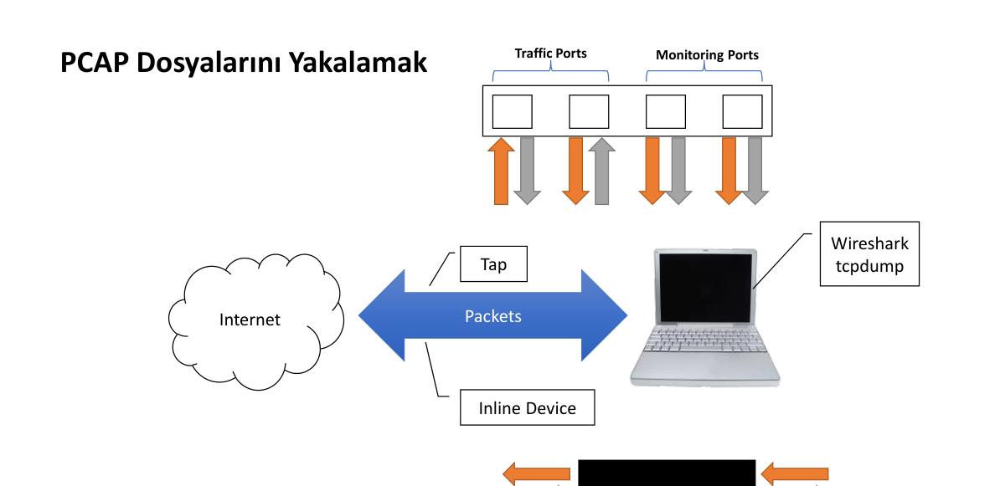
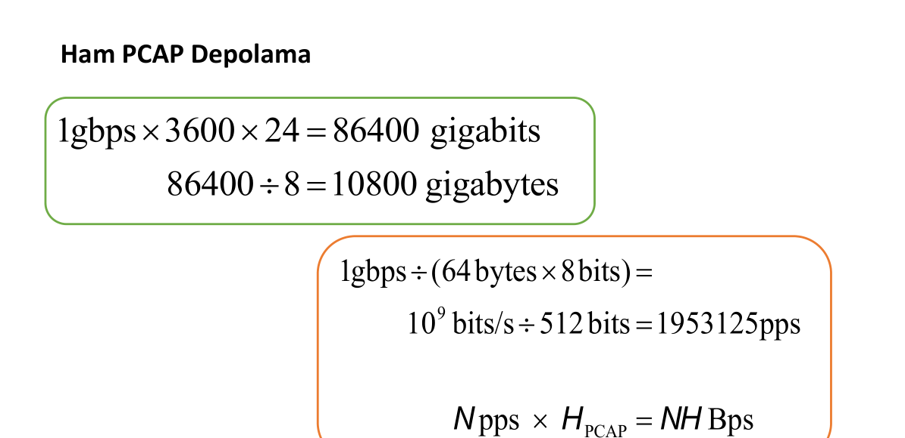
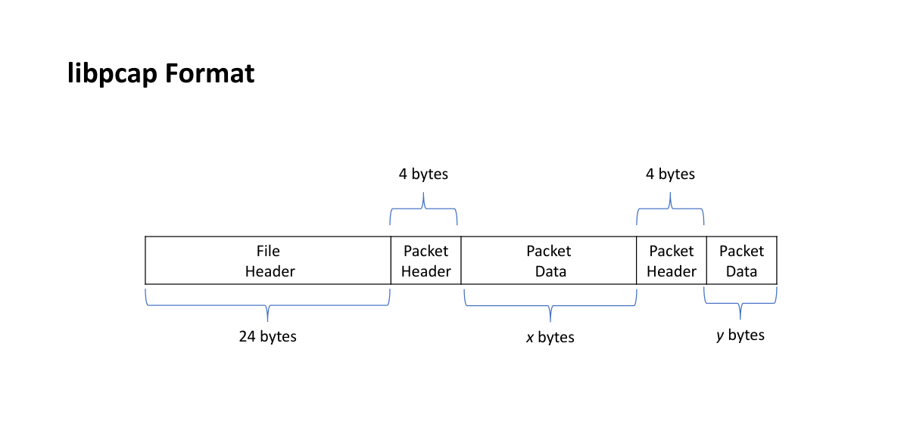
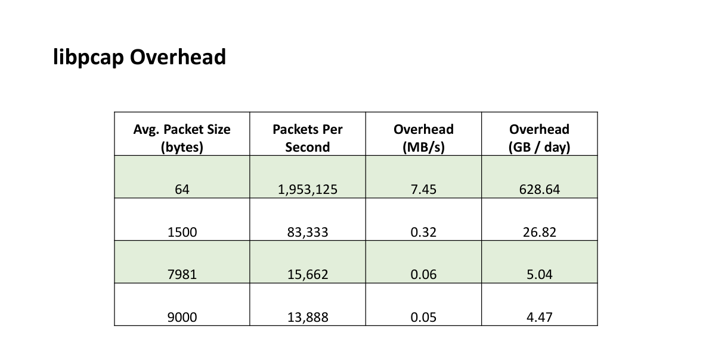
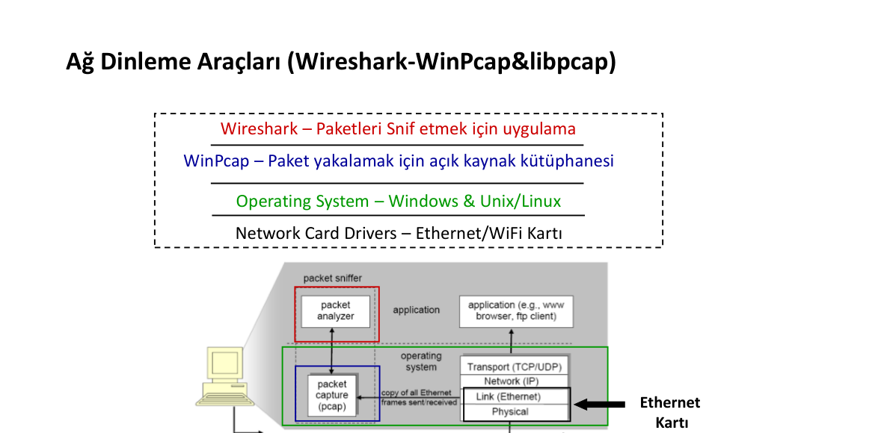
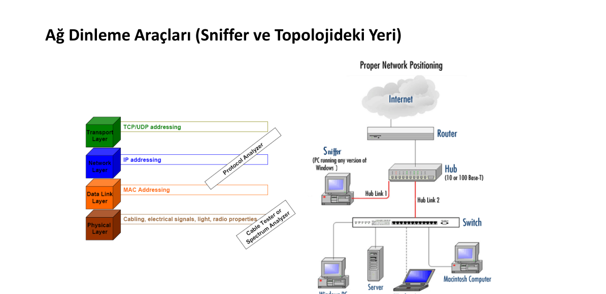
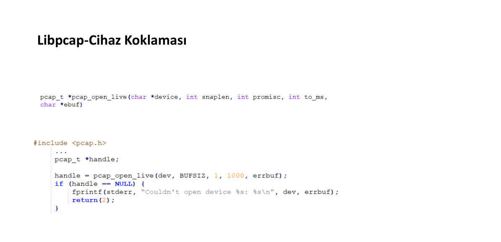
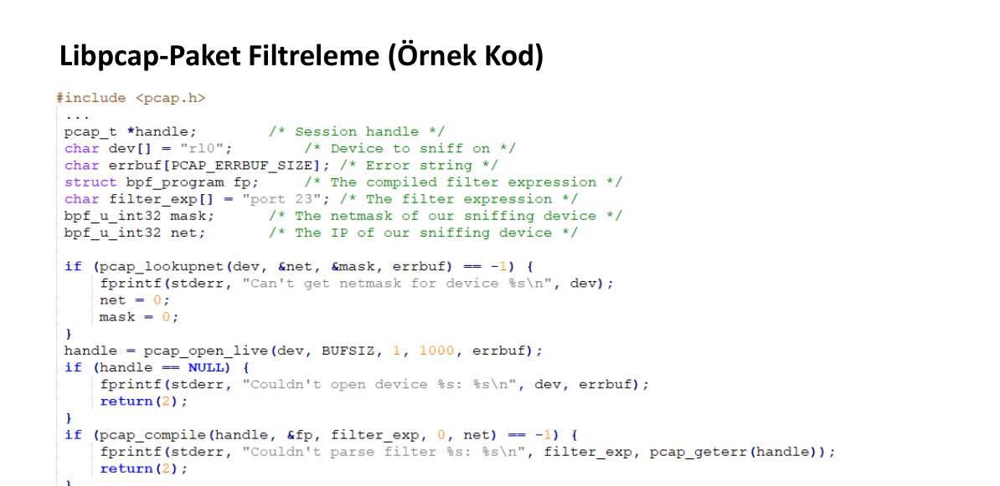

# 🌐 BSM 451 – Ağ Programlama Vize Çalışma Rehberi

> **Sakarya Üniversitesi – Bilgisayar Mühendisliği Bölümü**  
> **Ders Sorumlusu:** Dr. Öğr. Üyesi Musa BALTA  
> **Kapsam:** Hafta 1–5 Ders Sunumları (`.pdf`) ve Katman 2–3 `libpcap` C Uygulama Kodları (`.c`)

---

## 📑 İçindekiler
1. [1. Ders: Hafta 1 – OSI Referans Modeli ve Katmansal Yapı](#1-ders-hafta-1--osi-referans-modeli-ve-katmansal-yapı)
2. [2. Ders: Hafta 2 (Bölüm 1) – PCAP ve Libpcap Kütüphanesi](#2-ders-hafta-2-bölüm-1--pcap-ve-libpcap-kütüphanesi)
3. [3. Ders: Hafta 2 (Bölüm 2) – Katman 2 Protokolleri (Ethernet & ARP) ve `1-arpgonder.c`](#3-ders-hafta-2-bölüm-2--katman-2-protokolleri-ethernet--arp-ve-1-arpgonderc)
4. [4. Ders (Bölüm 1): Hafta 3 – Katman 3: IPv4, Fragmantasyon, Opsiyonlar, Checksum ve IPv6](#4-ders-bölüm-1-hafta-3--katman-3-ipv4-fragmantasyon-opsiyonlar-checksum-ve-ipv6)
5. [5. Ders (Bölüm 2): Hafta 3 – Katman 3: ICMP Protokolü ve 3 C Kodu (`2-icmpgonder.c`, `ping_server.c`, `ping_client.c`)](#5-ders-bölüm-2-hafta-3--katman-3-icmp-protokolü-ve-3-c-kodu)
6. [6. Ders: Hafta 4 – Katman 4 Protokolleri (TCP ve UDP) *(Sıradaki Konu)*](#6-ders-hafta-4--katman-4-protokolleri-tcp-ve-udp)
7. [7. Ders: Hafta 5 – Soket Programlama (C, Java ve Endianness) *(Sıradaki Konu)*](#7-ders-hafta-5--soket-programlama-c-java-ve-endianness)

---

# 1. Ders: Hafta 1 – OSI Referans Modeli ve Katmansal Yapı
**Kaynak Dosya:** [`Hafta-1-OSI Referans Modeli ve Katmasal Yap .pdf`](./Hafta-1-OSI%20Referans%20Modeli%20ve%20Katmasal%20Yap%20.pdf) *(Toplam 4 PDF Sayfası / 8 Slayt)*

## 1.1. Bilgisayar Ağlarının Sınıflandırma Ağacı (PDF Sayfa 2, Slayt 3)


* **1) Coğrafi Yapılar:** `LAN` (Yerel Alan Ağı), `MAN` (Metropol Alan Ağı), `WAN` (Geniş Alan Ağı).
* **2) Standart Yapılar *(Sınavda De Jure / De Facto ayrımına dikkat!)*:**
  * **De Jure (Resmi / Yasal Standartlar):** `CCITT`, `IEEE`, `ISO`.
  * **De Facto (Fiili / Pratikte Kabul Gören Standartlar):** `IBM`, `UNIX`.
* **3) İletişim Tekniği:** `Senkron`, `Asenkron`, `İsenkron` (Sabit zaman aralıklı).
* **4) Topolojiler:** `Doğrusal` (Bus), `Yıldız` (Star), `Ağaç` (Tree), `Karmaşık` (Mesh), `Halka` (Ring).
* **5) İletim Ortamı ve İletim Metodları:**
  * *Ortamlar:* `Fiber Optik`, `Koaksiyel`, `Çift-Burgulu` (Twisted Pair).
  * *Metodlar:* `Geniş Band` (Broadband), `Taşıyıcı Band` (Carrierband), `Temel Band` (Baseband).
* **6) Kontrol Tipleri:** `Merkezi`, `Rastgele`, `Dağıtılmış`.
* **7) Ortam Erişim Kontrol Yöntemleri (MAC):** `DQDB`, `Token` (Jeton), `CSMA/CD`.
* **8) Haberleşme Tipleri:**
  * `Yayınlamalı Haberleşme` (Broadcast)
  * `Anahtarlamalı Haberleşme` (Switched) $\rightarrow$ **Devre Anahtarlamalı**, **Mesaj Anahtarlamalı**, **Paket Anahtarlamalı**.

---

## 1.2. Standart Organizasyonlar Hiyerarşisi (PDF Sayfa 2, Slayt 4)


* **Şemadaki Hiyerarşi (Üstten Alta):**
  * **ISOC** (*Internet Society*) $\rightarrow$ **IAB** (*Internet Architecture Board*)
  * **IAB** iki ana kola ayrılır:
    1. **IETF** (*Internet Engineering Task Force*) $\rightarrow$ **IESG** (*Internet Engineering Steering Group*) $\rightarrow$ *Working Group #1, #2, #3...*
    2. **IRTF** (*Internet Research Task Force*) $\rightarrow$ **IRSG** (*Internet Research Steering Group*) $\rightarrow$ *Research Group #1, #2, #3...*
* **Diğer Kuruluşlar:** `IEEE`, `ISO`, `EIA`, `TIA`, `ITU-T`, `ICANN` (Alan adları ve sayılar), `IANA` (Port ve IP numara tahsisi).

---

## 1.3. OSI Referans Modeli, Kapsülleme ve Cihazlar (PDF Sayfa 3, Slayt 5–6 & PDF Sayfa 4, Slayt 7)


> [!IMPORTANT]
> **Sınav Detayı (Slayt 5 ve Slayt 6):**
> * **Intermediate Node (Ara Düğüm / Yönlendirici - Router):** Slayt 5'in sağındaki şemada görüldüğü üzere `Transmitting Node` ve `Receiving Node` 7 katmanın tamamını (`L1–L7`) çalıştırırken, aradaki yönlendiriciler (`Intermediate Node`) **yalnızca ilk 3 katmanı (`L1: Physical`, `L2: Data Link`, `L3: Network`)** çalıştırır!
> * **Kapsülleme (Encapsulation) Sırası (Slayt 6 Sağ Sütun):** Üst katmanlarda **`DATA`** (L7–L5) $\rightarrow$ Taşıma katmanında (L4) **`SEGMENT`** $\rightarrow$ Ağ katmanında (L3) **`PACKET or DATAGRAM`** $\rightarrow$ Veri Bağı katmanında (L2) **`FRAME`** $\rightarrow$ Fiziksel katmanda (L1) **`Bit or Data-Stream`**.

| Katman No | OSI Katmanı | Görevi ve Protokol Örnekleri (Slayt 5–7) | Cihaz / Bileşen (Slayt 6) | TCP/IP Modeli | Veri Birimi (PDU) |
| :---: | :--- | :--- | :--- | :--- | :--- |
| **7** | **Application** | Uygulama servisleri (`HTTP, DNS, DHCP, FTP, Telnet, SMTP`) | FTP services | Application | **DATA** |
| **6** | **Presentation**| Veri formatlama, sıkıştırma, şifreleme (`ANSI, HTML, JPEG, SSL/TLS`) | ANSI | Application | **DATA** |
| **5** | **Session** | Oturum kontrolü, diyalog yönetimi (`NetBIOS, RPC, SQL`) | — | Application | **DATA** |
| **4** | **Transport** | Uçtan uca bağlantı, güvenilirlik, akış/hata kontrolü, portlar (`TCP, UDP`) | Ports, Some Firewalls | **Host to Host** | **SEGMENT** |
| **3** | **Network** | Mantıksal adresleme (IP), yönlendirme, parçalama (`IP, ARP, ICMP, IGMP, OSPF`) | **Routers** | **Internetwork** | **PACKET / DATAGRAM** |
| **2** | **Data-Link (`LLC`+`MAC`)** | Fiziksel adresleme (MAC), hata tespiti (`FCS/CRC`), çerçeveleme (`Ethernet, PPP, ATM`) | **Bridges or Switches, NIC** | **Network Access** | **FRAME** |
| **1** | **Physical** | Kablo, sinyal gücü, ikili (binary) iletim (`RS-232, RJ45, 100BASE-TX`) | **Hubs, Network Cards** | **Network Access** | **Bit / Data-Stream** |


---

# 2. Ders: Hafta 2 (Bölüm 1) – PCAP ve Libpcap Kütüphanesi
**Kaynak Dosya:** [`Hafta-2 Pcap.pdf`](./Hafta-2%20Pcap.pdf) *(Toplam 9 PDF Sayfası / 17 Slayt)*

## 2.1. PCAP Kavramı ve Paket Yakalama Yöntemleri (PDF Sayfa 2, Slayt 3–4)
* **Slayt 3 (`PCAP == Packet Capture`):** Ağ aktivitelerinin **Katman 2'den Katman 7'ye kadar** tüm kaydıdır. En yaygın açık kaynak C kütüphanesi **`libpcap`**'tir (*nix ve Windows uyumlu; Windows karşılığı **WinPcap**).
* **Kullanım Alanları (Slayt 3):** Ağ trafiğini dinlemek, bant genişliği kontrolü, pasif DNS çözümlemesi, saldırı girişimlerini görüntüleme, araştırma testleri.
* **Slayt 4 (PCAP Dosyalarını Yakalamak):** Ağdan paket yakalamanın 3 topolojik yolu:
  1. **Switch üzerinde Monitoring Ports (Port Mirroring / SPAN)**
  2. **Tap (Network TAP):** Kablo üzerine fiziksel olarak takılan pasif kopyalayıcı
  3. **Inline Device:** Trafiğin doğrudan içinden geçtiği ara cihaz



---

## 2.2. Ham PCAP Depolama, Dosya Formatı ve Overhead Hesapları (PDF Sayfa 3–4, Slayt 5–7)




> [!TIP]
> **Sayısal Sınav Sorusu Rehberi (Slayt 5, 6 ve 7 Hesaplamaları):**
> 1. **1 Gbps Hattın 1 Günlük (24 Saat) Toplam Ham Veri Boyutu (Slayt 5):**
>    $$1\text{ Gbps} \times 3600\text{ sn} \times 24\text{ saat} = 86,400\text{ gigabits} \xrightarrow{\div 8} 10,800\text{ gigabytes (GB/gün)}$$
> 2. **Saniyedeki Paket Sayısı (`pps` - Packets Per Second) Hesabı (Slayt 5):**
>    * Ortalama paket boyutu **64 byte** ise bit cinsinden boyutu: $64\text{ bytes} \times 8\text{ bits} = 512\text{ bits}$.
>    $$\text{pps} = \frac{1\text{ Gbps}}{512\text{ bits}} = \frac{10^9\text{ bits/s}}{512\text{ bits}} = 1,953,125\text{ pps}$$
> 3. **libpcap Dosya Formatı ve Başlık Ek Yükü (Overhead) Hesabı (Slayt 6 & 7):**
>    * Slayt 6'da görüldüğü gibi `.pcap` dosyasının en başında **1 adet `File Header` (`24 bytes`)**, ardından yakalanan **her paket için `Packet Header` (Slaytta `4 bytes`)** + `Packet Data (x bytes)` yer alır.
>    * Saniyedeki başlık ek yükü: $N\text{ pps} \times H_{\text{PCAP}} = N \cdot H\text{ Bps}$.
>    * *Slayt 7 Doğrulaması (64 Byte için):* $1,953,125\text{ pps} \times 4\text{ byte} = 7,812,500\text{ Byte/s} \div 1024^2 \approx \mathbf{7.45\text{ MB/s}}$ (Günde $628.64\text{ GB}$). Paket boyutu büyüdükçe (1500B, 9000B) saniyedeki paket sayısı (`pps`) düştüğü için overhead de `0.32 MB/s` ve `0.05 MB/s` seviyesine iner.

---

## 2.3. Ağ Dinleme Araçları (Sniffer) ve Wireshark Mimarisi (PDF Sayfa 4–7, Slayt 8–13)
* **Slayt 8–9 (Sniffer):** Ağ trafiğini **pasif izleme (sezme)** veya **aktif (atak yapma)** amacıyla kullanılan araçlardır. Saldırganlar şifresiz protokollerden (`FTP, POP3, IMAP, SMTP, rlogin, HTTP, VoIP`) pasif veri toplamak için kullanır.
* **Slayt 10 (Wireshark Hakkında Kesin Bilinmesi Gerekenler):**
  * **Gerald Combs** tarafından **1998** yılında **Ethereal** adıyla başlatılmış, **Haziran 2006**'da **Wireshark** adını almıştır.
  * 750'nin üzerinde protokol destekler ve kapsüllemeli görünüm sunar.
  * **Çok Kritik 2 Sınav Maddesi:**
    1. *"Paket sniffer uygulamasıdır, dolayısıyla **bir ağın haritasını çıkartmak için kullanılamaz**."*
    2. *"**Pasif bir izleme aracıdır, dolayısıyla ağ verisi üretmez**."*




---

## 2.4. Libpcap C Fonksiyonları ve Syntax Yapısı (PDF Sayfa 7–8, Slayt 14–16)



| Libpcap Fonksiyonu | Slayt Yeri | C Kodlarındaki Satır Yeri | Parametreleri, Dönüş Değeri ve Görevi |
| :--- | :--- | :--- | :--- |
| `pcap_lookupdev(errbuf)` | Slayt 14 (Sayfa 7) | [`1-arpgonder.c` Satır 14](./0-Katman2-3%20Kodlar/1-arpgonder.c#L14)<br>[`ping_server.c` Satır 37](./0-Katman2-3%20Kodlar/Ping%20Uygulaması/ping_server.c#L37) | Sistemdeki varsayılan aktif ağ kartı adını döndürür. Bulamazsa `NULL` döner ve hatayı `errbuf` (`PCAP_ERRBUF_SIZE`) içine yazar. |
| `pcap_lookupnet(dev, &net, &mask, errbuf)` | Slayt 16 (Sayfa 8) | [`ping_client.c` Satır 59](./0-Katman2-3%20Kodlar/Ping%20Uygulaması/ping_client.c#L59)<br>[`ping_server.c` Satır 47](./0-Katman2-3%20Kodlar/Ping%20Uygulaması/ping_server.c#L47) | Cihazın IP ağ adresini (`net`) ve alt ağ maskesini (`mask`) `bpf_u_int32` tipinde alır. Başarısızsa `-1` döner. |
| `pcap_open_live(dev, snaplen, promisc, to_ms, errbuf)` | Slayt 15 (Sayfa 8) | [`1-arpgonder.c` Satır 22](./0-Katman2-3%20Kodlar/1-arpgonder.c#L22)<br>[`ping_server.c` Satır 54](./0-Katman2-3%20Kodlar/Ping%20Uygulaması/ping_server.c#L54) | Cihazı yakalama/gönderme için açar, `pcap_t*` döner (Hata: `NULL`). `snaplen`: max byte (`BUFSIZ` veya `100`), `promisc`: `1` ise promiscuous mod (tüm paketleri yakala), `to_ms`: okuma zaman aşımı (`1000` ms). |
| `pcap_compile(handle, &fp, filter_exp, 0, net)` | Slayt 16 (Sayfa 8) | [`ping_client.c` Satır 80](./0-Katman2-3%20Kodlar/Ping%20Uygulaması/ping_client.c#L80)<br>[`ping_server.c` Satır 67](./0-Katman2-3%20Kodlar/Ping%20Uygulaması/ping_server.c#L67) | Filtre stringini (Slayt 16'da `"port 23"`, ping kodlarında `"icmp && dst <IP>"`) derleyip `struct bpf_program fp` yapısına yazar (Hata: `-1`). |
| `pcap_setfilter(handle, &fp)` | Slayt 16 (Sayfa 8) | [`ping_client.c` Satır 85](./0-Katman2-3%20Kodlar/Ping%20Uygulaması/ping_client.c#L85)<br>[`ping_server.c` Satır 72](./0-Katman2-3%20Kodlar/Ping%20Uygulaması/ping_server.c#L72) | Derlenmiş olan `fp` filtresini açık oturuma uygular (Hata: `-1`). |

---

# 3. Ders: Hafta 2 (Bölüm 2) – Katman 2 Protokolleri (Ethernet & ARP) ve `1-arpgonder.c`
**Kaynak Dosyalar:** [`Hafta-2 Katman 2 Protokolleri.pdf`](./Hafta-2%20Katman%202%20Protokolleri.pdf) *(8 PDF Sayfası / 15 Slayt)* & [`1-arpgonder.c`](./0-Katman2-3%20Kodlar/1-arpgonder.c) *(Satır 1–108)*

## 3.1. Ethernet Protokolü (IEEE 802.3) ve CSMA/CD Backoff Algoritması (PDF Sayfa 2–3, Slayt 3–5)
* **Slayt 3 (Ethernet):** En yaygın LAN veri bağı protokolü **IEEE 802.3 Ethernet**'tir (1960'lardaki radyo tabanlı **Alohanet**'in uzantısıdır). Tercih sebepleri: Kurulum kolaylığı, güvenilirlik, ölçeklenebilirlik, çoklu kullanım uyumu.
* **Slayt 4 (CSMA/CD):**
  * **Carrier Sense (Taşıyıcı Sezme):** Kabloda aktarım olup olmadığını kontrol eder.
  * **Multiple Access (Çoklu Erişim):** İletim hattındaki tüm düğümlerin aynı hakka sahip olduğunu belirtir.
  * **Collision Detection (Çarpışmayı Sezme):** İki düğümün aynı anda veri göndermesiyle oluşan çarpışmayı algılar.
* **Slayt 5 (Ethernet'te Veri Gönderme / Backoff Akış Şeması):**
  1. `Start` $\rightarrow$ `Set k to zero` (Deneme sayacı $k = 0$ yapılır).
  2. `Sense carrier` (Hattı dinle — *1-persistent strategy*: hat meşgulse boşalana kadar sürekli dinle).
  3. Hat boşsa (`Busy? No`) $\rightarrow$ `Wait IFG time` (*Interframe Gap* süresi kadar bekle) $\rightarrow$ `Send the frame` (Çerçeveyi gönder).
  4. `Collision?` (Çarpışma oldu mu?): Hayır ise `Success`. Evet ise `Send jam signal` (diğer düğümleri uyarmak için bozucu sinyal gönder) $\rightarrow$ `Increment k` ($k = k + 1$).
  5. Deneme sayısı kontrolü (Slayttaki şemada `k < 10`): Limit aşılmadıysa `Wait backoff time` kadar rastgele bekle ve başa dön; limit aşıldıysa `Abort` (iptal et).


---

## 3.2. Ethernet II Başlık Yapısı (14 Byte) ve İletişim Şekilleri (PDF Sayfa 3–4, Slayt 6–7)


* **Slayt 6 (Ethernet II Başlığı = `14 Byte`):**
  * `Destination Address (Hedef MAC)`: **6 Byte** (`packet[0..5]`)
  * `Source Address (Kaynak MAC)`: **6 Byte** (`packet[6..11]`)
  * `Packet Type (Üst katman protokol tipi)`: **2 Byte** (`packet[12..13]` $\rightarrow$ ARP için `0x0806`, IPv4 için `0x0800`)
  * **Toplam Ethernet Başlığı:** $6 + 6 + 2 = \mathbf{14\text{ Byte}}$! *(Baştaki 8 Byte `Preamble` ve sondaki 4 Byte `CRC` ağ kartı donanımı tarafından kabloda eklenir; yazılımdaki 14 byte başlığa dahil değildir).*
  * `Data Bölümü (Payload)`: **46 – 1500 Byte** arasındadır.
* **Slayt 7 (Ethernet İletişim Şekilleri):**
  1. **Unicast:** Tek bir MAC adresine (`00-07-E9-42-AC-28`).
  2. **Multicast:** Bir gruba; hedef MAC **`01-00-5E`** ile başlar (`01-00-5E-00-00-01`).
  3. **Broadcast:** Ağdaki tüm cihazlara; hedef MAC **`FF-FF-FF-FF-FF-FF`**.


---

## 3.3. ARP (Address Resolution Protocol) Yapısı ve Senaryoları (PDF Sayfa 4–7, Slayt 8–14)
* **Slayt 8–10 (ARP Görevi):** Paketin teslimi için **Mantıksal (IP)** ve **Fiziksel (MAC)** olmak üzere iki düzey adresleme gerekir. ARP, IP protokolünden mantıksal (IP) adresi alır, fiziksel (MAC) adresle eşler ve veri bağı katmanına iletir.
* **Slayt 9 (ARP İşleyişi):** **ARP Request** tüm yerel ağa yayınlanır (**Broadcast**: Ethernet hedef MAC `FF:FF:FF:FF:FF:FF`), **ARP Reply** ise sadece soran düğüme gönderilir (**Unicast**).


> [!IMPORTANT]
> **Kapsülleme Mantığı: "14 Byte Ethernet + 28 Byte ARP = 42 Byte" Nereden Gelir?**
> * **Slayt 11 ve Slayt 12:** Şablonun genel adı **ARP Paketi**dir ve boyutu **28 Byte**'tır (`2B Hardware Type + 2B Protocol Type + 1B HW Len + 1B Proto Len + 2B Operation + 6B Sender MAC + 4B Sender IP + 6B Target MAC + 4B Target IP = 28 Byte`).
> * Bu 28 byte'lık ARP şablonunun `Operation` (`packet[20..21]`) alanına `1` (`0x0001`) yazılırsa adı **ARP Request Paketi**, `2` (`0x0002`) yazılırsa adı **ARP Reply Paketi** olur.
> * Slayt 11'de pembe oklarla gösterildiği gibi, bu **28 byte'lık ARP (Request veya Reply) paketi** doğrudan Ethernet çerçevesinin **`Data`** kısmına (`packet[14..41]`) yerleştirilir! *(ARP paketinde IP başlığı yoktur).*
> * Başına **14 Byte Ethernet Başlığı** (`packet[0..13]`) eklendiğinde kabloya gönderilen toplam çerçeve **`14 + 28 = 42 Byte`** (`u_char packet[42]`) olur.


* **Slayt 13 (ARP 4 Kullanım Durumu — Sınav Senaryosu!):**
  * **Case 1 (Host $\rightarrow$ Aynı ağdaki Host):** ARP `Target IP` = IP datagramındaki `Destination IP`.
  * **Case 2 (Host $\rightarrow$ Başka ağdaki Host):** Paket önce yerel ağ geçidine (Router) gitmelidir; bu yüzden ARP `Target IP` = **Router'ın IP adresi** olur!
  * **Case 3 (Router $\rightarrow$ Başka ağdaki Router):** ARP `Target IP` = **Bir sonraki Router'ın IP adresi**.
  * **Case 4 (Router $\rightarrow$ Aynı ağdaki Hedef Host):** ARP `Target IP` = IP datagramındaki `Destination IP`.
* **Slayt 14 (ARP Cache Table Durum Harfleri):** `R` = *Resolved* (Çözümlenmiş, MAC biliniyor), `P` = *Pending* (Beklemede, istek atıldı), `F` = *Free* (Boş satır).


---

## 3.4. Kod Analizi: [`1-arpgonder.c`](./0-Katman2-3%20Kodlar/1-arpgonder.c) (Satır 1–108)

| Dizi İndeksi | Boyut | Katman ve Alan Adı | Kodda Atanan Değer | `1-arpgonder.c` Satır No ve Açıklama |
| :--- | :---: | :--- | :--- | :--- |
| `packet[0..5]` | 6 Byte | Ethernet: Destination MAC | `0xff, 0xff, 0xff, 0xff, 0xff, 0xff` | **[Satır 28–34](./0-Katman2-3%20Kodlar/1-arpgonder.c#L28-L34):** Broadcast MAC adresi (Tüm LAN'a gider). |
| `packet[6..11]` | 6 Byte | Ethernet: Source MAC | `0x54, 0x42, 0x49, 0x02, 0x31, 0x8c` | **[Satır 38–44](./0-Katman2-3%20Kodlar/1-arpgonder.c#L38-L44):** Gönderen cihazın MAC adresi. |
| `packet[12..13]` | 2 Byte | Ethernet: Type (EtherType) | `0x08, 0x06` (`0x0806`) | **[Satır 46–48](./0-Katman2-3%20Kodlar/1-arpgonder.c#L46-L48):** Ethernet Data kısmında **ARP** olduğunu belirtir. |
| `packet[14..15]` | 2 Byte | ARP: Hardware Type | `0x00, 0x01` | **[Satır 53–55](./0-Katman2-3%20Kodlar/1-arpgonder.c#L53-L55):** Donanım tipi `1` = Ethernet. *(Satır 53 yorumundaki `=Request` dizgi hatasıdır)*. |
| `packet[16..17]` | 2 Byte | ARP: Protocol Type | `0x08, 0x00` (`0x0800`) | **[Satır 57–59](./0-Katman2-3%20Kodlar/1-arpgonder.c#L57-L59):** Çözümlenen protokol tipi = IPv4. |
| `packet[18]` | 1 Byte | ARP: Hardware Size | `0x06` | **[Satır 61–62](./0-Katman2-3%20Kodlar/1-arpgonder.c#L61-L62):** MAC adres uzunluğu = 6 byte. |
| `packet[19]` | 1 Byte | ARP: Protocol Size | `0x04` | **[Satır 64–65](./0-Katman2-3%20Kodlar/1-arpgonder.c#L64-L65):** IPv4 adres uzunluğu = 4 byte. |
| `packet[20..21]` | 2 Byte | ARP: Opcode (Operation) | `0x00, 0x01` | **[Satır 67–69](./0-Katman2-3%20Kodlar/1-arpgonder.c#L67-L69):** `1` = **ARP Request** (`2` olsaydı ARP Reply olurdu). |
| `packet[22..27]` | 6 Byte | ARP: Sender MAC | `0x54, 0x42, 0x49, 0x02, 0x31, 0x8c` | **[Satır 71–77](./0-Katman2-3%20Kodlar/1-arpgonder.c#L71-L77):** Gönderen MAC (`packet[6..11]` ile aynı). |
| `packet[28..31]` | 4 Byte | ARP: Sender IP | `0x0a, 0x09, 0x1b, 0xe1` | **[Satır 79–83](./0-Katman2-3%20Kodlar/1-arpgonder.c#L79-L83):** Gönderen IP: `10.9.27.225`. |
| `packet[32..37]` | 6 Byte | ARP: Target MAC | `0x00, 0x00, 0x00, 0x00, 0x00, 0x00` | **[Satır 85–91](./0-Katman2-3%20Kodlar/1-arpgonder.c#L85-L91):** Hedef MAC henüz bilinmediği için `0` doldurulur (Slayt 12). |
| `packet[38..41]` | 4 Byte | ARP: Target IP | `0x0a, 0x09, 0x1b, 0x64` | **[Satır 93–97](./0-Katman2-3%20Kodlar/1-arpgonder.c#L93-L97):** MAC adresi sorulan hedef IP: `10.9.27.100`. |

---

# 4. Ders (Bölüm 1): Hafta 3 – Katman 3: IPv4, Fragmantasyon, Opsiyonlar, Checksum ve IPv6
**Kaynak Dosya:** [`Hafta-3 Katman 3 Protokolleri.pdf`](./Hafta-3%20Katman%203%20Protokolleri.pdf) *(PDF Sayfa 1–10, Slayt 1–20)*

## 4.1. IPv4 Temel Özellikleri ve Başlık Yapısı (PDF Sayfa 2–3, Slayt 3–5)
* **Slayt 4 (IPv4 Özellikleri):** Ağ katmanı paketlerine **datagram** denir. **Bağlantısız**, **en iyi teslim (best-effort)** ve **ortam bağımsız** bir protokoldür.
* **Boyut Kuralları (Slayt 4):** IP Başlığı **20–60 bayt** aralığındadır (Sabit kısım **20 bayt**, Opsiyonlar **0–40 bayt**). Toplam datagram boyutu **20–65,535 bayt** aralığındadır.
* **Slayt 5 (`Protocol` Alanı Değerleri Tablosu — `packet[23]`):** **`1` = ICMP**, **`2` = IGMP**, **`6` = TCP**, **`17` = UDP**, **`89` = OSPF**.


---

## 4.2. IPv4 Fragmantasyon (Parçalama) ve Sayısal Hesaplama (PDF Sayfa 3–4, Slayt 6–7)


> [!TIP]
> **Fragmantasyon Sayısal Çözüm Formülleri (Slayt 7):**
> * **Bayraklar (3 Bit):** `D (Do not fragment) = 1` ise parçalanamaz. `M (More fragments) = 1` ise arkadan başka parçalar gelecek, `M = 0` ise bu son parçadır.
> * **Total Length (Toplam Uzunluk):** Her parçaya 20 Byte IP başlığı eklendiği için $\text{Total Length} = \text{Parça Veri Boyutu} + 20$.
> * **Fragmentation Offset:** Son parça hariç her parçadaki veri boyutu **8'in katı** olmalıdır: $\text{Offset} = \text{İlk Veri Baytının Sıra Numarası} \div 8$.
> * **Slayt 7 Örneğinin Adım Adım Çözümü (Orijinal Veri: 4000 Byte [`0000–3999`], Total Length: `4020`, ID: `14,567`):**
>   * **Fragment 1 (`0000–1399`, 1400B veri):** `Total Length` = $1400 + 20 = \mathbf{1420}$ | `M = 1` | `Offset` = $0 \div 8 = \mathbf{000}$.
>   * **Fragment 2 (`1400–2799`, 1400B veri):** `Total Length` = $1400 + 20 = \mathbf{1420}$ | `M = 1` | `Offset` = $1400 \div 8 = \mathbf{175}$.
>     * *Fragment 2.1 (`1400–2199`, 800B veri):* `Total Length` = $800 + 20 = \mathbf{820}$ | `M = 1` | `Offset` = $1400 \div 8 = \mathbf{175}$.
>     * *Fragment 2.2 (`2200–2799`, 600B veri):* `Total Length` = $600 + 20 = \mathbf{620}$ | **`M = 1`** *(arkada hala Fragment 3 var!)* | `Offset` = $2200 \div 8 = \mathbf{275}$.
>   * **Fragment 3 (`2800–3999`, 1200B veri):** `Total Length` = $1200 + 20 = \mathbf{1220}$ | **`M = 0`** *(Son parça!)* | `Offset` = $2800 \div 8 = \mathbf{350}$.

---

## 4.3. IPv4 Başlık Opsiyonları (Seçenekler) (PDF Sayfa 4–9, Slayt 8–17)


| Kategori (Slayt 10) | Opsiyon Adı | Type / Code Değeri | Slayt No | Görevi ve Çalışma Mantığı |
| :--- | :--- | :---: | :---: | :--- |
| **Single-byte** | **No operation (`NO-OP`)** | `Type: 1` (`00000001`) | Slayt 11 | Seçenekleri 16/32-bit sınırına **hizalamak (align)** için kullanılır. |
| **Single-byte** | **End of option (`END-OP`)**| `Type: 0` (`00000000`) | Slayt 11 | Seçeneklerin sonunu **doldurmak (padding)** için kullanılır. |
| **Multiple-byte**| **Record route** | `Type: 7` (`00000111`) | Slayt 11–12| Başlangıçta boş olan (maks. **9 adreslik**) listeye, paketin geçtiği her router kendi çıkış IP adresini kaydeder (`Pointer` 4 artar). |
| **Multiple-byte**| **Strict source route** | `Type: 137` (`10001001`)| Slayt 13–14| **Kesin Kaynak Yönlendirme:** Gönderen, geçilecek **tüm** router IP'lerini baştan belirler; paket liste dışındaki hiçbir router'dan geçemez! |
| **Multiple-byte**| **Loose source route** | `Type: 131` (`10000011`)| Slayt 15 | **Esnek Kaynak Yönlendirme:** Paket listedeki router'lara uğramak zorundadır ama aralarında başka router'lardan da geçebilir. |
| **Multiple-byte**| **Timestamp** | `Code: 68` (`01000100`) | Slayt 16–17| Geçilen her router'ın IP adresini ve paketin işlendiği **zaman damgasını** kaydeder. |

---

## 4.4. IPv4 Kontrol Toplamı (Checksum), İşletim Modülleri ve IPv6 (PDF Sayfa 9–10, Slayt 18–20)


* **Slayt 18 (Kontrol Toplamı / Checksum):** Başlık 16-bitlik satırlara bölünür. Gönderende Checksum alanı `0` yapılarak toplanır (`Sum`) ve **1'e tümleyeni (bitlerin tersi)** alınarak Checksum alanına (`35761`) yazılır. Alıcıda tüm başlık (Checksum dahil) toplandığında `Sum = 11111111 11111111` ve tersi alındığında **`Checksum = 0000 0000 0000 0000`** çıkmalıdır.
* **Slayt 19 (4 İşletim Modülü):** `Adding Module`, `Processing Module` (Router ise `TTL` azaltır, `TTL <= 0` ise atıp ICMP hata döner), `Fragmantasyon Module` (`Boyut > MTU` ve `D=1` ise atıp ICMP hata döner), `Reassembly Module` (Süre aşımı olursa tüm fragmentleri düşürüp ICMP hata döner).
* **Slayt 20 (IPv6):** **128 bit adresleme** (340 undesilyon adres), **NAT ihtiyacını ortadan kaldırır**, entegre güvenlik. IPv6 başlığında `IHL`, `Identification`, `Flags`, `Fragment Offset` ve `Header Checksum` kaldırılmış; `TTL` $\rightarrow$ `Hop Limit`, `Protocol` $\rightarrow$ `Next Header`, `Type of Service` $\rightarrow$ `Traffic Class` olmuş ve **`Flow Label`** eklenmiştir.

---

# 5. Ders (Bölüm 2): Hafta 3 – Katman 3: ICMP Protokolü ve 3 C Kodu
**Kaynak Dosyalar:** [`Hafta-3 Katman 3 Protokolleri.pdf`](./Hafta-3%20Katman%203%20Protokolleri.pdf) *(PDF Sayfa 11–16, Slayt 21–32)* & [`2-icmpgonder.c`](./0-Katman2-3%20Kodlar/2-icmpgonder.c), [`ping_server.c`](./0-Katman2-3%20Kodlar/Ping%20Uygulaması/ping_server.c), [`ping_client.c`](./0-Katman2-3%20Kodlar/Ping%20Uygulaması/ping_client.c)

## 5.1. ICMP Kapsüllemesi, 8 Byte Başlık ve Mesaj Kategorileri (PDF Sayfa 11–12, Slayt 21–23)


## 5.2. ICMP Hata Raporlama ve Sorgu Mesajları Kuralları (PDF Sayfa 12–16, Slayt 24–31)


> [!IMPORTANT]
> **Sınavda Kesin Sorulabilecek ICMP Hata Kuralları (Slayt 24–30):**
> * **Ortak Kural (Slayt 24–28):** Tüm ICMP hata mesajları, hataya sebep olan paketin **IP başlığını + orijinal verinin ilk 8 baytını** (`IP header plus the first 8 bytes of datagram data`) içerir.
> * **1) Hedef Ulaşılamaz (`Type: 3, Code: 0..15` — Slayt 24):**
>   * **`Code 2` (Protokol ulaşılamaz) ve `Code 3` (Port ulaşılamaz)** mesajları **YALNIZCA hedef ana bilgisayar (Host)** tarafından oluşturulabilir!
>   * Diğer tüm `Type 3` iletileri **YALNIZCA yönlendiriciler (Router)** tarafından oluşturulabilir!
> * **2) Kaynak Söndürme (`Type: 4, Code: 0` — Slayt 25):** Yönlendirici veya hedefteki tıkanıklık nedeniyle **atılan her datagram için** gönderilir; kaynağın gönderimi yavaşlatmasını ister.
> * **3) Zaman Aşımı (`Type: 11, Code: 0 veya 1` — Slayt 26):**
>   * **`Code 0`:** Yalnızca **yönlendiriciler (Router)** tarafından `TTL = 0` olduğunda gönderilir.
>   * **`Code 1`:** Yalnızca **hedef ana bilgisayar (Host)** tarafından, parçalanmış datagramın tüm parçaları süresi içinde gelmediğinde gönderilir.
> * **4) Parametre Problemi (`Type: 12, Code: 0 veya 1` — Slayt 27):** Yönlendirici veya hedef host tarafından oluşturulabilir; `Pointer` alanı hatanın olduğu baytı gösterir.
> * **5) Yeniden Yönlendirme / Redirection (`Type: 5, Code: 0..3` — Slayt 28):** Yönlendiriciden (`R1`), **aynı yerel ağdaki (LAN)** bir ana bilgisayara (`Host A`) gönderilerek yönlendirme tablosunu hedef yönlendirici (`R2`) ile güncellemesini sağlar.
> * **6) Sorgu Mesajları (Slayt 29–30):** `Type 8 / 0` (Echo Request / Reply — `ping, traceroute`) ve `Type 13 / 14` (Timestamp Request / Reply — **saatler senkronize olmasa bile** gidiş-dönüş süresi RTT hesabı ve saat eşitleme yapar).

---

## 5.3. Kod Analizi 1: [`2-icmpgonder.c`](./0-Katman2-3%20Kodlar/2-icmpgonder.c) (Satır 1–118) — 50 Byte ICMP Echo Request

**Toplam Boyut:** `14 Byte` (Ethernet Başlığı) + `20 Byte` (IPv4 Başlığı) + `16 Byte` (8B ICMP Başlığı + 8B Veri) = **`50 Byte`** (`u_char packet[50]`)

| Dizi İndeksi | Boyut | Katman ve Alan Adı | Kodda Atanan Değer | `2-icmpgonder.c` Satır No ve Açıklama |
| :--- | :---: | :--- | :--- | :--- |
| `packet[0..5]` | 6 Byte | L2 Ethernet: Hedef MAC | `00:50:56:fc:18:27` | **[Satır 24–29](./0-Katman2-3%20Kodlar/2-icmpgonder.c#L24-L29):** Alıcı MAC adresi. |
| `packet[6..11]` | 6 Byte | L2 Ethernet: Kaynak MAC | `00:0c:29:cd:27:50` | **[Satır 32–37](./0-Katman2-3%20Kodlar/2-icmpgonder.c#L32-L37):** Gönderen MAC adresi. |
| `packet[12..13]` | 2 Byte | L2 Ethernet: Tip (EtherType) | `0x08, 0x00` (`0x0800`) | **[Satır 40–41](./0-Katman2-3%20Kodlar/2-icmpgonder.c#L40-L41):** Üst katmanın **IPv4** olduğunu belirtir. |
| `packet[14]` | 1 Byte | L3 IPv4: Version + HLEN | `0x45` | **[Satır 45](./0-Katman2-3%20Kodlar/2-icmpgonder.c#L45):** `4` = IPv4, `5` = $5 \times 4 = 20\text{ Byte}$ IP başlığı. |
| `packet[15]` | 1 Byte | L3 IPv4: Service Type | `0x00` | **[Satır 48](./0-Katman2-3%20Kodlar/2-icmpgonder.c#L48):** Servis alanı (TOS). |
| `packet[16..17]` | 2 Byte | L3 IPv4: Total Length | `0x00, 0x24` (`36 Byte`) | **[Satır 51–52](./0-Katman2-3%20Kodlar/2-icmpgonder.c#L51-L52):** $20\text{B IP} + 16\text{B ICMP} = 36\text{ Byte}$ (Hex `0x24`). |
| `packet[18..19]` | 2 Byte | L3 IPv4: Identification | `0x10, 0xfd` | **[Satır 55–56](./0-Katman2-3%20Kodlar/2-icmpgonder.c#L55-L56):** Paket kimlik numarası. |
| `packet[20..21]` | 2 Byte | L3 IPv4: Flags + Offset | `0x00, 0x00` | **[Satır 59–60](./0-Katman2-3%20Kodlar/2-icmpgonder.c#L59-L60):** Parçalanma yok. |
| `packet[22]` | 1 Byte | L3 IPv4: TTL | `0x40` (`64`) | **[Satır 63](./0-Katman2-3%20Kodlar/2-icmpgonder.c#L63):** Yaşam süresi = 64 (`ping_client.c` Satır 182'de okunur!). |
| `packet[23]` | 1 Byte | L3 IPv4: Protocol | `0x01` (`1 = ICMP`) | **[Satır 66](./0-Katman2-3%20Kodlar/2-icmpgonder.c#L66):** IP'nin içinde **ICMP** taşındığını belirtir (Slayt 5). |
| `packet[24..25]` | 2 Byte | L3 IPv4: Header Checksum | `0x00, 0x00` | **[Satır 69–70](./0-Katman2-3%20Kodlar/2-icmpgonder.c#L69-L70):** IP başlık kontrol toplamı. |
| `packet[26..29]` | 4 Byte | L3 IPv4: Kaynak IP | `0xc0, 0xa8, 0x0b, 0x80` | **[Satır 73–76](./0-Katman2-3%20Kodlar/2-icmpgonder.c#L73-L76):** `192.168.11.128`. |
| `packet[30..33]` | 4 Byte | L3 IPv4: Hedef IP | `0xd8, 0x3a, 0xce, 0xc4` | **[Satır 79–82](./0-Katman2-3%20Kodlar/2-icmpgonder.c#L79-L82):** `216.58.206.196`. |
| `packet[34]` | 1 Byte | ICMP: Tip Alanı (Type) | `0x08` | **[Satır 86](./0-Katman2-3%20Kodlar/2-icmpgonder.c#L86):** `8` = **ICMP Echo Request** (Cevapta `0x00` yapılır). |
| `packet[35]` | 1 Byte | ICMP: Kod Alanı (Code) | `0x00` | **[Satır 89](./0-Katman2-3%20Kodlar/2-icmpgonder.c#L89):** `0` *(Not: `ping_client.c` Satır 295'te özel olarak `0x08` verilmiştir)*. |
| `packet[36..37]` | 2 Byte | ICMP: Checksum | `0x00, 0x00` | **[Satır 92–93](./0-Katman2-3%20Kodlar/2-icmpgonder.c#L92-L93):** ICMP kontrol toplamı. |
| `packet[38..41]` | 4 Byte | ICMP: Rest of Header | `0x11, 0x8d, 0x00, 0x1b` | **[Satır 96–99](./0-Katman2-3%20Kodlar/2-icmpgonder.c#L96-L99):** Identifier (2B) + Sequence Number (2B) (Slayt 29). |
| `packet[42..49]` | 8 Byte | ICMP: Zaman Damgası (Data) | `0xa6, 0x5d, 0x4d, 0x5e...` | **[Satır 102–109](./0-Katman2-3%20Kodlar/2-icmpgonder.c#L102-L109):** 8 byte isteğe bağlı veri / zaman damgası. |

---

## 5.4. Kod Analizi 2: [`ping_server.c`](./0-Katman2-3%20Kodlar/Ping%20Uygulaması/ping_server.c) ve [`ping_client.c`](./0-Katman2-3%20Kodlar/Ping%20Uygulaması/ping_client.c)

* **1) Dinamik BPF Filtresi Oluşturma (`filter_ip_address` — [`ping_server.c` Satır 148–176](./0-Katman2-3%20Kodlar/Ping%20Uygulaması/ping_server.c#L148-L176) & [`ping_client.c` Satır 186–212](./0-Katman2-3%20Kodlar/Ping%20Uygulaması/ping_client.c#L186-L212)):**
  * `pcap_findalldevs(&alldevs, error_buffer)` ile tüm ağ arayüzlerini bağlı liste olarak alır.
  * `strcmp(d->name, device) == 0` ile aktif cihazı bulur; `a->addr->sa_family == AF_INET` kontrolüyle IPv4 adresini `inet_ntoa(((struct sockaddr_in *)a->addr)->sin_addr)` ile stringe çevirir ve `" icmp && dst <kendi_IP_adresi>"` filtresini oluşturur.
* **2) Sunucuda Echo Request Yakalayıp Echo Reply Gönderme ([`ping_server.c` Satır 82–137](./0-Katman2-3%20Kodlar/Ping%20Uygulaması/ping_server.c#L82-L137)):**

```c
// ping_server.c Satır 107-118: Kaynak/Hedef MAC ve IP Adreslerini Takas Edip Echo Reply Gönderme
for (int i = 0; i < 4; i++) {
    swap(&my_packet[i + 0], &my_packet[i + 6]);   // MAC adresi ilk 4 byte takası (packet[0..3] <-> packet[6..9])
    swap(&my_packet[i + 26], &my_packet[i + 30]); // IP adresi 4 byte takası (packet[26..29] <-> packet[30..33])
}
swap(&my_packet[4], &my_packet[10]); // MAC 5. byte takası
swap(&my_packet[5], &my_packet[11]); // MAC 6. byte takası (Çünkü MAC 6 byte, IP ise 4 byte'tır!)

my_packet[34] = 0x00; // ICMP Type: Echo Request (0x08) -> Echo Reply (0x00) yapılır!
pcap_sendpacket(handle, my_packet, 50);
```

---

# 6. Ders: Hafta 4 – Katman 4 Protokolleri (TCP ve UDP)
*(Bu bölüm bir sonraki çalışma adımımızda buraya eklenecektir)*

---

# 7. Ders: Hafta 5 – Soket Programlama (C, Java ve Endianness)
*(Bu bölüm bir sonraki çalışma adımımızda buraya eklenecektir)*
